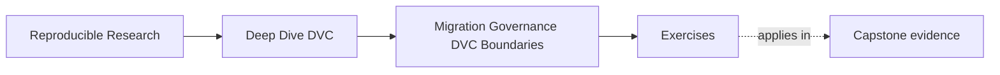
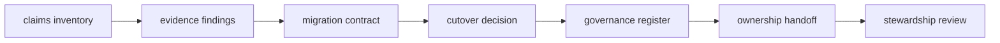

# Exercises

<!-- page-maps:start -->
## Page Maps




<!-- page-maps:end -->

These exercises form one cumulative stewardship lab. You will produce a
review packet for the capstone's release-boundary migration, then use that
packet to make and defend a cutover decision.

The work is designed for independent study. Every exercise names:

- the evidence to inspect;
- the artifact to produce;
- a falsification question;
- a completion check.

Do not answer from memory. Run the routes and cite the generated evidence.

## Prepare the evidence and workspace

From the repository root:

```console
make PROGRAM=reproducible-research/deep-dive-dvc \
  capstone-boundary-migration-audit

make PROGRAM=reproducible-research/deep-dive-dvc \
  capstone-recovery-readiness-audit

mkdir -p artifacts/learning/deep-dive-dvc/governance-stewardship
```

Use this packet:

```text
artifacts/learning/deep-dive-dvc/governance-stewardship/
├── claims-and-evidence.md
├── finding-partial-copy.md
├── migration-contract-review.md
├── consumer-and-rollback.md
├── governance-register.md
├── exception-review.md
├── intervention.md
├── ownership-map.md
├── cutover-decision.md
└── handoff-review.md
```

The generated audits remain under `artifacts/audit/`. Your learning packet
should link to them rather than copying their full content.

## Exercise: Inventory the repository trust claims

Inspect:

- `capstone/dvc.yaml`;
- `capstone/dvc.lock`;
- `capstone/params.yaml`;
- `capstone/publish/v1/manifest.json`;
- `capstone/docs/PUBLISH_CONTRACT.md`;
- the boundary migration `report.json`;
- the recovery readiness `report.json`.

In `claims-and-evidence.md`, create a table with these columns:

| Claim | Direct evidence | Falsifying route | Result | Proof limit |
|---|---|---|---|---|

Include at least these claims:

- pipeline declarations identify the current computation;
- the promoted inventory is complete;
- the target is byte-identical to the source;
- consumers can use the target boundary;
- protected revisions remain recoverable;
- each cross-system responsibility has an authority.

Classify each result as `verified`, `contradicted`, `unverified`, or
`out-of-scope`.

**Falsification question:** What observation would make each claimed result
false?

**Completion check:** Every row names a concrete file or executed route, and no
row uses “the repository looks correct” as evidence.

## Exercise: Write a contract finding from the partial copy

Compare:

```text
workspace/complete-cutover/assessment.json
workspace/partial-copy/assessment.json
```

Write `finding-partial-copy.md` with:

- claim under review;
- exact evidence path;
- changed observation;
- failed check;
- consumer consequence;
- immediate safety action;
- smallest complete repair;
- closure proof;
- claims you deliberately do not make.

Do not use “migration failed” as the finding. Name the missing artifact and the
invariant it contradicts.

**Falsification question:** If `report.md` were added, which other observations
would still be needed before approval?

**Completion check:** A different maintainer could perform the repair and know
which receipt closes the finding.

## Exercise: Review the migration change budget

Read:

```text
migration-contract.json
migration-decision.json
workspace/unbounded-change/assessment.json
```

In `migration-contract-review.md`, record:

- exact source and target;
- one permitted changed surface;
- every preserved invariant;
- required before and after evidence;
- consumer acceptance;
- rollback promise;
- ownership split;
- exception requirements.

Then explain why adding `metric-schema` to `changed_surfaces` must block this
cutover even if the target files match.

Draft a separate one-paragraph contract for a future metric-schema migration.
It must version semantic meaning rather than pretending the schema is only a
location change.

**Falsification question:** Which evidence distinguishes a second boundary
change from a more detailed description of the first?

**Completion check:** The release-location and metric-schema decisions are
independently approvable and independently reversible.

## Exercise: Prove consumer acceptance and rollback readiness

Inspect:

```text
workspace/unverified-consumer/assessment.json
workspace/no-rollback/assessment.json
capstone/docs/boundary-migration-audit-guide.md
```

Write `consumer-and-rollback.md` containing two contracts.

The consumer contract must name:

- durable target reference;
- consumer-equivalent credential class;
- manifest retrieval;
- digest verification;
- smallest meaningful consumer operation;
- retained receipt.

The rollback contract must name:

- trigger;
- decision authority;
- retained source;
- restoration route;
- time objective;
- post-rollback consumer check;
- rollback window;
- separate source-retirement decision.

**Falsification question:** Why can equal source and target inventories coexist
with a failed consumer contract?

**Completion check:** Neither contract uses “switch back if necessary” or
“consumers were notified” as proof.

## Exercise: Build a proportional governance register

Create `governance-register.md` with one row for each:

- stage dependency change;
- parameter affecting model behavior;
- metric definition or population change;
- experiment promotion;
- release bundle change;
- DVC remote migration;
- consumer-boundary cutover;
- retention deletion.

Use columns:

| Trigger | Contract | Evidence route | Block condition | Authority | Receipt |
|---|---|---|---|---|---|

Add a consequence class: ordinary, reproducibility, comparison, consumer, or
protected-history risk. Match the depth of evidence to the consequence.

**Falsification question:** Which meaningful change would escape a rule that
looks only at filenames?

**Completion check:** A prose-only edit does not require a recovery drill, and
a remote deletion cannot pass through ordinary review.

## Exercise: Evaluate an expired exception

Inspect:

```text
workspace/stale-exception/migration-decision.json
workspace/stale-exception/assessment.json
```

Write `exception-review.md` with:

- bypassed rule;
- owner;
- reason;
- expiry;
- removal condition;
- compensating control;
- current evaluation date;
- decision;
- permissible repair choices.

Explain the different work performed by expiry and removal condition. Decide
whether the exception should be removed, renewed through a fresh decision, or
cause the cutover to remain blocked.

**Falsification question:** What direct evidence would show that the removal
condition has already been satisfied?

**Completion check:** Your response does not silently extend the existing
exception.

## Exercise: Intervene on a mutable release shortcut

A contributor writes:

> The registry has `latest/model.json`, so deployment can use it.

Write `intervention.md` using:

- observation;
- mechanism;
- affected contract;
- consequence;
- bounded repair;
- closure proof;
- excluded concerns.

Your repair must connect:

```text
Git revision
-> DVC artifact identity
-> promoted manifest digest
-> immutable registry reference
-> consumer retrieval receipt
```

**Falsification question:** How would you demonstrate that the immutable
reference still identifies the approved bytes after another promotion?

**Completion check:** The intervention teaches a repair and does not merely
label the shortcut an anti-pattern.

## Exercise: Assign cross-system ownership

Inspect:

```text
workspace/tool-ownership-overreach/migration-decision.json
workspace/tool-ownership-overreach/assessment.json
```

Create `ownership-map.md` for:

- source revision;
- artifact lineage;
- shared verification;
- consumer release lifecycle;
- access policy;
- deployment rollout;
- incident response;
- cutover decision;
- retention deletion.

Use columns:

| Fact or decision | Evidence producer | Authority | Handoff receipt | Failure owner |
|---|---|---|---|---|

Explain why non-empty owner fields do not prove correct ownership. Identify the
fact for which DVC is authoritative and the fact for which the registry is
authoritative.

**Falsification question:** Which system can actually observe and enforce each
decision?

**Completion check:** Every fact has one authority, and no single tool owns the
entire lifecycle by convenience.

## Exercise: Decide whether cutover is approved

Assume the proposed migration has these observations:

- source and target inventories match;
- only consumer location changes;
- before and after verifiers pass;
- consumer retrieval passes;
- source remains available;
- rollback has never been exercised or timed;
- owners are correct;
- no exception is active.

Write `cutover-decision.md`.

Your decision must include:

- `APPROVE_CUTOVER` or `BLOCK_CUTOVER`;
- a premise table;
- the decisive evidence gap;
- immediate safety action;
- repair proof;
- what the decision does and does not authorize.

Then write the new observation that would change your decision.

**Falsification question:** Can strong target evidence compensate for an
unexercised rollback contract?

**Completion check:** Source deletion is not authorized by the cutover
decision.

## Exercise: Conduct an independent stewardship handoff

Write `handoff-review.md` as if the next maintainer missed the course.

Give them a route that lets them:

- identify current declarations and recorded state;
- reproduce the pipeline;
- verify the promoted release;
- compare an experiment under a semantic contract;
- restore protected history;
- evaluate a boundary migration;
- find decision authorities;
- close or escalate one failed finding.

For each route, state:

- entry command or file;
- expected evidence;
- proof limit;
- owner when it fails.

End with three questions the new maintainer must answer without your help:

1. Which system identifies promoted bytes?
2. Which evidence permits source retirement?
3. Which claim remains unverified by the capstone routes?

**Falsification question:** What part of the handoff still depends on your
private explanation?

**Completion check:** Remove or rewrite every part that requires “ask the
original maintainer.”

## Mastery review

Your packet demonstrates module mastery when:

- findings separate contradiction from missing evidence;
- migration contracts permit one coherent change;
- consumer acceptance and rollback have independent proof;
- governance rules connect triggers to contracts and receipts;
- exceptions have an end mechanism;
- interventions include closure evidence;
- ownership follows observation and authority;
- decisions name failed premises;
- handoff routes expose their proof limits.

Compare your reasoning with the answer page only after all ten artifacts exist.
The answer page provides models, not text to copy.
