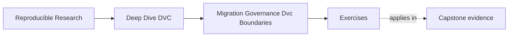

# Exercises

<!-- page-maps:start -->
## Page Maps

<!-- page-maps:end -->

Use these exercises to practice final stewardship judgment.

The strongest answers will name evidence, risk, repair, and ownership.

## Exercise 1: Review a repository by evidence

Write a five-section review outline for a DVC repository:

- identity and state layers
- pipeline and experiment truth
- metrics, promotion, and release surfaces
- remote, retention, and recovery
- tool-boundary recommendations

For each section, name one file or command you would inspect.

## Exercise 2: Plan one safe migration

A team wants to move promoted artifacts from `publish/v1/` to
`registry/incident-escalation/v1/`.

Write a migration plan that preserves trust and rollback.

## Exercise 3: Write a governance rule

Write one durable governance rule for future changes to `params.yaml`, `dvc.lock`, or
`publish/`.

Explain which state contract your rule protects.

## Exercise 4: Intervene on an anti-pattern

A reviewer sees this comment:

> We copied the best model to `outputs/latest/`; consumers can use that.

Write a better review intervention with a repair path.

## Exercise 5: Decide tool ownership

A team wants DVC to handle artifact lineage, deployment approval, model registry lifecycle,
and alerting.

Explain which concerns DVC should own and which should probably belong to another layer.

## Exercise 6: Audit a repository against current truth

Interview the files, not only the maintainers. Compare documentation, `dvc.yaml`,
`dvc.lock`, remotes, CI, and release bundles. Record every promise that lacks executable
or recoverable evidence.

## Exercise 7: Migrate one artifact family safely

Move one governed artifact family to a new storage or workflow boundary. Preserve old and
new recovery routes during validation, compare identities, and define the rollback point.

## Exercise 8: Write an exception with an expiry

Document one justified departure from repository policy. Include owner, reason, affected
artifacts, risk, compensating evidence, expiry condition, and the check that detects an
overdue exception.

## Exercise 9: Decide whether DVC should keep ownership

Evaluate one concern such as model registry, secrets, streaming data, scheduler policy, or
environment construction. Use requirements to decide whether DVC owns, references, or
must not own it.

## Exercise 10: Conduct a stewardship review

Present the repository to a new maintainer. Demonstrate recovery, reproduction,
comparison, promotion, incident response, and one safe change. Record every boundary the
new maintainer cannot explain from durable evidence.

## Mastery check

You have a strong grasp of this module if your answers consistently keep five ideas
visible:

- review starts from evidence surfaces
- migration should move one boundary with proof
- governance should be small and enforceable
- anti-patterns are shortcuts that damage state contracts
- DVC should own artifact lineage, not every production concern
