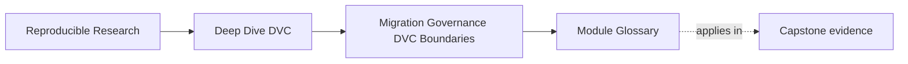
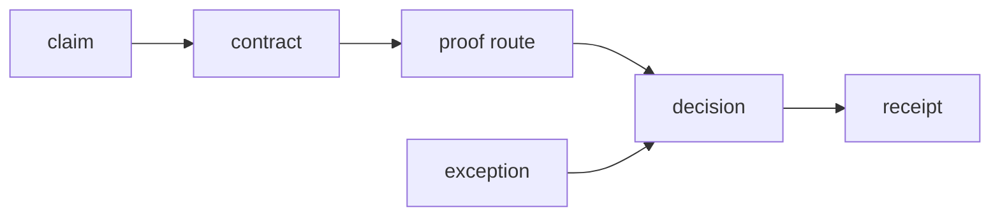

# Module Glossary

<!-- page-maps:start -->
## Page Maps




<!-- page-maps:end -->

Use this glossary when two terms begin to collapse into one another. The
distinctions matter because each term authorizes a different conclusion.

## Evidence and review terms

### Claim

A statement the repository or team asks another person to trust.

Example: “Every protected release can be restored from the candidate remote.”

A claim is not evidence merely because it appears in documentation.

### Contract

A claim made testable by naming its boundary, inputs, outputs, invariants,
evidence, and failure behavior.

Example: the boundary migration contract permits consumer location to change
while inventory, bytes, meaning, and provenance remain invariant.

### Evidence

An observed fact relevant to a contract: file identity, command receipt,
verification result, retrieval record, owner decision, or measured duration.

Evidence supports a bounded inference. A successful copy is evidence of
transfer, not automatically of consumer acceptance.

### Proof route

A reproducible sequence that challenges a contract and retains enough evidence
to review the result.

Example:

```console
make PROGRAM=reproducible-research/deep-dive-dvc \
  capstone-boundary-migration-audit
```

The word “proof” is scoped to the modeled claim; it does not imply mathematical
certainty or production assurance.

### Receipt

A compact record connecting an execution or decision to identities and result.
A useful receipt names source revision, contract, command or evidence, result,
and responsible role.

“CI passed sometime yesterday” is status memory, not a durable receipt.

### Verified

Direct evidence supports the bounded claim.

### Contradicted

Direct evidence shows the bounded claim is false. `PARTIAL_COPY` contradicts
the invariant that source and target inventories match.

### Unverified

Required evidence is absent or was not collected. This result is not the same
as failure, but it cannot authorize a decision that requires the proof.

### Out of scope

The route does not promise to answer the question. Production load behavior is
out of scope for the local boundary-migration specimen.

### Stewardship finding

A review record containing claim, evidence, gap, consequence, decision, repair,
and closure proof. It is stronger than a concern because another maintainer can
act on it.

### Closure proof

The observation that demonstrates a finding's affected contract now passes.
Editing the named file is a repair attempt; repeating the falsifying route and
retaining its receipt closes the finding.

## Migration terms

### State boundary

The line across which authority, durability, access, or consumer promises
change. A DVC remote, promoted bundle, registry reference, or pipeline handoff
can be a state boundary.

### Migration

A controlled change from one state boundary to another. It includes identity,
consumer, rollback, ownership, and decision evidence—not only data movement.

### Transfer

The operation that copies or moves content. Transfer may be part of migration,
but transfer success does not prove cutover readiness.

### Change budget

The exact surfaces a migration is allowed to alter. The course specimen permits
only `consumer-location`. A metric schema change exceeds that budget.

### Invariant

A testable property required to remain true across the migration.

Examples: equal path/digest inventory, unchanged release meaning, preserved
source provenance, recoverable protected history.

### Before evidence

Source identity and verification captured before mutation. It establishes what
the migration promises to preserve.

### After evidence

Target identity and verification collected using a comparable route. It
supports direct source-to-target comparison.

### Dual-boundary interval

A bounded period when source remains available while target is verified and
consumers adopt it. For immutable releases this is dual availability; mutable
state also needs a write and reconciliation policy.

### Consumer acceptance

Evidence that the intended consumer can resolve, retrieve, verify, and perform
the smallest meaningful operation through the target route. Producer-side
storage success is not consumer acceptance.

### Cutover

The decision that makes the target boundary primary for consumers. It does not
automatically authorize source deletion.

### Rollback

A retained, authorized, tested route that restores the old boundary or service
state after a named trigger. “We could copy it back” is a recovery idea, not a
ready rollback.

### Rollback window

The declared interval during which the source and rollback route remain
supported after cutover.

### Source retirement

A separate decision to remove or stop supporting the old boundary after
cutover acceptance, rollback window, retention review, and recovery proof.

## Governance terms

### Governance rule

A durable mapping from an observable change trigger to a protected contract,
required evidence, decision authority, and retained receipt.

### Trigger

An observation that invokes a rule. A trigger can be a path change, promotion
request, retention action, or boundary decision. Path triggers alone may miss
shared code and external policy changes.

### Authority

The system or role permitted and able to make or enforce a decision. Authority
is not the same as producing evidence.

### Owner

The accountable role for a contract or failure route. A non-empty owner field
can still be wrong if the role cannot observe or control the boundary.

### Exception

A recorded, temporary departure from a rule with owner, reason, expiry,
removal condition, and compensating control.

### Expiry

The date by which an exception must be reevaluated. It prevents indefinite
approval by neglect.

### Removal condition

The observable fact that allows the exception to end. Expiry says **when to
review**; removal condition says **what makes the bypass unnecessary**.

### Compensating control

A narrower protection used while normal evidence is unavailable. Keeping the
source authoritative while consumer verification is unavailable is one
example. It does not prove the missing contract.

### Governance register

A compact table of triggers, contracts, evidence routes, block conditions,
authorities, and receipts. It helps future maintainers discover the relevant
decision rule.

### Proportional governance

Evidence and approval depth matched to trust consequence. A documentation typo
needs ordinary review; protected-history deletion needs inventory, dry run,
recovery proof, and authority.

## Intervention terms

### Anti-pattern

A recurring, locally attractive choice that damages identity,
reproducibility, comparability, promotion trust, recovery, consumer contract,
or responsibility clarity.

### Symptom

The visible clue, such as a mutable `latest` path or metadata-only change. A
symptom prompts investigation but does not establish the mechanism.

### Mechanism

How the shortcut bypasses a contract. For `latest`, mutable path is substituted
for immutable release identity.

### Review intervention

An evidence-backed comment that explains mechanism and consequence, requests
the smallest complete repair, and names closure proof.

### Repair

The change intended to restore the affected contract. Repair is not closure
until the falsifying route passes.

## Tool and ownership terms

### Capability

An operation a tool can perform. DVC can upload an artifact. Capability alone
does not grant authority over release approval or deployment.

### Evidence boundary

The limit of facts a tool can directly observe and support. DVC can identify
tracked bytes; it normally cannot observe service health or organization-wide
access entitlement.

### Tool boundary

The point where a responsibility should pass from one authority to another.
Tool boundaries should preserve identity and decision evidence.

### Artifact lineage

The connection between artifact content and the repository declarations,
inputs, parameters, and recorded execution that produced it. DVC is well suited
to this responsibility.

### Consumer lifecycle

How a release is discovered, approved, referenced, deprecated, and retired by
downstream users. A registry or release system often owns this responsibility.

### Handoff contract

A producer-to-consumer agreement naming identity, invariant, acceptance
receipt, and failure owner. The DVC-to-registry handoff must preserve the
promoted manifest digest.

### Hybrid ownership

Several systems owning different facts in one lifecycle: Git source revision,
DVC artifact lineage, CI shared verification, registry consumer lifecycle,
deployment rollout, identity access, and incident response.

Hybrid ownership is safe only when each fact has one authoritative source and
handoffs are testable.

### Ownership overreach

A tool or role receives responsibility for a fact it cannot observe or enforce.
The course specimen swaps DVC artifact-lineage and registry consumer-lifecycle
duties to make this failure visible.

### Responsibility gap

A decision or failure route has no accountable authority. `OWNERLESS_TARGET`
models this gap for registry lifecycle.

## Common distinctions

| Do not collapse | Distinction |
|---|---|
| path and identity | a path may move; content identity must remain stable |
| transfer and migration | transfer moves bytes; migration governs trust |
| target verification and consumer acceptance | producer proof does not exercise consumer access |
| cutover and source retirement | primary use can change while rollback remains |
| experiment and promotion | comparison nominates; promotion authorizes |
| evidence producer and authority | one system observes; another may decide |
| owner present and ownership correct | completeness does not prove responsibility fit |
| repair and closure | change is attempted; falsifying route proves result |
| expiry and removal condition | one schedules review; one ends the exception |
| unverified and contradicted | missing observation differs from observed failure |

When a review becomes vague, rewrite the sentence using both sides of the
relevant distinction.
