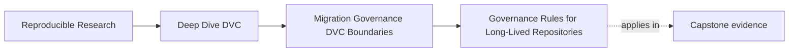
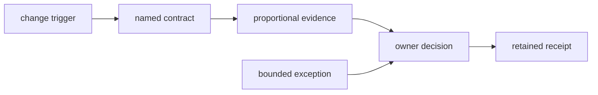
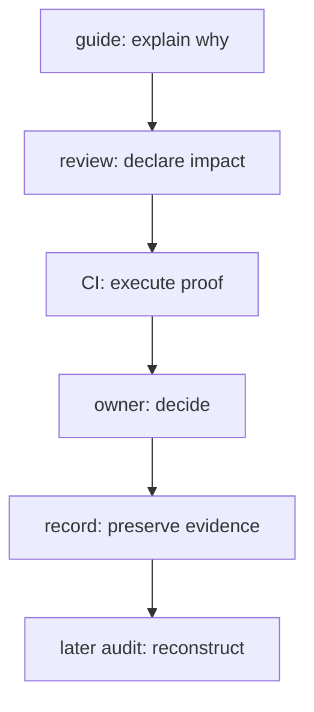

# Governance Rules for Long-Lived Repositories

<!-- page-maps:start -->
## Page Maps




<!-- page-maps:end -->

Governance keeps repository claims true after the person who designed them is
gone. It is not the number of policy pages. It is the connection between a
risky change, the contract it may affect, the evidence required, and the person
authorized to decide.

## Write a rule as an executable sentence

A useful rule has five parts:

```text
when <observable change>
affects <named contract>,
run or inspect <specific evidence>,
require <decision owner>,
retain <decision receipt>.
```

Example:

> When a pull request changes `dvc.yaml`, stage code, or declared parameters,
> test stage invalidation and reproducibility; require a maintainer who owns
> the pipeline contract; retain the check result with the review.

Compare:

> Follow DVC best practices.

The second sentence has no trigger, contract, proof, or owner. Reviewers cannot
apply it consistently.

## Govern decisions, not file extensions

Paths are useful triggers, but the protected object is a decision.

| Change | Contract at risk | Required evidence |
|---|---|---|
| stage command, dependency, or output | truthful invalidation | stage contract audit and focused tests |
| parameter affecting behavior | reproducible control surface | parameter diff, rerun, metric contract |
| metric computation or population | semantic comparability | definition and population comparison |
| experiment promotion | immutable approved candidate | promotion integrity audit |
| publish manifest or bundle | consumer release contract | release verifier and inventory |
| remote, credential class, or retention | protected-history recovery | clean recovery readiness drill |
| artifact location or registry reference | consumer boundary | boundary migration audit |
| cleanup or deletion | future recoverability | inventory, retention rule, dry run, approval |

A change in shared code may affect the stage contract without touching
`dvc.yaml`. A path-only rule misses it. Pair path triggers with a short
contributor question: “Which state contract changes?”

## Scale evidence with consequence

The same ceremony for every change creates bypass pressure. Use tiers based on
the decision's worst credible consequence.

| Consequence | Example | Evidence depth |
|---|---|---|
| no state claim changes | fix prose typo | normal review and docs build |
| reproducibility may change | alter stage code | focused test and invalidation proof |
| comparison meaning may change | redefine metric | semantic contract and baseline comparison |
| consumer trust may change | modify promoted bundle | release verification and owner approval |
| protected state may be lost | migrate remote or delete objects | multi-revision recovery and rollback proof |

“Small diff” is not a risk classification. A one-line retention change can
destroy history; a large lesson rewrite may not alter executable state.

## Place rules at the decision point

Readers should encounter the rule when they can still act:

- contributor guide explains the contract;
- pull request form asks which contract changes;
- Make target offers the evidence route;
- CI check executes shared verification;
- release guide names approval evidence;
- deletion tool defaults to dry run;
- registry policy prevents mutable replacement;
- owner map identifies escalation.



A policy hidden in a governance folder but absent from the workflow protects
nothing. A CI check with no explanation is also weak: maintainers learn how to
bypass it rather than what it preserves.

## Make acceptance and rejection symmetric

A rule should state both:

- evidence that permits the decision;
- failure that blocks it;
- repair evidence that allows reconsideration.

Example for a remote cutover:

```text
accept:
  every protected revision restores from the candidate remote
  content claims match
  recovery is read-only and within objective

block:
  any protected revision is absent
  any restored content disagrees
  the test repairs the candidate
  duration is unmeasured or exceeds objective

repair:
  populate the missing objects, then repeat the clean read-only drill
```

This shape prevents a green result from being defined after the outcome is
known.

## Assign authority by responsibility

An owner is not merely the person available today. The role must control the
boundary.

| Decision | Accountable role | Why |
|---|---|---|
| pipeline contract | pipeline maintainer | can approve dependency and output semantics |
| metric definition | evaluation owner | can defend population and interpretation |
| release promotion | release owner | can authorize consumer exposure |
| remote retention | storage owner | can enforce retention and deletion |
| registry cutover | registry/release owner | can control durable reference and rollback |
| deployment rollout | service owner | can observe runtime health and restore service |

Record a role in durable docs and map it to people in the organization's
maintained ownership system. Hard-coding one person's name into every lesson
ages poorly.

## Preserve evidence, not just status

“CI was green” is difficult to audit after logs expire. For consequential
decisions, retain a compact receipt:

```json
{
  "contract": "boundary-migration",
  "source_revision": "recorded-git-sha",
  "evidence": "boundary-migration/report.json",
  "decision": "APPROVE_CUTOVER",
  "owner_role": "release-owner",
  "decided_at": "2026-07-28"
}
```

The receipt points to evidence rather than copying every artifact. Its source
revision makes the decision reproducible.

## Turn recurring comments into contracts

Repeated review comments reveal a missing rule when they protect the same
property:

1. collect several examples;
2. identify the common trust failure;
3. name the contract;
4. find an observable trigger;
5. create the narrowest proof route;
6. add adversarial tests;
7. place the rule at the decision point;
8. remove redundant prose.

Do not automate a comment simply because it is repeated. Style preferences and
context-sensitive judgment may not deserve repository-wide enforcement.

## Design exceptions to disappear

Sometimes the normal evidence route is unavailable. A governed exception
contains:

- rule being bypassed;
- accountable owner;
- concrete reason;
- expiry date;
- removal condition;
- compensating control;
- decisions the exception does **not** authorize.

Example:

```yaml
rule: consumer-retrieval-must-pass
owner_role: release-owner
reason: isolated registry acceptance endpoint unavailable
expires_at: 2026-08-01
removal_condition: clean consumer-equivalent retrieval receipt exists
compensating_control: keep source authoritative; do not retire rollback
does_not_authorize:
  - source deletion
  - expansion to additional consumers
```

An exception that merely says “approved temporarily” has become a second,
weaker policy.

## Review exceptions as active state

Evaluate exceptions on every governed decision:

```text
current =
    owner exists
    and evaluation_date <= expiry
    and removal condition is not already satisfied
    and compensating control still operates
```

If the removal condition is satisfied, remove the exception. If it expired,
block or renew through a fresh decision. Renewal should explain what prevented
removal, not copy the old reason.

The boundary migration specimen uses a fixed evaluation date so the stale case
remains deterministic:

```console
make PROGRAM=reproducible-research/deep-dive-dvc \
  capstone-boundary-migration-audit
```

Inspect `STALE_EXCEPTION`. Every other premise passes; expiry alone blocks the
cutover. That isolation shows that exception lifecycle is part of the contract,
not administrative decoration.

## Audit whether rules still earn their cost

Governance can outlive the risk it was designed for. Review rules periodically:

| Question | Evidence |
|---|---|
| does the protected contract still exist? | current architecture and consumer map |
| does the trigger catch relevant changes? | recent changes and escaped incidents |
| does the check falsify the claim? | adversarial test |
| is the owner still authoritative? | current responsibility map |
| is the evidence retained long enough? | artifact retention |
| are exceptions removed on time? | exception inventory |
| is the cost proportional? | execution time and bypass rate |

Remove duplicate or obsolete rules. Keep the contract legible.

## A minimal governance register

For a small research repository, one table can be enough:

| Trigger | Contract | Route | Owner | Receipt |
|---|---|---|---|---|
| pipeline state changes | stage truth | `capstone-stage-contract-audit` | pipeline maintainer | audit report |
| experiment comparison | comparability | `capstone-experiment-comparability-audit` | evaluation owner | comparison report |
| promotion request | release integrity | `capstone-promotion-integrity-audit` | release owner | decision record |
| remote migration | recoverability | `capstone-recovery-readiness-audit` | storage owner | recovery report |
| consumer location cutover | boundary invariants | `capstone-boundary-migration-audit` | release owner | cutover decision |

The target names are implementation details; the durable value is the mapping
from change to contract, evidence, authority, and receipt.

## Reader checkpoint

You can govern a long-lived DVC repository when you can:

- express a rule as trigger, contract, proof, owner, and receipt;
- scale verification to trust consequence rather than diff size;
- place explanation and enforcement at the decision point;
- define acceptance, rejection, and repair symmetrically;
- assign authority to the role that controls the boundary;
- retain evidence that reconstructs consequential decisions;
- bound exceptions with expiry and removal conditions;
- remove rules that no longer protect a live contract.

Governance succeeds when future maintainers can make the right state decision
without depending on the memory of the original team.
