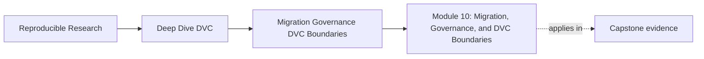
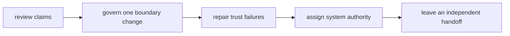
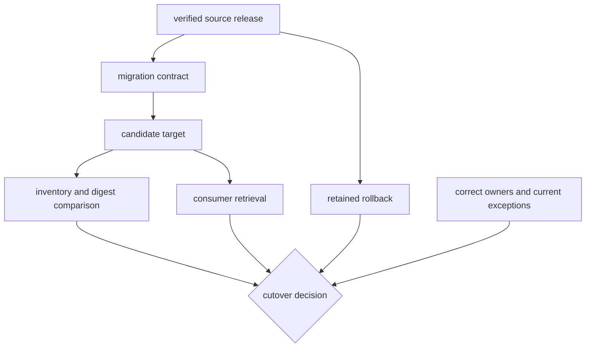

# Module 10: Migration, Governance, and DVC Boundaries

<!-- page-maps:start -->
## Page Maps




<!-- page-maps:end -->

This module turns the course's individual DVC contracts into a stewardship
method. You will review claims rather than appearances, migrate one state
boundary without changing release meaning, write governance that can be
executed, intervene on shortcuts with repair evidence, and decide where DVC's
authority ends.

The module is built around one decision:

> May an approved release move from `publish/v1/` to a registry location while
> consumers, rollback, identity, and ownership remain trustworthy?

You will not answer from a hypothetical checklist. The capstone creates one
approved specimen and seven deliberately blocked variants.

## What you should already know

This final module assumes you can:

- distinguish Git revision, DVC metadata, cache, workspace, and remote state;
- read `dvc.yaml` beside `dvc.lock`;
- identify declared dependencies and parameters;
- explain why metric semantics precede numeric comparison;
- distinguish an experiment from a promoted release;
- run a clean recovery route for protected state.

If those distinctions are unclear, use this diagnostic:

| If you cannot yet explain | Revisit |
|---|---|
| why a path is not content identity | Module 2 |
| why current success may hide runtime drift | Module 3 |
| why undeclared inputs break invalidation | Module 4 |
| why equal metric names may not be comparable | Module 5 |
| why experiment evidence is not release approval | Modules 6 and 9 |
| why a working workspace does not prove recovery | Module 8 |

You do not need an external registry account. The local specimen models the
contract and decision evidence without network access.

## Learning outcomes

By the end, you should be able to:

- express repository promises as falsifiable claims;
- classify evidence as verified, contradicted, unverified, or out of scope;
- write a finding with consequence, repair, and closure proof;
- define a migration change budget and preserved invariants;
- require independent consumer and rollback evidence;
- govern consequential changes with triggers, evidence, owners, and receipts;
- bound exceptions with expiry and removal conditions;
- assign authority across Git, DVC, CI, registry, deployment, access, and
  incident systems;
- hand the repository to a maintainer who missed the class.

## The executable case

The source is the capstone's verified promoted bundle:

```text
capstone/publish/v1/
├── data-profile.json
├── manifest.json
├── metrics.json
├── model.json
├── params.yaml
├── predictions.csv
└── report.md
```

The proposed target is:

```text
incident-escalation/2026-07
```

The migration may change only consumer location. It must preserve inventory,
bytes, release meaning, and source provenance.



## Prepare the study environment

Run from the repository root:

```console
make PROGRAM=reproducible-research/deep-dive-dvc \
  capstone-boundary-migration-audit

make PROGRAM=reproducible-research/deep-dive-dvc \
  capstone-boundary-migration-selftest
```

The audit bundle appears at:

```text
artifacts/audit/reproducible-research/deep-dive-dvc/boundary-migration/
```

Confirm that `report.json` contains one `APPROVE_CUTOVER` and seven
`BLOCK_CUTOVER` decisions. If the command fails, keep the error output and use
the capstone README plus `make ... capstone-install` to restore the environment.
Do not continue by imagining what the report would contain.

## A serious-session route

Plan about four hours without the optional extensions.

| Time | Study surface | Work product |
|---:|---|---|
| 25 min | this overview and audit guide | written decision question |
| 40 min | repository review lesson | claims/evidence table |
| 45 min | migration lesson and audit contrasts | invariant and rollback map |
| 35 min | governance and exception lesson | governance register |
| 35 min | anti-pattern and ownership lessons | intervention and owner map |
| 35 min | worked investigation | independent cutover finding |
| 45 min | exercises | cumulative stewardship packet |
| 20 min | answer review | corrected reasoning notes |

Pause after migration if you cannot explain why `UNBOUNDED_CHANGE` blocks while
its file inventories still match. Pause after ownership if you cannot explain
why non-empty owner fields can still be wrong.

## Reading route

| Page | What it teaches | Evidence to keep open |
|---|---|---|
| [Repository Review without Wishful Thinking](repository-review-without-wishful-thinking.md) | turns promises into falsifiable findings | capstone declarations, publish contract, audit reports |
| [Safe Migration Plans for State Boundaries](safe-migration-plans-for-state-boundaries.md) | defines change budgets, invariants, dual boundaries, and rollback | migration contract and eight assessments |
| [Governance Rules for Long-Lived Repositories](governance-rules-for-long-lived-repositories.md) | connects triggers to proof, authority, receipts, and exceptions | Make targets, tests, stale-exception case |
| [Anti-Patterns and Review Interventions](anti-patterns-and-review-interventions.md) | diagnoses mechanisms and writes bounded repairs | rejected specimen cases |
| [DVC Tool Boundaries and System Ownership](dvc-tool-boundaries-and-system-ownership.md) | separates capability, evidence, and authority | ownerless and ownership-overreach cases |
| [Worked Investigation: Blocking an Unsafe Boundary Cutover](worked-investigation-blocking-an-unsafe-boundary-cutover.md) | investigates one block from claim through closure proof | partial-copy assessment |
| [Exercises](exercises.md) | produces ten cumulative review artifacts | all audit evidence |
| [Exercise Answers](exercise-answers.md) | models reasoning and proof limits | your completed packet |
| [Glossary](glossary.md) | distinguishes migration and governance terms | use when decision language blurs |

Read in order on the first pass. For later review, enter through the problem:

- uncertain repository claim → repository review;
- moving a state location → migration;
- recurring risky change → governance;
- vague or scolding review comment → interventions;
- conflict between DVC and another platform → ownership.

## How to read an assessment

Each case has `assessment.json`. Read these fields first:

```console
jq '{
  finding,
  decision,
  failed_checks,
  checks
}' artifacts/audit/reproducible-research/deep-dive-dvc/boundary-migration/workspace/partial-copy/assessment.json
```

Then inspect only the evidence related to the failed check. Avoid reading the
implementation first; code familiarity can make you accept the tool's status
without reconstructing its argument.

Use one contrast at a time:

| Accepted control | Rejected contrast | Distinction learned |
|---|---|---|
| complete cutover | partial copy | byte and inventory identity |
| complete cutover | unbounded change | one-boundary budget |
| complete cutover | no rollback | target success versus reversibility |
| complete cutover | unverified consumer | producer proof versus consumer proof |
| complete cutover | ownerless target | evidence versus accountability |
| complete cutover | stale exception | temporary bypass lifecycle |
| complete cutover | ownership overreach | owner completeness versus correctness |

## Evidence language

Use four result words consistently:

| Result | Meaning |
|---|---|
| verified | direct evidence supports the bounded claim |
| contradicted | direct evidence shows the claim is false |
| unverified | the required observation is absent |
| out of scope | this repository or route does not promise the claim |

Example:

- target inventory in `PARTIAL_COPY` is **contradicted**;
- a real production load objective is **out of scope** for the specimen;
- a consumer check never attempted is **unverified**;
- complete specimen inventory equality is **verified**.

This vocabulary prevents missing evidence from becoming wishful approval.

## Commands to keep close

From the repository root:

```console
# governed consumer-location migration
make PROGRAM=reproducible-research/deep-dive-dvc \
  capstone-boundary-migration-audit

# protected-history remote migration
make PROGRAM=reproducible-research/deep-dive-dvc \
  capstone-recovery-readiness-audit

# immutable candidate promotion
make PROGRAM=reproducible-research/deep-dive-dvc \
  capstone-promotion-integrity-audit

# semantic experiment comparison
make PROGRAM=reproducible-research/deep-dive-dvc \
  capstone-experiment-comparability-audit
```

Use the route that matches the decision. More checks are not automatically
better; irrelevant checks can obscure the missing premise.

## Proof limits

The module proves:

- how to structure and enforce a boundary-cutover argument;
- exact file identity for the local specimen;
- isolated rejection of seven unsafe cases;
- deterministic exception evaluation;
- tests for the modeled decision rule.

It does not prove:

- production registry availability or load behavior;
- organization-wide access policy;
- deployment health;
- legal retention compliance;
- recovery objectives beyond the modeled route;
- that every real repository influence is declared.

Do not convert a passing local audit into any of those broader claims.

## Optional extensions

After the required packet:

- add a measured rollback case without weakening the existing specimen;
- model a DVC remote migration across two protected revisions;
- draft a metric-schema contract that forbids comparisons across versions;
- create a handoff receipt between the promoted manifest and a deployment
  release identity;
- review a repository you maintain using the four evidence result words.

Keep each extension focused on one decision boundary.

## Completion standard

You have completed the module when you can, without instructor help:

- run and navigate the audit bundle;
- explain why every rejected case blocks;
- write a finding that stays inside observed evidence;
- distinguish cutover approval from source retirement;
- define consumer and rollback proofs independently;
- write a rule with trigger, contract, proof, owner, and receipt;
- remove or renew an exception through an explicit decision;
- assign DVC only the responsibilities its evidence can support;
- give another maintainer a durable route with proof limits.

The final skill is not using DVC for every concern. It is preserving artifact
lineage while state crosses boundaries that other systems own.
