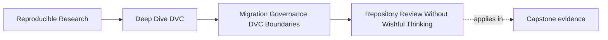
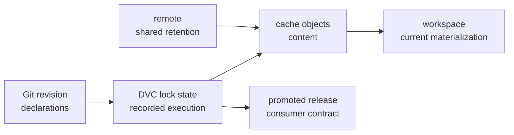
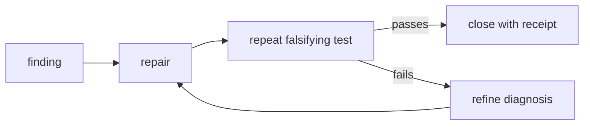

# Repository Review Without Wishful Thinking

<!-- page-maps:start -->
## Page Maps




<!-- page-maps:end -->

A repository review is an argument about trust. It is not a tour of files and
it is not a vote on whether the layout feels tidy. A mature DVC repository may
contain polished documentation and still be unable to reproduce a release. A
small untidy repository may have a complete, testable state contract.

The reviewer's job is to distinguish those cases with evidence.

## Begin with claims, not commands

Before opening `dvc.yaml`, write down what the repository appears to promise.
For the course capstone, the claims include:

- the pipeline prepares a stable train/evaluation split;
- parameters control training behavior;
- metrics describe a defined evaluation population;
- `publish/v1/` is a complete promoted release;
- a shared DVC remote can restore protected revisions;
- a clean reviewer can verify the release without private context.

These claims set the review boundary. `dvc status` can help test some of them,
but no single DVC command answers all of them.

| Claim | Direct evidence | Useful falsifying test |
|---|---|---|
| stage dependencies are truthful | `dvc.yaml`, stage code, `dvc.lock` | change each declared input and observe invalidation |
| recorded state matches the workspace | lock entries and file digests | remove or alter an output and run `dvc status` |
| metrics are comparable | metric definition, population identity, params | compare a candidate with one semantic field changed |
| release is complete | manifest, inventory, verifier | remove one promoted file and run verification |
| history is recoverable | protected revisions and remote objects | restore each revision into an empty workspace |
| consumer boundary is stable | release contract and retrieval route | retrieve with consumer-equivalent access |

A review becomes useful when every important promise has both evidence and a
way it could fail.

## Build an evidence inventory

Read related surfaces together. Isolated file review encourages false
confidence because each file can look plausible on its own.

| State question | Read together | Agreement to test |
|---|---|---|
| what runs? | `dvc.yaml`, command implementation, tests | command, dependencies, and outputs describe the same stage |
| what ran? | `dvc.lock`, output files, environment receipt | recorded inputs identify the execution that produced the outputs |
| what may vary? | `params.yaml`, `params` entries, experiment record | every decision-changing control is declared |
| what does a metric mean? | metric file, evaluation code, data profile | name, direction, population, threshold, and units agree |
| what was promoted? | publish manifest, release report, source provenance | inventory and digests identify one immutable candidate |
| what can be restored? | Git revision, DVC metadata, remote inventory | every protected revision has reachable content |
| what can a consumer use? | publish contract, durable reference, access proof | consumer can retrieve only the supported surface |

Create the inventory under the repository's `artifacts/` directory. It should
record paths and observations, not copies of secrets or large data.

```text
artifacts/review/dvc-stewardship/
├── claims.md
├── evidence-index.md
├── command-receipts/
├── findings.md
└── unknowns.md
```

`unknowns.md` matters. Absence of evidence is not automatically proof of
failure, but it is never proof of success.

## Separate four review outcomes

Use precise result language:

| Outcome | Meaning | Example |
|---|---|---|
| verified | direct evidence supports the claim | clean restore reproduced the protected release digest |
| contradicted | direct evidence disproves the claim | target release lacks a manifest-listed file |
| unverified | required evidence was not collected | no consumer-equivalent retrieval was attempted |
| out of scope | the repository does not promise this property | production availability is owned by another system |

Calling every missing proof a defect overstates the review. Calling every
missing proof “probably fine” hides risk. `unverified` preserves the
distinction and points to the next observation.

## Follow the state story

DVC repositories contain several identities that must not be collapsed:



Review each transition:

- Does the Git revision name the intended declarations?
- Does the lock file record the inputs and outputs for that revision?
- Are the referenced objects present in the promised remote?
- Does the workspace merely materialize state, or has it become an
  unrecorded source of truth?
- Does the promoted release identify its source rather than inherit the
  identity of whatever workspace happens to exist now?

The repository is not trustworthy merely because the current workspace works.
Current success can coexist with broken history, missing remote objects, or a
release assembled from an unrecorded candidate.

## Inspect declarations for honesty

For each stage, reconstruct a contract:

```text
command + code + data + parameters + runtime influences
    -> declared outputs + observable receipts
```

Then ask what can change the result without invalidating the stage. Common
hidden influences include:

- environment variables read by stage code;
- undeclared configuration files;
- package or model downloads;
- current time, random seed, locale, or thread count;
- directory glob expansion;
- files read through paths assembled at runtime.

Do not respond by tracking every file in the repository. Declare the smallest
truthful boundary. If an influence is intentionally external, record and
verify its identity.

## Review experiments as comparisons

An experiment table is not evidence of comparability. Two rows can be shown
side by side while differing in population, metric semantics, runtime, or
source code.

Before interpreting a metric delta, prove:

1. both runs use the intended source revision;
2. data and split identities match;
3. metric name, population, direction, and units match;
4. the bounded parameter change is known;
5. runtime differences are either controlled or declared;
6. promotion criteria were defined before seeing the candidate result.

If one premise fails, the correct result is “comparison blocked,” not “candidate
worse.” Governance protects the meaning of the comparison.

## Review promotion independently

Reproduction and promotion answer different questions:

- reproduction asks whether the pipeline can rebuild recorded outputs;
- promotion asks whether a specific output set is approved for consumers.

A promotion review needs an immutable candidate identity, manifest, source
provenance, verification result, and decision record. A green `dvc repro`
cannot supply the approval or consumer contract.

Use the capstone route:

```console
make PROGRAM=reproducible-research/deep-dive-dvc \
  capstone-promotion-integrity-audit
```

Compare `COMPLETE_PROMOTION` with one rejected case. Notice that valid digests
can still describe the wrong candidate or an unsafe mutable reference.

## Review recovery across history

Remote review is often weakened to “does `dvc pull` work here?” That checks the
current materialization with the current cache and credentials. A recovery
claim is stronger.

For every protected revision:

- enter an empty cache and workspace;
- retrieve only from the promised shared remote;
- materialize the declared outputs;
- verify their content identities;
- record duration and command receipts;
- avoid repairing the remote during the test.

The capstone recovery readiness route contrasts complete migration with
current-only, release-only, stale-claim, mutating, and unmeasured cases:

```console
make PROGRAM=reproducible-research/deep-dive-dvc \
  capstone-recovery-readiness-audit
```

Successful recovery of `main` says nothing about a protected release unless
that release was tested too.

## Write findings as broken contracts

A review finding needs five parts:

1. **Claim** — the promise under review.
2. **Evidence** — the exact observation and route.
3. **Gap** — the failed or missing premise.
4. **Consequence** — what decision or user is affected.
5. **Repair proof** — the observation that would close the finding.

Weak:

> The DVC setup is messy.

Reviewable:

> The publish contract promises a seven-file release. In
> `workspace/partial-copy/assessment.json`, the target inventory lacks
> `report.md`, so target identity differs from the approved source. Block
> cutover until a repeated copy produces equal inventories and the verifier
> passes at the target.

Weak:

> Recovery needs improvement.

Reviewable:

> The migration decision declares rollback ready, but no retained source or
> executed restoration receipt is named. A target access failure would require
> an improvised response. Keep the source boundary active and attach a clean
> restoration receipt before approving cutover.

Specificity is not verbosity. It makes the repair and closure condition clear.

## Rank by trust consequence

Do not rank findings by how easy they are to edit.

| Severity | Trust consequence | Typical response |
|---|---|---|
| blocking | can publish, lose, or misidentify protected state | stop promotion, deletion, or cutover |
| major | can make comparison or recovery claims unreliable | repair before the next governed decision |
| moderate | increases ambiguity or manual error | schedule with owner and proof condition |
| advisory | improves maintainability without changing current trust | consider alongside related work |

A missing title is not equal to a missing protected revision. Review reports
lose credibility when cosmetic consistency is mixed with state-integrity
failures.

## Close findings with evidence

Editing the named file does not automatically close a finding. Repeat the
falsifying route and preserve the new receipt.



Closure should say what now passes, where the evidence lives, and which claim
remains outside scope.

## Reader checkpoint

You are ready to review a DVC repository when you can:

- turn repository promises into falsifiable claims;
- distinguish verified, contradicted, unverified, and out-of-scope results;
- follow identity across Git, lock state, cache, workspace, remote, and release;
- block comparisons whose semantics are not established;
- review promotion and recovery independently from current reproduction;
- write findings with consequence and a repair proof;
- close findings by repeating the route that exposed them.

The standard is not certainty about every system. It is an honest boundary
between what the evidence proves, what it contradicts, and what remains
unknown.
