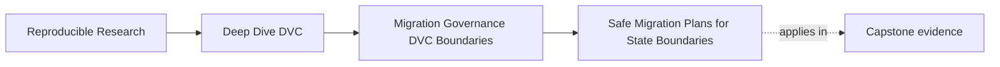
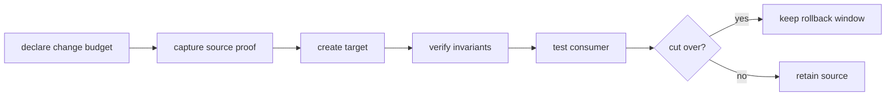
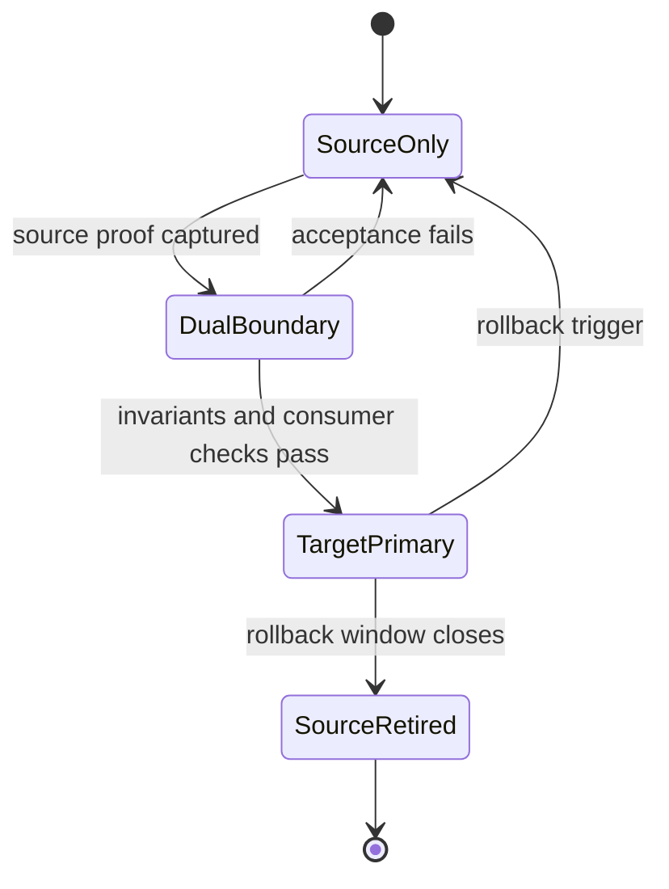

# Safe Migration Plans for State Boundaries

<!-- page-maps:start -->
## Page Maps




<!-- page-maps:end -->

A state migration changes where a trusted claim is enforced. Moving bytes is
only one operation inside that change. The migration is safe when the team can
show which boundary changed, which meanings did not, how consumers were tested,
and how service returns to the old boundary if acceptance fails.

Examples include:

- moving protected DVC objects to a new remote;
- moving promoted releases into a registry;
- splitting one pipeline across repositories;
- changing metric storage or schema;
- replacing mutable release aliases with immutable references;
- handing artifact lifecycle from a research team to an operations team.

Each example affects different evidence and owners. A generic “migration
checklist” is not enough.

## Name the boundary precisely

Start with a sentence that contains a source, target, allowed change, and
preserved invariants:

> Move the approved files at `publish/v1/` to registry reference
> `incident-escalation/2026-07`; change only consumer location; preserve file
> inventory, bytes, release meaning, source provenance, and consumer contract.

This statement creates a change budget.

| Part | Question | Unsafe ambiguity |
|---|---|---|
| source | what exact state is trusted now? | “the current release” |
| target | what durable boundary will replace it? | “the new registry” |
| changed surface | what is intentionally different? | “publishing improvements” |
| invariant | what must remain identical? | “everything important” |
| consumer | who depends on the boundary? | “downstream teams” |
| decision owner | who may authorize cutover? | “the project” |

If the sentence cannot be made precise, the work is not ready to execute.

## Keep migrations orthogonal

Suppose a team moves a release into a registry while also:

- renaming metric keys;
- retraining the model;
- changing retention;
- adopting a new authentication scheme.

Even if the final system works, a failed acceptance test cannot identify which
change broke the contract. Rollback is also ambiguous: should it restore
location, model, schema, credentials, or all four?

Decompose by independently testable state boundary:

1. prove the old release at the new location;
2. cut consumers to the new location;
3. change authentication under its own contract;
4. release a new metric schema as a versioned semantic change;
5. change retention only after recovery evidence exists.

The order may differ in a real system, but the decisions remain separate.

## Write invariants before copying

An invariant is a property the migration promises not to change. Phrase it so
that a reviewer can test it.

| Weak wording | Testable invariant |
|---|---|
| data stays the same | relative-path and digest inventory is equal |
| releases still work | target verifier passes the same release contract |
| history is preserved | every protected Git revision restores from the candidate remote |
| metrics are unchanged | definition, population, direction, units, and values match |
| consumers are unaffected | consumer-equivalent retrieval and smallest useful operation pass |
| rollback is possible | retained source restores within the declared window and objective |

Some migrations intentionally change meaning. Do not disguise those changes as
failed invariants. Declare a versioned contract transition and give consumers a
compatibility or adoption route.

## Capture source proof before mutation

Evidence collected after the source changes cannot reliably describe the
starting state. Before migration:

- identify the source revision and release;
- record inventories and content digests;
- execute the existing verification route;
- identify protected history;
- enumerate consumers and their durable references;
- record current owners and escalation routes;
- exercise rollback while the source is known to work.

Preserve the receipts outside the boundary being migrated. If the remote is the
subject of the migration, storing the only audit report inside that remote
creates circular evidence.

```text
artifacts/migration/release-registry/
├── contract.json
├── before/
│   ├── source-inventory.json
│   ├── verification.json
│   └── consumer-index.json
├── after/
├── decision.json
└── rollback/
```

This directory is a review packet, not a second authoritative release.

## Create target evidence symmetrically

After copying, collect evidence that can be compared directly with the source:

- the same relative-path inventory;
- digests computed independently at the target;
- the same or explicitly superseding verifier;
- provenance that still identifies the approved source;
- retrieval through the target's real access path;
- the target owner and retention promise.

Avoid before/after reports that use different names or aggregation rules.
Asymmetry creates a manual interpretation problem exactly when reviewers need a
clear decision.

## Use a dual-boundary interval

A cutover should not require destroying the source to learn whether the target
works. During a bounded dual-boundary interval:

- source remains authoritative or explicitly available for rollback;
- target is populated and verified;
- selected consumers test target retrieval;
- writes are frozen, mirrored, or reconciled under a declared rule;
- discrepancies block cutover;
- the interval has an owner and end condition.



For immutable promoted artifacts, dual running is mostly dual availability.
For mutable metadata or write traffic, it requires a conflict and consistency
policy. Do not infer one from the diagram.

## Test consumers, not storage alone

The producer's copy command can succeed while the consumer's route fails
because of:

- missing permissions;
- incompatible path or reference semantics;
- a manifest not reachable from the durable reference;
- content available only in the producer's cache;
- unsupported schema or serialization;
- a stale mutable alias.

A consumer acceptance receipt should state:

```json
{
  "consumer": "incident-review-service",
  "target": "incident-escalation/2026-07",
  "retrieved_manifest": true,
  "verified_inventory": true,
  "useful_operation": "loaded predictions and threshold",
  "result": "PASS"
}
```

In a real system, include command identity, timestamp, credentials class, and
output digest without recording secrets.

## Make rollback a tested contract

Rollback is not “copy the files back if needed.” Define:

| Element | Example |
|---|---|
| trigger | consumer verification fails or target availability breaches objective |
| authority | release owner |
| route | switch durable reference to retained source |
| retained state | source release and manifest remain readable |
| time objective | service restored within 30 minutes |
| validation | consumer retrieval passes from restored boundary |
| window | source retained for 14 days after cutover |

Run the route before approving cutover. Record measured duration. If the route
depends on inventing credentials, restoring deleted objects, or reconstructing
an old environment, it is a recovery project rather than a ready rollback.

Source retirement deserves its own decision after the rollback window. It
should not be an automatic side effect of target acceptance.

## Decide from premises

The cutover decision can be modeled as:

```text
approve =
    target_identity_matches
    and only_declared_boundary_changed
    and before_after_proofs_pass
    and consumer_acceptance_passes
    and rollback_is_ready
    and responsibilities_have_owners
    and exceptions_are_current
```

This is not a claim that governance reduces to one Boolean. It forces the team
to name the premises and make blocks repairable.

Run the course specimen:

```console
make PROGRAM=reproducible-research/deep-dive-dvc \
  capstone-boundary-migration-audit
```

Then inspect the decision contrast:

```console
jq '.findings[] | {
  finding,
  decision,
  failed_checks
}' artifacts/audit/reproducible-research/deep-dive-dvc/boundary-migration/report.json
```

Only `COMPLETE_CUTOVER` is approved. Each blocked case isolates one premise:
content, change budget, rollback, consumer proof, ownership, exception life, or
tool responsibility.

## Adapt the proof to the boundary

The invariant pattern stays stable, but evidence differs.

### DVC remote migration

Protect:

- all named Git revisions, not only the current workspace;
- DVC object reachability;
- directory-object completeness;
- read-only recovery testing;
- measured restoration time;
- retention and deletion ownership.

Use the recovery readiness audit rather than the release-location specimen.

### Pipeline split

Protect:

- stage input and output contracts;
- provenance across repository handoff;
- invalidation behavior;
- atomic or recoverable publication between pipelines;
- ownership of the integration boundary.

Do not treat a successful independent run of each half as proof that their
handoff is correct.

### Metric schema migration

Protect or deliberately version:

- metric name and definition;
- evaluation population;
- direction and units;
- missing-value policy;
- compatibility window for consumers.

Equal numeric values do not prove equal meaning.

### Release registry migration

Protect:

- immutable candidate identity;
- complete manifest and digests;
- source provenance;
- durable consumer reference;
- retrieval authorization;
- rollback reference.

This is the boundary modeled by the executable specimen.

## Handle incomplete evidence honestly

If a required proof cannot be collected, choose among:

- block cutover;
- narrow the migration claim;
- run a bounded pilot with no source retirement;
- record a time-limited exception with compensating control.

An exception needs an owner, reason, expiry, removal condition, and narrower
control. “We will verify consumers later” is not an exception record.

## Migration plan template

Write the plan as a decision packet:

```markdown
# Boundary migration

## Claim
Source, target, one changed boundary, preserved invariants.

## Before evidence
Exact receipts and identities captured before mutation.

## Operation
Copy or transition route, write policy, and observation points.

## Acceptance
Target comparison and consumer-equivalent proof.

## Rollback
Trigger, authority, route, objective, validation, and retention window.

## Ownership
System responsibilities and named accountable roles.

## Exceptions
Owner, reason, expiry, removal condition, compensating control.

## Decision
Approve or block with evidence for every premise.
```

Do not include vague headings such as “risks handled.” Name the risk, affected
contract, observation, and response.

## Reader checkpoint

You are ready to plan a state migration when you can:

- state one precise source-to-target boundary change;
- translate “preserve behavior” into testable invariants;
- capture source proof before mutation;
- compare source and target evidence symmetrically;
- distinguish storage success from consumer acceptance;
- keep a tested rollback route through a bounded window;
- adapt proof to remote, pipeline, metric, or release boundaries;
- approve or block from named premises;
- bound any exception so it can be removed.

Safe migration is not movement without failure. It is controlled change whose
meaning, evidence, consumers, and recovery remain understandable throughout.
