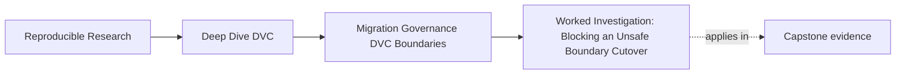
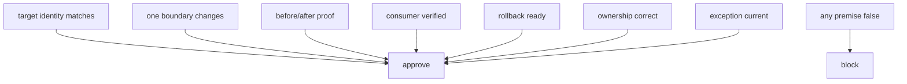

# Worked Investigation: Blocking an Unsafe Boundary Cutover

<!-- page-maps:start -->
## Page Maps




<!-- page-maps:end -->

This investigation begins with a plausible request:

> The release files have been copied from `publish/v1/` into the registry.
> Please approve the cutover and remove the old location.

The copy is real. The target contains files. Neither fact is enough to approve
the request. We will build the evidence bundle, reconstruct the migration
claim, find the failed premise, and write a block that gives the maintainer a
precise repair route.

## Establish the review question

The operation is meant to change one boundary:

```text
source consumer location: publish/v1
target consumer location: incident-escalation/2026-07
```

It is **not** meant to:

- produce a new model;
- alter metrics or parameters;
- change the promoted inventory;
- change source provenance;
- redefine the consumer contract;
- transfer artifact-lineage ownership from DVC.

Our decision question is therefore:

> Can consumers switch to the target while release identity, meaning,
> provenance, recoverability, and responsibility remain governed?

This is narrower than “does the registry work?” and stronger than “did the copy
command exit zero?”

## Build the audit packet

From the repository root:

```console
make PROGRAM=reproducible-research/deep-dive-dvc \
  capstone-boundary-migration-audit
```

Set a shell variable only if it helps you navigate:

```console
AUDIT=artifacts/audit/reproducible-research/deep-dive-dvc/boundary-migration
```

The generated route is:

```text
boundary-migration/
├── BOUNDARY_MIGRATION_AUDIT_GUIDE.md
├── migration-contract.json
├── migration-decision.json
├── report.json
├── route.txt
├── review-questions.txt
├── manifest.json
├── scripts/
├── tests/
└── workspace/
    ├── complete-cutover/
    ├── partial-copy/
    ├── unbounded-change/
    ├── no-rollback/
    ├── unverified-consumer/
    ├── ownerless-target/
    ├── stale-exception/
    └── tool-ownership-overreach/
```

The packet contains deliberate contrasts. We do not inspect them all at once.

## Read the change budget

Open `migration-contract.json`. Extract only the decision surfaces:

```console
jq '{
  migration_id,
  boundary,
  preserved_invariants,
  required_evidence,
  ownership
}' "$AUDIT/migration-contract.json"
```

The important observation is that `changed_surfaces` contains only
`consumer-location`. This is the authorized budget.

Now open `migration-decision.json` and inspect:

```console
jq '{
  boundary,
  before_evidence,
  after_evidence,
  rollback,
  consumer_cutover,
  owners,
  exception
}' "$AUDIT/migration-decision.json"
```

The contract says what is required. The decision says what the operator claims
to have observed. The audit compares both records with actual source and target
inventories.

## Confirm the accepted control

Begin with `COMPLETE_CUTOVER`:

```console
jq '{
  finding,
  decision,
  failed_checks,
  checks
}' "$AUDIT/workspace/complete-cutover/assessment.json"
```

Expected result:

```text
decision: APPROVE_CUTOVER
failed_checks: []
```

Do not stop at the status. Inspect why:

- source and target inventories are equal;
- exactly one boundary change is declared;
- before and after proofs are named;
- rollback retains the source and is ready;
- the consumer retrieval is verified;
- DVC, registry, CI, and release decision have owners;
- no stale exception bypasses the rule;
- DVC and registry responsibilities remain correctly assigned;
- decision and contract describe the same change;
- preserved invariants are explicit.

This control establishes that the audit can approve a complete argument. A
check that rejects every case would not teach the decision boundary.

## Investigate the submitted target

Assume the submitted cutover resembles `PARTIAL_COPY`. Read its assessment:

```console
jq '{
  finding,
  decision,
  failed_checks,
  source_inventory,
  target_inventory
}' "$AUDIT/workspace/partial-copy/assessment.json"
```

The result blocks on one check:

```text
target_matches_source
```

Compare only path names:

```console
jq -r '.source_inventory | keys[]' \
  "$AUDIT/workspace/partial-copy/assessment.json"

jq -r '.target_inventory | keys[]' \
  "$AUDIT/workspace/partial-copy/assessment.json"
```

`report.md` exists at the source and is absent at the target.

The missing file is not cosmetic. The source manifest and release contract
describe a seven-file promoted surface. The target therefore cannot represent
the same approved release. A successful copy of six files is a different
inventory.

## Avoid an invalid conclusion

We may conclude:

> The target inventory contradicts the invariant that artifact inventory is
> preserved.

We may not yet conclude:

> The registry is unreliable.

The audit does not test broad registry reliability. The missing file could be a
bad copy selection, interrupted transfer, or target failure. The block is
stronger because it stays inside the observed evidence.

## Check whether another premise can rescue the cutover

The other checks pass:

- rollback is ready;
- consumer receipt is recorded;
- owners are named;
- exception policy is current;
- tool responsibilities are correct.

None can compensate for wrong release identity. Governance premises are not a
point system. Seven passing checks do not offset one missing required file.



## Write the finding

Use claim, evidence, gap, consequence, and repair proof:

> **Claim:** The registry target is the same approved release at a new consumer
> location.
>
> **Evidence:** In
> `workspace/partial-copy/assessment.json`, the source inventory contains
> `report.md` and the target inventory does not. The audit records
> `target_matches_source: false`.
>
> **Consequence:** The target cannot satisfy the promoted seven-file release
> contract. Consumers switching now would receive a boundary different from
> the approved source.
>
> **Decision:** Block cutover and keep `publish/v1/` available.
>
> **Repair proof:** Repeat the copy, then attach an assessment showing equal
> source and target inventories, matching digests, passing target verification,
> and a clean consumer-equivalent retrieval.

This finding does not ask for a redesign. It requests the smallest complete
repair.

## Test competing failure mechanisms

The other specimen cases show why “the files are present” is insufficient.

### Unbounded change

```console
jq '{decision, failed_checks}' \
  "$AUDIT/workspace/unbounded-change/assessment.json"
```

Here target content matches, but `metric-schema` was added to the migration.
The operation now combines location and semantic changes. Block it until the
schema change becomes a separately versioned contract decision.

### No rollback

```console
jq '{decision, failed_checks}' \
  "$AUDIT/workspace/no-rollback/assessment.json"
```

The target matches, but the old boundary is not retained as a ready route.
Target acceptance cannot authorize irreversible source retirement.

### Unverified consumer

```console
jq '{decision, failed_checks}' \
  "$AUDIT/workspace/unverified-consumer/assessment.json"
```

Producer evidence passes, but no consumer retrieval receipt exists. The repair
is to test the real access path, not to rerun the copy.

### Ownerless target

```console
jq '{decision, failed_checks}' \
  "$AUDIT/workspace/ownerless-target/assessment.json"
```

All technical evidence can pass while a target failure has no accountable
owner. Name the role that controls registry lifecycle and escalation.

### Stale exception

```console
jq '{decision, failed_checks}' \
  "$AUDIT/workspace/stale-exception/assessment.json"
```

An expired exception cannot authorize current cutover. Remove it if the
condition is satisfied or issue a fresh, bounded decision with compensating
control.

### Tool ownership overreach

```console
jq '{decision, failed_checks}' \
  "$AUDIT/workspace/tool-ownership-overreach/assessment.json"
```

Every owner field is non-empty, but DVC is assigned consumer lifecycle and the
registry artifact lineage. Correct the responsibility map and preserve an
identity-bearing handoff.

## Decide source retirement separately

After repairing the copy and approving cutover, keep the old boundary through
the declared rollback window. During that interval:

- monitor real consumer retrieval;
- preserve source identity and access;
- exercise the rollback trigger if acceptance fails;
- collect target ownership and service evidence;
- avoid changing release meaning.

At the end of the window, a separate decision may retire the source. That
decision needs evidence that:

- consumers use the durable target;
- rollback triggers did not fire or were resolved;
- retained history remains recoverable elsewhere;
- retention policy authorizes deletion;
- an owner accepts the remaining risk.

Cutover approval and source deletion are not synonyms.

## Inspect the enforcement route last

After understanding the evidence, inspect:

```text
scripts/audit_boundary_migration.py
tests/test_boundary_migration_audit.py
```

The tests require one approved decision and seven isolated blocks. The
adversarial cases matter because they show that unrelated evidence cannot
silently rescue a failed premise.

Run the focused tests:

```console
make PROGRAM=reproducible-research/deep-dive-dvc \
  capstone-boundary-migration-selftest
```

## Investigation record

The completed review can be summarized:

| Field | Record |
|---|---|
| migration claim | change consumer location only |
| source | `publish/v1` |
| target | `incident-escalation/2026-07` |
| contradicted invariant | promoted inventory preserved |
| direct evidence | target lacks `report.md` |
| decision | `BLOCK_CUTOVER` |
| immediate safety action | keep source available |
| repair | complete copy and repeat target verification |
| closure proof | equal inventory/digests plus consumer retrieval |
| not proved | general registry reliability |

## Reader checkpoint

You have completed the investigation when you can explain:

- why copy success is weaker than cutover readiness;
- how the change budget limits a migration;
- why one failed required premise blocks the whole decision;
- why the missing `report.md` changes release identity;
- how unbounded change differs from partial copy;
- why consumer, rollback, exception, and ownership evidence are independent;
- what observation closes the finding;
- why source retirement requires a later decision.

The central stewardship skill is not finding fault. It is producing a decision
whose evidence, consequence, and repair route another maintainer can follow
without private context.
