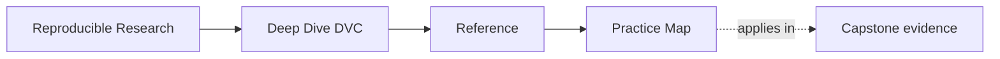

# Practice Map


<!-- page-maps:start -->
## Page Maps




<!-- page-maps:end -->

Read the first diagram as a lookup map: this page is part of the review shelf, not a first-read narrative. Read the second diagram as the reference rhythm: arrive with a concrete ambiguity, compare the current work against the boundary on the page, then turn that comparison into a decision.

The course should make it obvious what to inspect, what to run, and what success looks
like at each stage.

This page collects that information in one place.

---

## Hundred-exercise route

| Module | Exercises 1-5 | Exercises 6-10 | Evidence to retain |
| --- | --- | --- | --- |
| 01 | failure language, hidden state, Git and DVC boundaries, inventory | cold start, evidence ladder, classification, failure report, adoption boundary | workflow inventory and reproduction blockers |
| 02 | path, pointer, cache, authority, recovery claims | pointer inspection, checkout, empty-cache pull, missing object, authority diagram | hashes, state transitions, recovery record |
| 03 | environment inputs, determinism, ownership, strategy, drift | fingerprint, deliberate drift, strategy comparison, CI gate, cross-context run | environment identities and output comparison |
| 04 | stage reading, influence placement, reruns, stale output, refactoring | complete pipeline, omitted edge, lock trace, output ownership, contract review | plans, lock diffs, graph findings |
| 05 | metric meaning, parameter classes, schema, diffs, plots | stable schema, control classification, manual comparison, decision rule, review packet | schemas, calculations, decision evidence |
| 06 | baseline, scope, table reading, proof limits, promotion | sweep, reproduction, contaminated baseline, promotion review, retention | candidate table and promotion record |
| 07 | shared rules, CI, merge blockers, stewardship, recovery | data review, remote check, conflict resolution, ownership, handoff | CI output, ownership map, handoff findings |
| 08 | durability, retention, cleanup, migration, incident note | measured objectives, reachability, outage, migration proof, tabletop | recovery timing and incident record |
| 09 | promotion, release surface, audit gap, registry, repair | manifest, consumer verification, ownership split, release comparison, gate | deterministic bundle and consumer proof |
| 10 | evidence review, migration, rules, intervention, ownership | current-truth audit, safe migration, expiring exception, ownership decision, handoff | stewardship review and migration evidence |

---

## Three Reusable Proof Loops

### State truth loop

Use when you want to inspect whether the repository is saying what changed honestly.

```bash
dvc status
dvc repro -n
```

### Comparison loop

Use when you want to inspect whether params and metrics remain meaningful across runs.

```bash
dvc params diff
dvc metrics diff
```

### Recovery loop

Use when you want to inspect whether durability claims survive local loss.

```bash
make PROGRAM=reproducible-research/deep-dive-dvc capstone-recovery-drill
make PROGRAM=reproducible-research/deep-dive-dvc capstone-recovery-review
```

### Route-choice loop

Use when the main question is which proof command or bundle should come first.

```bash
make PROGRAM=reproducible-research/deep-dive-dvc capstone-walkthrough
make PROGRAM=reproducible-research/deep-dive-dvc capstone-verify
make PROGRAM=reproducible-research/deep-dive-dvc capstone-confirm
```

---

## Best Study Habit

For each module:

1. name the state boundary the module is teaching
2. complete Exercises 1-5 without the answer page
3. apply Exercises 6-10 and retain their requested evidence
4. compare your reasoning with the model answers
5. inspect the capstone only after the smaller concept is legible

That keeps the course centered on comprehension instead of command accumulation.
