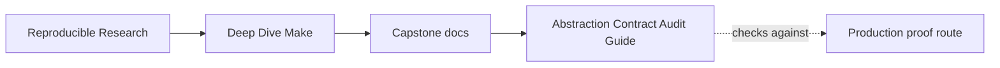
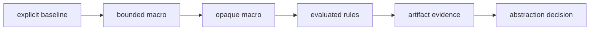
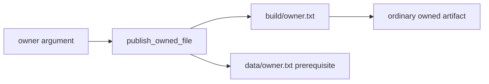

# Abstraction Contract Audit Guide

<!-- page-maps:start -->
## Guide Maps




<!-- page-maps:end -->

Use this audit when repeated Make rules invite `define`, `call`, and `eval`, but shorter
source text is not enough to justify the abstraction.

The audit asks:

> Does the generated graph preserve the explicit rule contract without creating targets,
> policy, or ownership that the call site does not reveal?

## Run the audit

From `capstone/`:

```sh
gmake abstraction-contract-audit
```

The generated bundle is:

```text
artifacts/audit/reproducible-research/deep-dive-make/abstraction-contracts/
```

Read it in this order:

1. `route.txt`
2. this guide
3. `summary.tsv`
4. one case in `report.json`
5. that case’s contract and database traces
6. its source specimen and built workspace

The bundle contains:

```text
ABSTRACTION_CONTRACT_AUDIT_GUIDE.md
summary.tsv
report.json
traces/
specimens/
workspace/
PROOF_GUIDE.md
manifest.json
route.txt
```

## What aggregate PASS means

All three cases must match their declared observations:

| Model | Required observation | Finding |
| --- | --- | --- |
| explicit rules | two explicit target/source pairs publish ordinary artifacts | `EXPLICIT_RULE_CONTRACT_CAPTURED` |
| bounded macro | generated rules preserve the same pairs, policy, and artifacts | `BOUNDED_MACRO_CONTRACT_PRESERVED` |
| opaque macro | generated rules add hidden targets and mutate artifact policy | `OPAQUE_MACRO_SIDE_EFFECTS_REPRODUCED` |

The opaque model is deliberately defective. Its case passes only when the audit reproduces
both hidden side effects. Never cite aggregate `PASS` as approval of every design.

## The explicit model establishes the contract

The baseline contains two ordinary rules:

```make
build/alpha.txt: data/alpha.txt | build/
	{ printf 'mode=%s\nsource=%s\n' '$(MODE)' '$<'; cat '$<'; } > '$@.tmp'
	mv '$@.tmp' '$@'

build/beta.txt: data/beta.txt | build/
	{ printf 'mode=%s\nsource=%s\n' '$(MODE)' '$<'; cat '$<'; } > '$@.tmp'
	mv '$@.tmp' '$@'
```

The important baseline is not “eight recipe lines.” It is:

| Target | Normal prerequisite | Policy | Publication |
| --- | --- | --- | --- |
| `build/alpha.txt` | `data/alpha.txt` | `ordinary` | temporary file, then rename |
| `build/beta.txt` | `data/beta.txt` | `ordinary` | temporary file, then rename |

The artifact contents repeat the policy and source binding:

```text
mode=ordinary
source=data/alpha.txt
owner=alpha
```

This is the behavior a proposed abstraction must preserve.

## The bounded macro has one responsibility

The control macro generates one publication rule:

```make
define publish_owned_file
build/$1.txt: data/$1.txt | build/
	{ printf 'mode=%s\nsource=%s\n' '$$(MODE)' '$$<'; cat '$$<'; } > '$$@.tmp'
	mv '$$@.tmp' '$$@'
endef
```

Its generated domain is visible:

```make
OWNERS := alpha beta
$(foreach owner,$(OWNERS),$(eval $(call publish_owned_file,$(owner))))
```

`show-contract` prints:

```text
mode=ordinary
outputs=build/alpha.txt build/beta.txt
macro-calls=publish_owned_file:alpha publish_owned_file:beta
```

The audit does not approve the macro because it is short. It approves the case because:

- both evaluated targets retain the expected source prerequisites
- no `publish-*` targets appear in the database
- artifact policy remains `ordinary`
- source and owner contents match the explicit baseline
- the call domain is printed for review



## The opaque macro crosses three responsibilities

The defect macro appears to define a component, but its body also contains:

```make
MODE := release

.PHONY: publish-$1
publish-$1: build/$1.txt
	@printf 'published=%s\n' '$1'
```

One call now:

1. defines an artifact rule
2. mutates global policy
3. creates another callable target

The normal `all` target still succeeds. Its artifacts reveal `mode=release`, and the
evaluated database contains `publish-alpha` and `publish-beta`. Help mentions neither
generated target.

```mermaid
flowchart TD
  call["define_component(alpha)"]
  call --> artifact["build/alpha.txt"]
  call --> policy["global MODE=release"]
  call --> hidden["publish-alpha"]
  hidden -.absent from.-> help["help output"]
```

The failure is not that `eval` was used. The failure is that the macro’s apparent rule
generation interface conceals unrelated architecture decisions.

## Read the evaluated database selectively

The audit runs:

```sh
gmake -npRr all
```

The options avoid execution, omit built-in rules and variables, and print the evaluated
database. The complete output is preserved in each `*-database.log`.

Do not read that file from top to bottom. Search for:

```text
build/alpha.txt:
build/beta.txt:
publish-alpha:
publish-beta:
```

For the publication targets, compare prerequisites with:

```text
build/alpha.txt: data/alpha.txt | build/
build/beta.txt: data/beta.txt | build/
```

The audit normalizes the order-only separator and stores the resulting map in
`report.json`.

## Separate source visibility from evaluated truth

Both views matter:

| View | Question it answers | What it cannot prove alone |
| --- | --- | --- |
| macro source | what the author appears to intend | which final rules exist |
| call sites | which arguments appear to generate rules | whether the macro has side effects |
| evaluated database | which targets and prerequisites Make knows | whether recipes publish correct bytes |
| artifact contents | which source and policy reached output | whether hidden targets also exist |
| help output | which targets are promised publicly | whether private generated targets are reachable |

A review packet needs enough of these views to test the actual concern.

## Use the rejection tests

Run:

```sh
gmake abstraction-contract-selftest
```

The seven tests include five dishonesty mutations:

- add a hidden publication target to the bounded model
- change its global policy
- remove its visible call-domain evidence
- remove the opaque model’s hidden publication surface
- remove the opaque model’s policy side effect

The first three must make a control fail. The final two must make the defect reproduction
fail. This proves the audit discriminates both directions.

## Abstraction decision table

| Observation | Decision pressure |
| --- | --- |
| repeated explicit rules differ in semantic edges | keep them explicit until the contract is understood |
| generated target/prerequisite pairs equal the baseline | macro remains a candidate |
| call domain is not locally visible | expose it or keep rules explicit |
| macro mutates policy | separate policy ownership before reuse |
| macro creates unrelated callable targets | split the abstraction by responsibility |
| only artifact bytes match | inspect the database before accepting |
| only the database matches | inspect publication behavior before accepting |

The result may still be “keep the explicit rules.” That is a successful architecture
decision when the abstraction cost exceeds the invariant it protects.

## Review checkpoint

Before accepting a rule-generating macro, record:

| Contract field | Required evidence |
| --- | --- |
| generated domain | owner list and call sites |
| target mapping | evaluated target/prerequisite map |
| policy ownership | contract trace and artifact mode |
| publication behavior | build trace and final contents |
| public surface | help output compared with generated targets |
| gate behavior | acceptance and rejection tests |

If a field is irrelevant, state why. Do not silently omit it.

## Limits of this audit

The specimens are intentionally small. They do not claim that:

- all `eval` usage is opaque
- explicit rules are always easier to maintain
- database text is a stable machine interface across every Make implementation
- these three cases cover dynamic discovery, secondary expansion, or generated includes

They provide a review method: establish an explicit contract, compare evaluated graph and
artifacts, then test whether the evidence gate rejects dishonesty.

## End-of-guide checkpoint

You are ready to use this audit when you can explain:

- why the explicit model is a contract rather than the preferred answer by default
- which observations make the bounded macro equivalent
- how the opaque macro changes both policy and target surface
- why `make -p` and artifact contents answer different questions
- which rejection test would fail if a bounded macro gained a hidden target
