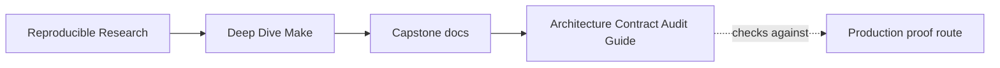
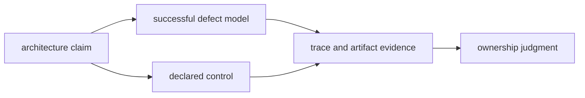
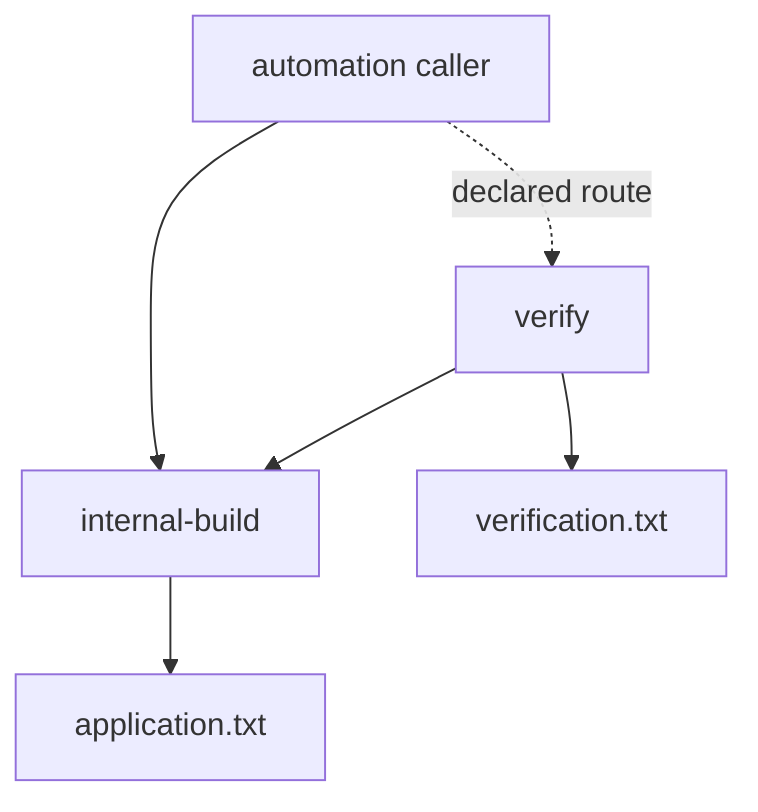
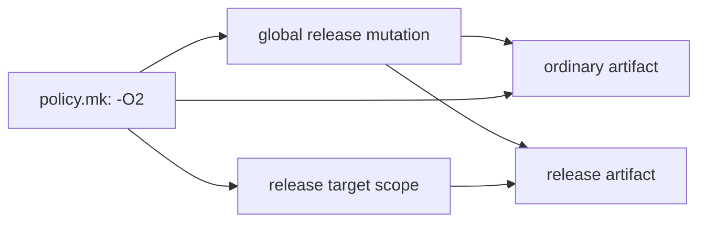
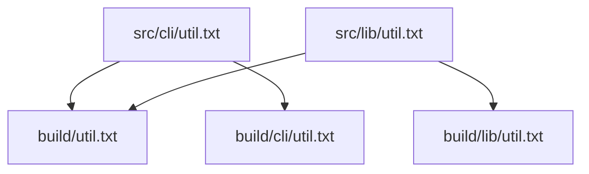

# Architecture Contract Audit Guide

<!-- page-maps:start -->
## Guide Maps




<!-- page-maps:end -->

Use this audit when a Make build still succeeds but its architecture may no longer tell
the truth about:

- which targets external callers may rely on
- which include layer owns a policy value
- which subsystem owns each generated output path

The audit asks one question throughout:

> Can another maintainer infer ownership from the public surface and graph, or does
> successful execution depend on private knowledge?

## Run the audit

From `capstone/`:

```sh
gmake architecture-contract-audit
```

The generated bundle is:

```text
artifacts/audit/reproducible-research/deep-dive-make/architecture-contracts/
```

Read it in this order:

1. `route.txt`
2. this guide
3. `summary.tsv`
4. the relevant row in `report.json`
5. that row's trace
6. the matching specimen and workspace

The bundle contains:

```text
ARCHITECTURE_CONTRACT_AUDIT_GUIDE.md
summary.tsv
report.json
traces/
specimens/
workspace/
REPRO_GUIDE.md
PROOF_GUIDE.md
manifest.json
route.txt
```

## What aggregate PASS means

`PASS` means all six models produced their declared observations. Some observations are
deliberate defects.

| Finding form | Meaning |
| --- | --- |
| `*_REPRODUCED` or `*_COLLAPSED` | the broken model exhibited the promised architecture defect |
| `*_HONORED` or `*_PRESERVED` | the control kept its declared ownership boundary |

Never quote only the aggregate result. Quote the finding and the observation that supports
it.

## Expected comparison matrix

| Family | Model | Successful observation | Finding |
| --- | --- | --- | --- |
| public API | private caller | application exists, verification absent | `PRIVATE_TARGET_DEPENDENCE_REPRODUCED` |
| public API | declared caller | application and verification both exist | `PUBLIC_TARGET_CONTRACT_HONORED` |
| include ownership | global mutation | ordinary and release artifacts both contain release flags | `CROSS_LAYER_POLICY_LEAK_REPRODUCED` |
| include ownership | target-scoped policy | ordinary flags stay ordinary; release flags stay release-specific | `TARGET_SCOPED_POLICY_PRESERVED` |
| output ownership | flat output | two source owners collapse into one output and one surviving owner | `FLAT_OUTPUT_OWNERSHIP_COLLAPSED` |
| output ownership | namespaced output | each source root publishes to its own output namespace | `SUBSYSTEM_OUTPUT_OWNERSHIP_PRESERVED` |

## Public targets are promises, not reachable nodes

Both public-API Makefiles contain an internal target that can build the application.
Both also publish this help surface:

```text
help    show the supported build interface
verify  build and verify the application
```

The broken automation calls `internal-build` directly. The command exits zero and creates
`build/application.txt`, but it never creates `build/verification.txt`.



This is architecture drift even though the helper works. Automation has converted an
undocumented implementation detail into a dependency and bypassed the public target's
meaning.

The control calls `verify`. It reaches the same application build and publishes the
verification evidence promised by the interface.

### What to inspect

Read:

- `traces/public-api-private-caller-help.log`
- `traces/public-api-private-caller-caller.log`
- `workspace/public-api/private-caller/build/`

Then compare the declared-caller equivalents.

The useful question is not “could the caller reach a target?” It is:

> Did the caller use a documented promise, and did that promise publish all of its
> required evidence?

## Include order can leak policy without a parse error

The broken model includes:

```make
include mk/policy.mk
include mk/release.mk
include mk/artifacts.mk
```

`policy.mk` declares:

```make
CFLAGS := -O2
```

`release.mk` then mutates the same global value:

```make
CFLAGS += -DRELEASE
```

Merely including the release layer changes the ordinary `all` artifact. Both outputs
contain:

```text
flags=-O2 -DRELEASE
```

The control gives the release target a target-specific value:

```make
release: CFLAGS += -DRELEASE
```

Target-specific variables propagate to that target's prerequisites, so the release
artifact receives the release policy while the ordinary artifact remains `-O2`.



The lesson is not that target-specific variables are always the right design. The lesson
is that ownership and scope must match. A release-only decision should not silently
change every target because a file was parsed.

### What to inspect

Compare:

- `workspace/include-ownership/global-mutation/build/default.txt`
- `workspace/include-ownership/global-mutation/build/release.txt`
- `workspace/include-ownership/target-scoped-policy/build/default.txt`
- `workspace/include-ownership/target-scoped-policy/build/release.txt`

The trace shows which recipes ran. The files prove which policy reached each artifact.

## Output paths encode ownership

Both output-ownership models discover:

```text
src/cli/util.txt
src/lib/util.txt
```

The broken mapping applies `notdir` and produces one unique target:

```make
OUTPUTS := $(sort $(addprefix build/,$(notdir $(SOURCES))))
```

The result is only:

```text
build/util.txt
```

The recipe chooses the first prerequisite, so the CLI owner survives and the library
owner disappears. No command fails. The path design erased ownership before the recipe
ran.

The control preserves the source-root suffix:

```make
OUTPUTS := $(patsubst src/%,build/%,$(SOURCES))
```

It publishes:

```text
build/cli/util.txt
build/lib/util.txt
```



Flat naming is not automatically wrong. It is wrong when distinct owners can map to the
same public path without an explicit merge contract.

## Read evidence by question

| Question | Best evidence |
| --- | --- |
| what does the public interface promise? | help trace |
| what did automation actually call? | caller trace |
| which policy reached each artifact? | default and release files |
| how many source owners were declared? | `show-map` trace |
| how many output owners survived? | output paths and file contents |

Do not use `make -p` as a substitute for artifact evidence. It can reveal the evaluated
world, but the architecture claim includes what callers did and what outputs were
published.

## Repair decision table

| Observation | Interpretation | Repair direction |
| --- | --- | --- |
| automation succeeds without promised verification | caller depends on a private helper | call a documented public target or deliberately promote a stable contract |
| low-level target appears in help only because CI calls it | documentation is hiding interface drift | repair the caller before enlarging the API |
| ordinary artifact contains release-only policy | include layer mutates a value outside its scope | move the policy to the owning target or explicit profile |
| two source roots produce one output basename | output mapping erased ownership | preserve rooted namespaces or define an explicit merge owner |
| namespaced outputs exist but callers still guess paths | file layout is not yet an interface | document stable artifact paths and verification route |

## Limits of this audit

The audit does not prove:

- that the capstone's complete public target list is ideal
- that every variable has exactly one owner
- that target-specific variables fit every policy boundary
- that namespaced paths alone make a graph correct
- that macros and generated rules remain reviewable

It proves three narrower architecture contracts with controlled comparisons. Use
`contract-audit` for the capstone's full public surface, `profile-audit` for variable
origins, and `selftest` for production graph behavior.

## Review checkpoint

Before leaving the bundle, explain:

1. why the private caller's exit status is not enough
2. why adding `internal-build` to help would not automatically repair the API
3. why include order is semantic even when every file parses
4. why release policy should not leak into the ordinary artifact
5. why two declared inputs and one successful output can still prove ownership loss
6. why namespaced output paths are evidence of ownership, not proof of all dependencies

If an answer relies only on prettier file layout, return to the traces and artifacts.
