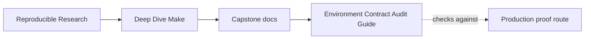
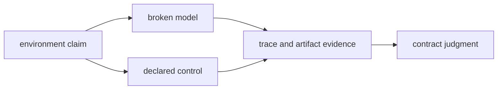
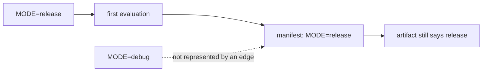
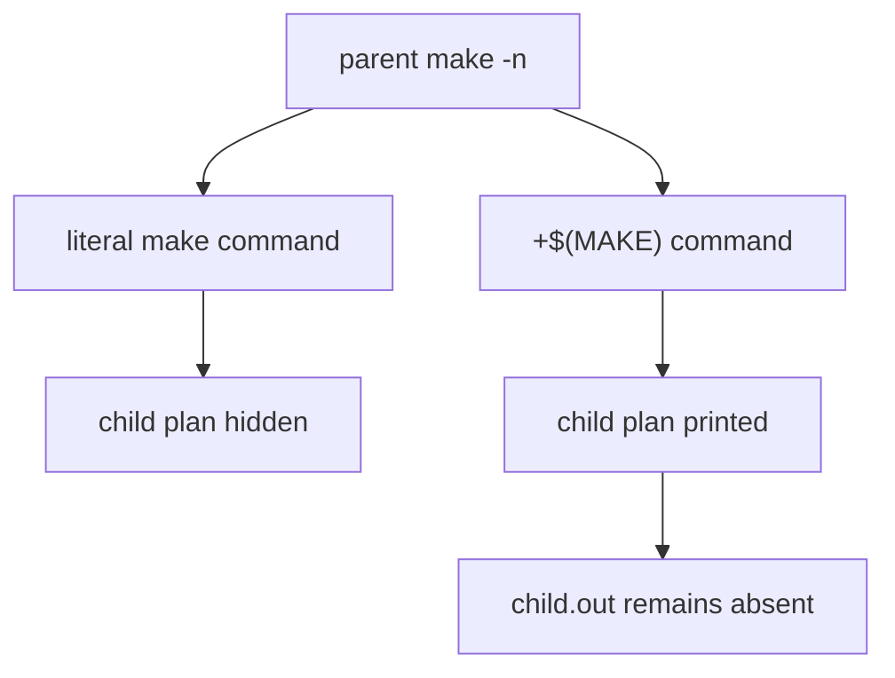

# Environment Contract Audit Guide

<!-- page-maps:start -->
## Guide Maps




<!-- page-maps:end -->

Use this audit when a build depends on facts that are not ordinary source files:

- command-line or environment values that change artifact meaning
- recursive Make boundaries that must remain visible under `-n` and `-j`
- external tools that must be present before publication begins

The audit asks one question throughout:

> Does the build declare when an external fact is evaluated, how it changes work, and
> where failure must stop?

## Run the audit

From `capstone/`:

```sh
gmake environment-contract-audit
```

From the program directory:

```sh
gmake capstone-environment-contract-audit
```

Read the generated bundle at:

```text
artifacts/audit/reproducible-research/deep-dive-make/environment-contracts/
```

The bundle contains:

```text
ENVIRONMENT_CONTRACT_AUDIT_GUIDE.md
summary.tsv
report.json
traces/
specimens/
workspace/
REPRO_GUIDE.md
PROOF_GUIDE.md
manifest.json
route.txt
```

## What aggregate PASS means

`PASS` means every observed behavior matched its declared model. It does not mean every
model is healthy.

| Finding form | Meaning |
| --- | --- |
| `*_REPRODUCED` or `*_LEFT_RESIDUE` | the broken model exhibited its promised defect |
| `*_REFRESHED` | a changed non-file fact propagated to the artifact |
| `*_EXPOSES_*` | the recursive control revealed its child plan |
| `*_REJECTED_EARLY` | the contract gate stopped before publication |
| `*_ACCEPTED` | an available required tool passed the same gate |

Read each defect beside its control. A broken row without a control proves only that
something went wrong; a paired row explains which contract repairs it.

## Expected comparison matrix

| Family | Model | Observation | Finding |
| --- | --- | --- | --- |
| non-file state | stale manifest | request `debug`, retain `release`, no rebuild | `STALE_NON_FILE_STATE_REPRODUCED` |
| non-file state | reevaluated manifest | request `debug`, publish `debug`, rebuild once | `NON_FILE_STATE_REFRESHED` |
| recursive boundary | literal recursion | dry run prints only the parent command | `LITERAL_RECURSION_HIDES_CHILD_PLAN` |
| recursive boundary | declared recursion | dry run reveals the child recipe without publishing | `DECLARED_RECURSION_EXPOSES_CHILD_PLAN` |
| required tool | late tool check | shell failure leaves an empty version file | `LATE_TOOL_FAILURE_LEFT_RESIDUE` |
| required tool | missing contract gate | deliberate message, no publication files | `REQUIRED_TOOL_REJECTED_EARLY` |
| required tool | available contract gate | interpreter version and result are published | `REQUIRED_TOOL_ACCEPTED` |

## Non-file state needs an evaluation trigger

The broken model creates its manifest once:

```make
$(MANIFEST): | build/
	printf 'MODE=%s\n' '$(MODE)' > $@
```

The first invocation uses `MODE=release`. A later invocation requests `MODE=debug`, but
the manifest has no prerequisite that became newer. Make has no reason to run the recipe
again.



The build exits zero and reports no work. That is the failure signature: command-line
intent changed while the graph retained old semantic state.

The control separates evaluation from publication:

```make
.PHONY: FORCE
FORCE:

$(MANIFEST): FORCE | build/
	printf 'MODE=%s\n' '$(MODE)' > $@.candidate
	cmp -s $@.candidate $@ 2>/dev/null || mv $@.candidate $@
	rm -f $@.candidate
```

`FORCE` makes the recipe inspect `MODE` on every invocation. `cmp` preserves the existing
file and mtime when the value is equal.

The audit runs three observations:

1. create state with `MODE=release`
2. request `MODE=debug`
3. request `MODE=debug` again

The control must rebuild the artifact for the changed value and must not rebuild it for
the repeated equal value. A design that always rewrites the manifest fixes staleness but
destroys convergence.

## Recursive intent must remain visible

The two parent Makefiles differ at the recursive recipe:

```make
# Literal process invocation
$(MAKE_BIN) -C child all
```

```make
# Declared recursive Make boundary
+$(MAKE) -C child all
```

Under `-n`, the literal route prints the parent command but does not traverse the child
plan. The declared route invokes the child in dry-run mode, so the child recipe appears
without creating `child.out`.



The report records `MAKELEVEL` from the actual child run. The expected value is relative:
the child must be exactly one Make level below the process running the audit. A direct
capstone invocation and a program-level wrapper legitimately produce different absolute
numbers.

### GNU Make 4.4 jobserver nuance

On systems using GNU Make 4.4's FIFO jobserver, a literal `gmake` process may happen to
inherit `-j2` and jobserver information through the environment. That observation does
not make the literal form a declared recursive boundary.

Older pipe-based jobservers and other invocation contexts may not preserve the same
resources. More importantly, the literal route still hides the child plan under `-n`.

Use the evidence carefully:

- `MAKEFLAGS` shows what this run inherited
- `$(MAKE)` declares recursive intent to the parent
- `+` makes the recursive line execute under dry-run modes
- a successful inheritance on one host is not a portability contract

## Required tools should fail before publication

The late-check model enters the artifact recipe before discovering the tool is missing:

```make
$(RESULT): | build/
	$(REQUIRED_TOOL) --version > build/tool-version.txt
	printf 'result=complete\n' > $@
```

The shell creates `tool-version.txt` for redirection before it tries to execute the
missing command. The command then fails, leaving a zero-byte file.

That empty file is not harmless. A later check that asks only whether the path exists may
mistake residue for evidence.

The contract gate moves the boundary ahead of publication:

```make
.PHONY: contract-check
contract-check:
	@command -v "$(REQUIRED_TOOL)" >/dev/null 2>&1 || { \
	  printf 'contract: missing required tool %s\n' "$(REQUIRED_TOOL)" >&2; \
	  exit 2; \
	}
```

The missing-tool case must satisfy all three conditions:

- nonzero exit
- deliberate contract message
- no version or result file

The available-tool case uses the same gate with Python and must publish both files. This
prevents a gate that rejects everything from being mistaken for a valid contract.

## Read the traces by question

| Family | Trace question |
| --- | --- |
| non-file state | did Make evaluate the manifest, and did artifact publication follow only a changed value? |
| recursive boundary | did dry-run output enter the child graph without creating its output? |
| required tool | did failure occur at the contract boundary or inside publication? |

Trace establishes what Make selected. Files and hashes establish the semantic consequence.
Use both.

## Repair decision table

| Observation | Interpretation | Repair |
| --- | --- | --- |
| command-line value changes but manifest remains old | non-file state is never reevaluated | add an evaluation trigger and change-only publication |
| manifest and artifact rewrite for equal state | evaluation and publication were collapsed | compare candidate content before replacing the file |
| parent dry run never shows child recipes | recursion is hidden from the planning route | use `+$(MAKE)` at a declared boundary |
| literal recursion inherits jobserver flags on one host | current transport happened to survive | keep the observation, but declare recursion with `$(MAKE)` |
| missing tool leaves empty or partial files | requirement checked after publication began | add a fail-fast contract target |
| gate fails even when the tool exists | rejection path is not paired with acceptance | test both missing and available cases |

## Limits of this audit

The audit does not prove:

- that every environment variable affecting the real capstone has been modeled
- that recursive Make is the right architecture for every subtree
- that one available interpreter is compatible with every script
- that inherited jobserver details will be identical across GNU Make versions

It proves narrower contracts with controlled specimens. Use `profile-audit` for the
capstone's declared policy and `selftest` for the production graph.

## Review checkpoint

Before leaving the bundle, explain:

1. why a no-op stale build can still exit zero
2. why `FORCE` and `cmp` solve different parts of non-file state
3. why absolute `MAKELEVEL` is less useful than the parent-child relationship
4. why observed FIFO inheritance does not replace `$(MAKE)`
5. why a zero-byte version file proves the tool check ran too late
6. why the available-tool row is necessary to trust the rejection gate

If any answer depends only on a command's exit status, return to the paired artifact and
trace evidence.
