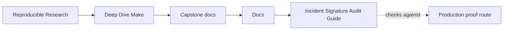
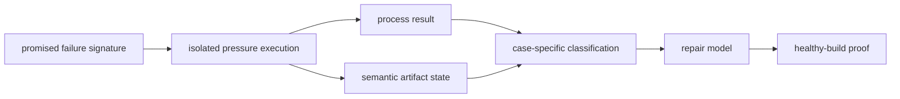
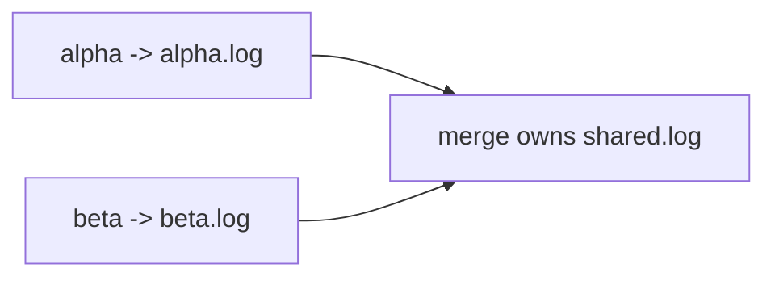

# Incident Signature Audit Guide

<!-- page-maps:start -->
## Guide Maps




<!-- page-maps:end -->

Use this guide when you need to learn how an incident packet proves a failure class. The
audit does not treat every nonzero command as useful evidence, and it does not treat exit
status `0` as evidence of correctness. It executes three deliberately broken concurrency
models and checks a different semantic signature for each one.

The central review question is:

> Did the controlled run exhibit the exact failure mechanism the specimen promises, and
> which preserved evidence proves that claim?

## Run the complete matrix

From `capstone/`:

```sh
gmake incident-audit
```

The bundle is written to:

```text
artifacts/audit/reproducible-research/deep-dive-make/incident/
```

To isolate one case while learning its evidence:

```sh
gmake incident-audit INCIDENT_CASE=shared-log-interleaving
gmake incident-audit INCIDENT_CASE=directory-creation-race
gmake incident-audit INCIDENT_CASE=shared-staging-collision
```

Case names are part of the teaching contract. The target does not accept an arbitrary
Makefile and then pretend to know what its output means.

## What PASS means

`PASS` means every selected specimen matched both:

1. its expected process outcome
2. its expected semantic or filesystem signature

It does **not** mean the specimens are healthy. Each row should report a finding ending
in `_REPRODUCED`.

The complete matrix should have this shape:

| Case | Expected exit | Required semantic signature | Finding |
| --- | --- | --- | --- |
| shared log interleaving | zero | both writers start before either writer completes | `SEMANTIC_CORRUPTION_REPRODUCED` |
| directory creation race | nonzero | exactly one claimant publishes its file | `DIRECTORY_RACE_REPRODUCED` |
| shared staging collision | nonzero | `y.out` survives while `x.out` and the shared staging path do not | `STAGING_COLLISION_REPRODUCED` |

This distinction prevents two common audit failures:

- calling any failed command a successful reproduction
- calling a successful command a healthy build without checking its outputs

## Read the bundle in evidence order

Read:

1. `route.txt`
2. `summary.tsv`
3. `report.json`
4. the named file under `runs/`
5. the named file under `evidence/`
6. the corresponding directory under `workspace/`
7. the corresponding source under `specimens/`
8. `repair-surfaces.txt`
9. `REPRO_GUIDE.md`
10. `PROOF_GUIDE.md`

The summary gives you the comparison before raw detail. The report tells you exactly
which observations were asserted. The raw log and semantic artifact then let you verify
that classification yourself.

## Separate three evidence layers

An incident review becomes clearer when you keep these layers separate:

| Layer | Question | Example |
| --- | --- | --- |
| process | did the invoked route return zero? | `exit_status` in `report.json` |
| mechanism | did the promised conflict occur? | interleaved writer records or one surviving claimant |
| impact | what trusted state was wrong, absent, or ambiguous? | `shared.log`, missing `x.out`, or incomplete directory contents |

A process failure can occur for the wrong reason. A process success can leave corrupt
state. The mechanism and impact layers are what turn output into an incident claim.

## Review the shared-log case

Open:

```text
evidence/shared-log-interleaving/shared.log
runs/shared-log-interleaving.log
workspace/shared-log-interleaving/incident.mk
```

The specimen uses a barrier so both independently schedulable writers publish a `start`
record before either publishes its `end` record. A valid observed sequence is:

```text
alpha:start
beta:start
alpha:end
beta:end
```

The order of the two starts and the two ends may differ. The invariant is that the first
two records are starts and the last two are ends. Neither writer owns a contiguous record
block.

The command exits `0`. That is part of the lesson: shell success says the append calls
completed, not that the resulting artifact has one owner or a valid publication contract.

Classify this as publication ownership. A repair usually gives each worker a private file
and gives one merge target ownership of the final log:



`--output-sync` may improve console attribution. It cannot repair recipes that mutate the
same undeclared file.

## Review the directory-creation race

Open:

```text
evidence/directory-creation-race/surviving-files.txt
runs/directory-creation-race.log
workspace/directory-creation-race/dir/
```

Both file targets wait at a barrier and then run `mkdir dir`. One recipe creates the
directory; the other recipe fails because it independently claims the same setup action.
Exactly one of `dir/file1` and `dir/file2` should survive.

The nonzero exit is necessary but insufficient. The audit also checks that one claimant
published and one did not. If the command failed before either output existed, the
promised race would not be proven.

Classify this as graph ownership. The durable repair gives the directory one target and
uses it as an order-only prerequisite:

```make
dir/file1 dir/file2: | dir/

dir/:
	mkdir -p $@
```

The order-only edge expresses setup ordering without making directory timestamp changes
invalidate both files.

## Review the shared-staging case

Open:

```text
evidence/shared-staging-collision/publication-state.json
runs/shared-staging-collision.log
workspace/shared-staging-collision/
```

Both targets publish through `shared.staging`. The barrier ensures both have reached that
shared path, then `y` moves it first. The delayed `x` move fails because the staging path
has already been consumed.

The required state is:

```json
{
  "files": {
    "shared.staging": false,
    "x.out": false,
    "y.out": true
  }
}
```

This is not merely a command-order problem. The two targets have been given one mutable
publication path. The repair is private staging followed by target-owned publication:

```make
x.out:
	printf 'X\n' > $@.staging
	mv -f $@.staging $@

y.out:
	printf 'Y\n' > $@.staging
	mv -f $@.staging $@
```

If the intended result is one combined artifact, use private worker outputs and one
explicit merge target instead.

## Use the report as a claim ledger

For each case, `report.json` records:

| Field | Review use |
| --- | --- |
| `command` | reproduces the exact pressure route |
| `expected_exit` | states whether process success or failure is part of the contract |
| `exit_status` | records the observed process result |
| `exit_matches` | checks the process result against the case contract |
| `observation` | records the semantic evidence and its artifact path |
| `signature_matches` | checks whether the promised mechanism appeared |
| `finding` | names the failure class demonstrated |
| `boundary` | routes repair ownership |
| `result` | combines process and semantic assertions |

Do not quote only `result`. A review should name the observation that made the result
credible.

## Compete explanations before repairing

For a failed concurrency route, compare at least these explanations:

| Explanation | Evidence expected if true | Evidence that weakens it |
| --- | --- | --- |
| shared output ownership | two runnable targets mutate one path | private outputs and one declared publication owner |
| missing setup ownership | peers repeat the same directory action | one directory target orders both consumers |
| scheduler defect | complete graph and unique outputs still produce invalid ordering | fault disappears after ownership repair without scheduler changes |
| storage failure | errors appear outside the controlled ownership conflict | incident follows the same graph defect in isolated local workspaces |

The specimens deliberately strengthen the first two explanations. They do not prove that
an unrelated production incident has the same cause.

## Do not repair the specimen

The broken Makefiles are controlled teaching instruments. Keep them broken and connect
their failure class to the healthy capstone:

- directory ownership is modeled in `mk/objects.mk`
- isolated generated publication is modeled in `mk/stamps.mk`
- repeated serial and parallel behavior is checked by `selftest-report`
- production target meaning is reviewed through `contract-audit`

The repro proves that a mechanism can fail. The healthy-build route proves that the
reference build avoids that mechanism under its declared contract.

## Close an incident with adjacent proof

After repairing the real build, verify more than the original symptom:

1. repeat the original pressure route from a controlled starting state
2. assert the semantic artifact, not only the exit status
3. compare serial and parallel outputs when the contract requires equivalence
4. verify one writer for every trusted output
5. run the route again and confirm convergence
6. exercise failure cleanup for staged publication
7. retain the incident packet and name the follow-up owner

A disappearing error message is not closure if artifact ownership remains ambiguous.

## Proof limits

This audit does not prove:

- every possible schedule has been explored
- network filesystems behave like the local workspace
- the healthy capstone has no concurrency defects
- serial execution is an acceptable permanent repair
- console output synchronization repairs shared semantic outputs

It proves that three named defect classes are reproducible with explicit signatures and
that a learner can review those signatures after execution.

## Review checkpoint

Before leaving the bundle, write one row per case:

| Case | Process result | Semantic observation | Boundary | Repair shape | Healthy proof |
| --- | --- | --- | --- | --- | --- |
| shared log | | | | | |
| directory race | | | | | |
| staging collision | | | | | |

If the semantic observation column contains only “exit `0`” or “exit nonzero,” review the
artifact again. The incident has not yet been explained.
