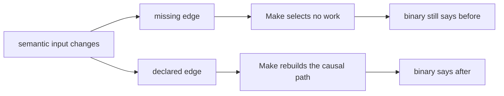
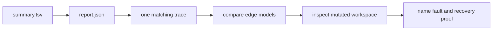

# Incremental Fault Audit Guide

<!-- page-maps:start -->
## Guide Maps




<!-- page-maps:end -->

Use this guide when “the build succeeded” is not enough. The audit asks a narrower
question:

> After one semantic input changes, can the build distinguish a missing edge from a
> declared edge by observing selected work and final behavior?

Run the route from `capstone/`:

```sh
gmake incremental-fault-audit
```

The route works only in copied artifact workspaces. It does not mutate the capstone's
tracked source files.

## Read the bundle in decision order

Open
`artifacts/audit/reproducible-research/deep-dive-make/incremental-faults/`
in this order:

1. `summary.tsv`
2. `report.json`
3. one matching file under `traces/`
4. the corresponding makefiles under `specimens/`
5. the mutated files and outputs under `workspace/`
6. `manifest.json`

Do not start by reading every makefile. First establish what happened, then use the model
to explain why.

## Interpret audit PASS correctly

The bundle executes four cases:

| Specimen | Model | Input mutation | Expected observation | Finding |
| --- | --- | --- | --- | --- |
| authored header | missing edge | `config.h`: `before` to `after` | binary remains `before`; no governed output changes | `FAULT_REPRODUCED` |
| authored header | declared edge | same mutation | `app` changes and prints `after` | `REPAIR_VERIFIED` |
| generated producer | missing edge | generator script: `before` to `after` | header and binary remain stale | `FAULT_REPRODUCED` |
| generated producer | declared edge | same mutation | header and binary change and print `after` | `REPAIR_VERIFIED` |

`result=PASS` means the audit observed the behavior promised by that specimen. It does not
mean the missing-edge model is healthy. Read `finding` before making a correctness claim:

- `FAULT_REPRODUCED` means the controlled defect remained stale exactly as predicted
- `REPAIR_VERIFIED` means the declared graph propagated the same semantic change

This distinction lets the harness test its own ability to discriminate. A fault laboratory
that only runs repaired examples cannot prove that its evidence would expose a missing
edge.

## Diagnose the authored-header case

Both models compile the same `main.c`, which includes `config.h`. Their recipes are
identical. The graph is the only meaningful difference:

```make
# missing-edge.mk
app: main.c

# declared-edge.mk
app: main.c config.h
```

After the audit changes `config.h`, the missing-edge trace says there is nothing to do.
The old binary still prints `before`. The command succeeded because Make answered the
graph it was given; the graph omitted a semantic input.

The declared-edge trace names `config.h` as the reason for updating `app`. The new binary
prints `after`. This proves both causality and refreshed behavior.

In a larger C build, generated dependency files usually carry this edge for each object.
The repair is not “touch every object” or “always clean.” The repair is to generate,
include, and test truthful compiler dependency data.

## Diagnose the generated-producer case

Both generated-producer models declare that `app` consumes `generated.h`. The disputed
edge sits one level earlier:

```make
# missing-edge.mk
generated.h:

# declared-edge.mk
generated.h: scripts/render_header.py
```

When the script changes, the missing-edge graph sees no reason to regenerate the header.
Because `generated.h` remains unchanged, the consumer also remains unchanged. The stale
result crosses two targets even though the consumer edge itself is correct.

The declared model exposes the full causal chain in its trace:

```text
scripts/render_header.py -> generated.h -> app
```

The changed-output set must therefore contain both `generated.h` and `app`. If only the
binary changed, the generator boundary would still be unexplained. If only the header
changed, the consumer edge would still be broken.

## Use traces to explain, not merely to label

A missing-edge trace can be almost empty. That emptiness is evidence when paired with:

- a semantic input whose content definitely changed
- an unchanged governed output
- a final program that still reports old behavior
- a declared-edge control that refreshes under the same mutation

Trace alone cannot prove stale semantics. Output alone cannot identify the missing edge.
The audit binds both.

For a declared edge, look for a complete causal path. Do not stop at “something rebuilt.”
Name the input, each selected target, and the final behavior that changed.

## Compare models without inventing extra causes

The copied `specimens/` directory preserves the clean teaching inputs. The `workspace/`
directory preserves each model after mutation and execution. Compare:

```sh
diff -u \
  specimens/authored-header/missing-edge.mk \
  specimens/authored-header/declared-edge.mk
```

Then repeat the comparison for `generated-producer`. The intended difference is one
prerequisite declaration. If recipes or source content also differed, the laboratory would
no longer isolate graph truth.

## What this route proves

The route proves that:

- both missing-edge models can reproduce stale behavior deterministically
- both declared-edge models propagate the same semantic mutations
- selected work agrees with final observed behavior
- causal traces and changed-output classifications are retained
- the source specimens remain separate from mutated execution workspaces

It does not prove that every edge in the real capstone is correct. Use
`performance-incremental` for the capstone's governed input classes and `selftest` for its
broader build invariants. This route teaches and tests the failure mechanism those
production routes are expected to reject.

## Review checkpoint

Before leaving the bundle, explain both failures without using the phrase “Make did not
notice”:

1. Which semantic input changed?
2. Which prerequisite declaration was absent?
3. Why did Make select no work?
4. Which governed outputs stayed stale?
5. What complete causal path appears after the edge is declared?

If the answer names only the final binary, revisit the generated-producer case. Its defect
begins at the producer boundary, not at the consumer recipe.
