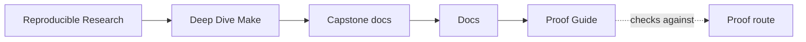
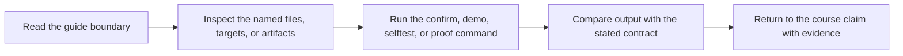

# Proof Guide

<!-- page-maps:start -->
## Guide Maps

<!-- page-maps:end -->

This capstone exists to corroborate build-system claims, not just to compile a small C
program. Use this guide when you know the question you want answered and need the shortest
honest route from that question to evidence.

When you do need the full sanctioned bundle set, run `make proof`. Most of the time,
start narrower.

---

## Start from the claim

| Claim | Smallest honest route | Read these first |
| --- | --- | --- |
| what is publicly promised here | `make inspect` | `CONTRACT_AUDIT_GUIDE.md`, `TARGET_GUIDE.md`, `help.txt` |
| the build converges after success | `make selftest` | `tests/run.sh`, `mk/stamps.mk` |
| serial and parallel schedules produce the same result | `make selftest` | `schedule-comparison.json`, both inventory files, `tests/run.sh` |
| the selftest rejects a known schedule defect | `make selftest-harness-tests` | rejected comparison report, failure summary, preserved workspace |
| one candidate matches exact package and identity policy | `make verify-dist` | `RELEASE_GUIDE.md`, package policy, candidate acceptance report |
| install remains contained and converges on rerun | `make install-rehearsal` | install policy, install acceptance report |
| malformed release inputs fail at the expected boundary | `make release-selftest` | release tests and rejection output |
| the full local release claim holds | `make release-check` | release acceptance record and `RELEASE_GUIDE.md` |
| governed local build-cost evidence is attributable and reviewable | `make perf` | `PERFORMANCE_EVIDENCE_GUIDE.md`, impact summary, `evidence.json`, then timing summary |
| every declared input class selects its required rebuild scope | `make performance-incremental` | policy, `incremental-summary.tsv`, then the relevant case in `incremental-work.json` |
| two build-cost bundles have compatible context and equivalent work | `make performance-compare` | execution context, complete case sets, inventories, then scenario deltas |
| performance gates reject dishonest evidence | `make performance-selftest` | context, incremental, capture, and comparison rejection tests |
| clean planning evidence retains causal attribution | `make trace-report` | trace report, raw trace, and manifest |
| proof can be reviewed later without rerunning commands | `make verify-report` | `SELFTEST_GUIDE.md`, `summary.txt`, `commands.txt`, `logs/` |
| missing generated-producer edges cause stale consumers and declared edges recover | `make incremental-fault-audit` | fault summary, paired producer models, traces, and mutated workspaces |
| the public contract is explicit enough for another engineer | `make contract-audit` | `README.md`, `TARGET_GUIDE.md`, `portability.txt`, `discovery.txt` |
| variable and execution-policy assumptions are reviewable | `make profile-audit` | `PROFILE_AUDIT_GUIDE.md`, `mk/contract.mk`, `origins.txt` |
| concurrency specimens exhibit their promised failure mechanisms | `make incident-audit` | incident summary, report, semantic evidence, raw logs, and preserved workspaces |
| the capstone can be entered without browsing randomly | `make walkthrough` | `WALKTHROUGH_GUIDE.md`, `README.md`, `TARGET_GUIDE.md` |
| this repository still deserves stewardship trust | `make confirm` | `PROOF_GUIDE.md`, `tests/run.sh`, audit bundles as needed |

---

## Good reading order

Use this order when the repository is new but the ideas are not:

1. `README.md` for the repository contract
2. [TARGET_GUIDE.md](target-guide.md) for the public target surface
3. this page for claim-to-route selection
4. `tests/run.sh` for the executed proof harness
5. [ARCHITECTURE.md](architecture.md) and `mk/contract.mk` for ownership and boundary rules
6. the audit or repro guide that matches the current question

That keeps claim, route, and evidence ahead of implementation detail.

---

## Route selection rules

- choose `walkthrough` for first contact
- choose `inspect` for contract review
- choose `selftest` for build-truth proof
- choose `selftest-harness-tests` when the open question is whether the proof gate rejects dishonesty
- choose `verify-dist` for one existing candidate
- choose `release-selftest` for acceptance and rejection behavior
- choose `release-check` for the complete local release claim
- choose `perf` to establish a local baseline without claiming a regression
- choose `performance-compare` only when an earlier clean bundle from the same toolchain and runner exists
- choose `performance-selftest` when the question is whether provenance, requested-work, capture, and comparison gates close
- choose `verify-report` when the proof needs to be saved
- choose `incident-audit` when process status and semantic artifact state must jointly prove a concurrency failure class
- choose `profile-audit` for portability, policy, and precedence questions
- choose `proof` only when the question genuinely spans multiple bundles
- choose `confirm` when stewardship review needs the strongest built-in route

---

## Companion surfaces

Read these with this guide:

- `README.md`
- [TARGET_GUIDE.md](target-guide.md)
- [RELEASE_GUIDE.md](release-guide.md)
- [WALKTHROUGH_GUIDE.md](walkthrough-guide.md)
- [CONTRACT_AUDIT_GUIDE.md](contract-audit-guide.md)
- [INCIDENT_REVIEW_GUIDE.md](incident-review-guide.md)
- [PERFORMANCE_EVIDENCE_GUIDE.md](performance-evidence-guide.md)
- [PROFILE_AUDIT_GUIDE.md](profile-audit-guide.md)
- [SELFTEST_GUIDE.md](selftest-guide.md)
