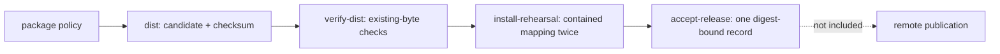

# Release Acceptance Guide

Use this guide when the question is whether one capstone candidate is reviewable and safe
to rehearse locally. The route produces no remote publication and no host installation.

## The contract in one diagram



Each target has one responsibility:

| Target | May create candidate bytes? | Requires an existing candidate? | Main result |
| --- | --- | --- | --- |
| `dist` | yes | no | archive and SHA-256 sidecar |
| `verify-dist` | no | yes | candidate acceptance report |
| `install-rehearsal` | no | yes, already accepted | installed-tree and convergence report |
| `accept-release` | no | yes, already accepted and rehearsed | bounded release acceptance record |
| `release-selftest` | creates isolated test specimens | no | acceptance and rejection test results |
| `release-check` | composes producer and consumer routes | no | locally accepted candidate |

`verify-dist`, `install-rehearsal`, and `accept-release` never invoke the compiler or archive
producer. That separation lets a reviewer inspect failed bytes without replacing them.

## Read the governed policies first

Before running a target, inspect:

- `release/package-policy.tsv`
- `release/install-policy.tsv`

The package policy declares archive path, source path, and mode. It selects four payloads
explicitly, so dependency files in `build/bin/` cannot enter merely because they share a
directory with executables.

The install policy maps archive paths to logical destinations:

```text
usr/local/bin/
usr/local/include/deep-dive-make-capstone/
usr/local/libexec/deep-dive-make-capstone/
```

Those paths are materialized below a repository-owned install root. The rehearsal does not
write to host `/usr/local`.

## Produce one candidate

From `capstone/`:

```sh
gmake dist
```

The candidate packet appears below the repository root:

```text
artifacts/release/reproducible-research/deep-dive-make/
└── candidate/
    ├── deep-dive-make-capstone.tar.gz
    └── deep-dive-make-capstone.tar.gz.sha256
```

Inspect before accepting:

```sh
tar -tvzf \
  ../../../../artifacts/release/reproducible-research/deep-dive-make/candidate/deep-dive-make-capstone.tar.gz
```

Expected regular files:

```text
deep-dive-make-capstone/app
deep-dive-make-capstone/bin/dyn1
deep-dive-make-capstone/bin/dyn2
deep-dive-make-capstone/include/dynamic.h
```

`scripts/mkdist.py` fixes member order, timestamps, ownership, modes, and gzip header
metadata. It writes through a sibling candidate and atomically replaces the public
pathname only after archive creation succeeds.

## Verify existing bytes

Run:

```sh
gmake verify-dist
```

This gate checks:

- sidecar filename and SHA-256 digest
- exact member equality with package policy
- traversal and absolute-path rejection
- regular-file-only member types
- declared modes
- normalized ownership and modification time

Evidence:

```text
artifacts/release/reproducible-research/deep-dive-make/
└── evidence/
    └── candidate-acceptance.json
```

To prove verification is consumer-only:

```sh
gmake clean
gmake verify-dist
```

The second command must pass using the preserved candidate while `app`, `all`, and `build/`
remain absent.

## Rehearse contained installation

After `verify-dist` passes:

```sh
gmake install-rehearsal
```

The rehearsal:

1. confirms the acceptance report names the candidate digest
2. rechecks archive policy
3. rejects symbolic-link ancestors and unowned destination files
4. reads payloads without extracting the whole archive
5. writes governed files atomically below the install root
6. applies the mapping twice
7. compares relative paths, modes, and SHA-256 values

Evidence:

```text
artifacts/release/reproducible-research/deep-dive-make/
├── install-root/
│   └── usr/local/
└── evidence/
    └── install-acceptance.json
```

The route proves one contained mapping and rerun convergence. It does not claim package
manager ownership, rollback, uninstall, upgrade migration, or privileged host installation.

## Bind the local acceptance decision

Run:

```sh
gmake accept-release
```

The target refuses to compose reports that name different candidate bytes. On success it
writes:

```text
evidence/release-acceptance.json
```

Read the record carefully. It states:

- the candidate filename and SHA-256 digest
- candidate contract passed
- contained install passed
- install convergence passed
- scope is internal capstone transfer and install rehearsal
- remote publication was not attempted

That last field prevents a local green route from being mistaken for a deployed release.

## Run the complete local route

```sh
gmake release-check
```

This composes:

1. runtime product tests
2. build-system selftest
3. ten release acceptance and rejection tests
4. candidate and checksum production
5. consumer-only candidate verification
6. contained install rehearsal
7. digest-bound acceptance

Use `release-check` when you need the whole local claim. Use the narrower targets while
diagnosing one boundary.

## Study rejection paths

Run:

```sh
gmake release-selftest
```

The tests use repository `artifacts/` for isolated work and prove rejection of:

- candidate bytes changed after checksum creation
- undeclared archive members
- traversal paths
- mode drift
- symbolic-link destination ancestors
- unowned destination files
- mismatched candidate and install reports

They also prove filename-neutral archive bytes and install convergence across complete
invocations.

A rejection is successful proof when it blocks the next trust transition for the expected
reason.

## Review the scripts by responsibility

| File | Responsibility |
| --- | --- |
| `scripts/release_policy.py` | parse and validate package and install policies |
| `scripts/mkdist.py` | create deterministic candidate bytes |
| `scripts/write_release_checksum.py` | bind a SHA-256 sidecar to the candidate filename |
| `scripts/verify_release_candidate.py` | verify existing identity and archive policy |
| `scripts/rehearse_release_install.py` | prove contained, convergent installation |
| `scripts/write_release_acceptance.py` | compose reports that name the same digest |
| `tests/test_release_candidate.py` | prove archive acceptance and rejection gates |
| `tests/test_release_install.py` | prove reproducibility and destination behavior |

The scripts are separate because production, verification, installation, and acceptance
have different trust roles.

## Stop at the supported claim

After `gmake release-check`, you may claim:

- one internal-transfer candidate was produced from governed members
- its exact bytes and archive contract passed
- its install mapping remained contained and converged
- controlled malformed candidates and destinations were rejected
- all acceptance evidence names the same digest

You may not claim:

- source authenticity from an external trust anchor
- signature authorization
- public package completeness
- remote registry publication
- transactional system installation

Those exclusions are part of the release contract, not missing polish.
