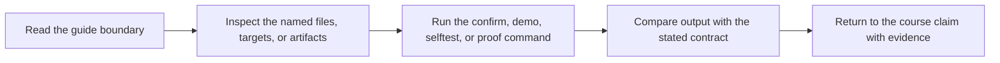

# Repro Guide

<!-- page-maps:start -->
## Guide Maps

<!-- page-maps:end -->

The repro pack turns build failures into reviewable failure surfaces. Use it when you
want to study one failure class at a time instead of treating concurrency and graph
defects as random incidents. When you need verified execution rather than source-only
inspection, use `make incident-audit` for the three concurrency cases or
`make incremental-fault-audit` for missing-edge cases.

---

## Repro Files By Failure Class

| File | Failure class | What it teaches |
| --- | --- | --- |
| `repro/shared-log-interleaving.mk` | shared mutable output | concurrent writers need isolated or atomic publication |
| `repro/shared-staging-collision.mk` | shared staging path | each publisher needs uniquely owned staging state |
| `repro/clock-based-stamp.mk` | dishonest stamp boundary | stamps cannot hide meaningful inputs |
| `repro/incremental-edges/` | missing semantic edges | paired models prove stale authored headers and generated producers, then verify declared-edge recovery |
| `repro/directory-creation-race.mk` | directory creation race | directory setup must be idempotent and correctly scoped |
| `repro/order-only-dependency-misuse.mk` | order-only misuse | ordering constraints do not replace semantic dependencies |
| `repro/pattern-rule-ambiguity.mk` | ambiguous rule selection | pattern rules must remain legible under growth |

---

## Best First Route

Use this route when the repro pack is new:

1. `repro/shared-log-interleaving.mk` for obvious schedule-dependent output
2. `repro/directory-creation-race.mk` for setup races that often hide in "small" builds
3. `repro/order-only-dependency-misuse.mk` for graph lies that still look tidy
4. `make incremental-fault-audit` for executed missing-edge and recovery proof

That route moves from visible failure into subtler graph-modeling mistakes. The final route
is deliberately paired: read the missing-edge observation beside the declared-edge control
rather than treating a successful build as evidence of freshness.

---

## Incident Bundle Route

Use this when you want a saved, asserted concurrency incident review:

1. Run `make incident-audit`.
2. Read `INCIDENT_REVIEW_GUIDE.md`.
3. Compare all rows in `summary.tsv`.
4. Read each case in `report.json` beside its named file under `evidence/`.
5. Use `runs/`, `workspace/`, and `specimens/` to verify the causal explanation.
6. Return to `PROOF_GUIDE.md` to match each repair to the healthy capstone.

Use `INCIDENT_CASE=<name>` only after reviewing the complete matrix. A named case retains
its expected process and semantic contract; an arbitrary Makefile would not.

---

## Review Questions

Ask these while using a repro:

* which output is being shared dishonestly
* which dependency is missing or misclassified
* whether the failure changes under `-j`
* which repair pattern belongs in the real capstone
