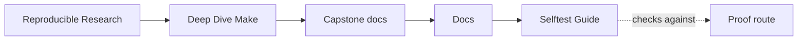
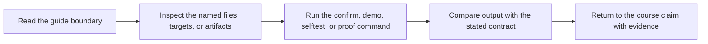

# Selftest Guide


<!-- page-maps:start -->
## Guide Maps




<!-- page-maps:end -->

Use the selftest report when the question is not "does the program run?" but "does the
build still behave honestly under change and concurrency?"
The shared catalog name for this route is `verify-report`, but the evidence itself stays
the same selftest bundle. A failed target still completes the bundle before returning a
nonzero exit status.

## Choose the right selftest target

| Question | Target | Result |
| --- | --- | --- |
| does the current build contract hold | `make selftest` | raw evidence and preserved workspace |
| do I need a complete review bundle | `make selftest-report` or `make verify-report` | raw evidence, guides, and manifest |
| does the harness reject known schedule drift | `make selftest-harness-tests` | one accepted and one rejected controlled case |

Do not use `SELFTEST_FAULT` during ordinary proof. It is a test seam used by
`selftest-harness-tests` to alter `build/include/dynamic.h` after the parallel build.
The harness must identify that path as changed and fail before later checks run.

## Reading order

1. `summary.txt` to see the result, stopping boundary, and checks not reached.
2. `settings.env` and `commands.txt` to confirm the execution contract.
3. the matching file under `logs/` to inspect command output without rerunning.
4. `schedule-comparison.json` to read the schedule-equivalence decision and diagnostics.
5. `serial-inventory.json` and `parallel-inventory.json` to inspect declared paths,
   byte counts, and digests.
6. `convergence.txt`, `trace-count.txt`, and `hidden-input.txt` for the other completed
   checks.
7. `workspace/` only when the summary and logs do not answer the question.
8. `PROOF_GUIDE.md` to decide whether a wider proof route is necessary.

## What each file proves

- `summary.txt` names `PASS` or `FAIL`, the failed check, its reason, and every check that
  remained `NOT_RUN`.
- `PROOF_GUIDE.md` tells you how this bundle relates to inspect, proof, and confirm.
- `settings.env` records the make and Python executables, trace guardrail, fault setting,
  and workspace.
- `commands.txt` records command order; `logs/` preserves each command's output.
- `schedule-comparison.json` separates missing, unexpected, and changed artifacts.
- `serial-inventory.json` and `parallel-inventory.json` define the compared artifact set
  instead of inheriting a platform checksum format.
- `trace-count.txt` shows whether the build has started doing too much work before the
  real execution phase.
- `hidden-input.txt` proves the harness still catches a graph that lies about its inputs.
- `workspace/` preserves the sandbox at the stopping boundary. It is evidence, not a
  source tree to repair in place.

## Read a failure without destroying it

Suppose `summary.txt` contains:

```text
result=FAIL
failed_check=serial_parallel_equivalence
serial_parallel_equivalence=FAIL
trace_guardrail=NOT_RUN
```

Read `schedule-comparison.json` next. Its lists distinguish three defect shapes:

| Field | Meaning | First ownership question |
| --- | --- | --- |
| `missing_paths` | serial produced a declared path that parallel did not | which edge or writer disappeared under scheduling |
| `unexpected_paths` | parallel published an undeclared extra path | which recipe or discovery boundary widened |
| `changed_artifacts` | both schedules published the path with different content | which writer observed hidden order, state, or input |

Then read `logs/parallel-build.log` and inspect the named path under `workspace/`.
Do not rerun first: the next invocation replaces the fixed report directory.

## What a passing report does not prove

A pass proves the declared checks for one recorded toolchain and artifact set. It does
not prove:

- equivalence for artifacts omitted from the inventory
- determinism across compilers or platforms not exercised
- absence of every possible race
- product behavior beyond the separate `test` target
- that a higher trace threshold would be harmless

## Review questions

- If `summary.txt` says pass, which individual files would you read next to trust that?
- If this bundle passes, which wider route would you choose next: `inspect`, `proof`, or `confirm`?
- If `schedule-comparison.json` reports a missing path, how does that differ from a
  changed digest when locating the faulty writer or edge?
- If `hidden-input.txt` stops failing dishonesty, which contract in the main build should
  you inspect first?
- Which evidence would you preserve before rerunning a failed report, and why?
- What would a weak harness do when `SELFTEST_FAULT=parallel-artifact-drift` is active?
