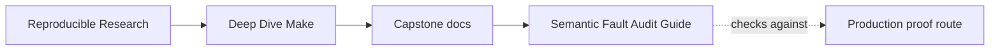
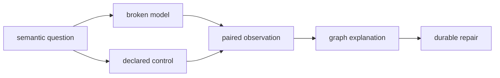
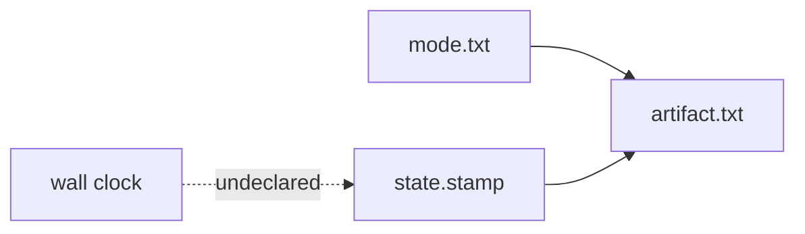
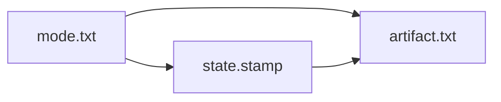
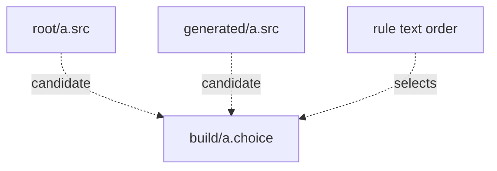

# Semantic Fault Audit Guide

<!-- page-maps:start -->
## Guide Maps




<!-- page-maps:end -->

Use this audit when source inspection alone cannot prove whether Make modeled state,
freshness, or rule selection honestly. It executes three specimen families:

- clock-derived state versus declared state
- order-only sequencing versus a semantic prerequisite
- overlapping pattern rules versus namespaced targets

The audit asks one question throughout:

> What changes when the dishonest model is replaced by an explicit semantic contract?

## Run the audit

From `capstone/`:

```sh
gmake semantic-fault-audit
```

Read the generated bundle at:

```text
artifacts/audit/reproducible-research/deep-dive-make/semantic-faults/
```

The bundle contains:

```text
SEMANTIC_FAULT_AUDIT_GUIDE.md
summary.tsv
report.json
traces/
specimens/
workspace/
REPRO_GUIDE.md
PROOF_GUIDE.md
manifest.json
route.txt
```

## What aggregate PASS means

`PASS` means all seven model observations matched their contracts. The findings do not all
mean the same thing:

| Finding form | Meaning |
| --- | --- |
| `*_REPRODUCED` | the broken model exhibited the promised defect |
| `*_STABLE` | the declared model produced identical semantic output |
| `*_REFRESHED` | the declared edge propagated a changed input |
| `*_EXPLICIT` | the target namespace removed selection overlap |
| `*_SELECTED` or `*_CHANGED_SELECTION` | rule order controlled an overlapping selection |

Do not summarize the audit as “all models are correct.” Some rows pass because they
reliably demonstrate incorrect modeling.

## Read in comparison order

Read:

1. `route.txt`
2. `summary.tsv`
3. the two clock-state rows in `report.json`
4. the two order-only-edge rows
5. the three pattern-selection rows
6. the matching files under `traces/`
7. `specimens/` beside the executed copies under `workspace/`
8. `REPRO_GUIDE.md`
9. `PROOF_GUIDE.md`

Keep each broken row beside its control. An isolated failure is easier to misread than a
controlled contrast.

## Expected comparison matrix

| Specimen | Model | Observation | Finding |
| --- | --- | --- | --- |
| clock state | clock derived | two identical-input builds have different hashes | `CLOCK_STATE_DRIFT_REPRODUCED` |
| clock state | declared state | two identical-input builds have equal hashes | `DECLARED_STATE_STABLE` |
| order-only edge | order only | input says `after`, output remains `before` | `ORDER_ONLY_STALENESS_REPRODUCED` |
| order-only edge | semantic edge | input and output both say `after` | `SEMANTIC_EDGE_REFRESHED` |
| pattern selection | generated rule first | shared target selects generated source | `FIRST_OVERLAPPING_RULE_SELECTED` |
| pattern selection | root rule first | same target selects root source | `REORDERED_RULE_CHANGED_SELECTION` |
| pattern selection | namespaced targets | both source families publish separate outputs | `NAMESPACED_SELECTION_EXPLICIT` |

## Clock-derived state is an undeclared input

The broken model writes wall-clock time into `state.stamp`, then copies that state into
`artifact.txt`:



Two isolated workspaces start with identical tracked inputs. Their artifacts differ only
because time entered the semantic output.

The control copies `mode.txt` into the state file:



The stamp is now reviewable evidence of declared state. Two clean builds produce equal
artifact hashes.

This does not mean clocks are forbidden in all build metadata. It means clock values
cannot enter a reproducibility claim unless the contract explicitly permits and governs
them.

## Order-only prerequisites do not express meaning

The broken rule says:

```make
output.txt: | input.txt
```

The edge guarantees ordering when both targets need work. It does not make a newer
`input.txt` invalidate `output.txt`.

The audit:

1. builds `output.txt` from `before`
2. changes `input.txt` to `after`
3. advances its timestamp beyond the output
4. runs Make with trace
5. reads the output

The broken model reports no work and leaves `before`. The control uses:

```make
output.txt: input.txt
```

Its trace names the newer prerequisite and refreshes the output to `after`.

Use order-only prerequisites for setup that must exist but does not change artifact
meaning, such as an output directory. Use normal prerequisites for semantic inputs.

## Overlapping pattern rules hide selection policy

The two ambiguous models request the same path:

```text
build/a.choice
```

Both `root/a.src` and `generated/a.src` exist. Both pattern rules can produce the target.
Changing which rule appears first changes the selected source while the inputs and target
name remain unchanged.



This is not a parse failure or a missing-file failure. Both builds succeed. The semantic
instability is that textual rule order acts as hidden policy.

The control gives the source families distinct target namespaces:

```text
build/root/a.choice
build/generated/a.choice
```

Each target pattern has one source family and both outputs can coexist.

## Trace questions for each family

| Family | Trace question |
| --- | --- |
| clock state | which recipe introduced state not derived from tracked inputs? |
| order-only edge | why did Make select no work after the semantic input changed? |
| pattern selection | which prerequisite and pattern rule produced the shared target? |

Trace explains Make’s decision under the modeled graph. The paired artifact observation
decides whether that graph is honest.

## Repair decision table

| Defect | Weak response | Durable repair |
| --- | --- | --- |
| wall-clock value enters semantic output | normalize the observed timestamp afterward | derive state from declared meaningful inputs |
| semantic input is order only | force a rebuild in the recipe | use a normal prerequisite |
| pattern rules overlap | add a comment saying which rule should win | separate target namespaces or write an explicit rule |

The durable repair removes hidden policy. It does not merely make the current demonstration
pass.

## Connect to the healthy build

The specimen controls are teaching models, not proof of the production capstone. Follow
them with:

- `make incremental-fault-audit` for additional missing-edge evidence
- `make trace-report` for attributed rule-selection evidence
- `make selftest-report` for convergence and schedule-equivalence proof
- `make contract-audit` for public target and tool-boundary review

The semantic audit proves mechanisms. The healthy routes prove the reference build’s
declared claims.

## Proof limits

The audit does not prove:

- every use of timestamps is semantically dishonest
- every order-only prerequisite is wrong
- every pair of pattern rules overlaps
- the same pattern-selection order holds across unrelated Make implementations
- the healthy build is free of all hidden inputs

It proves the behavior of seven named GNU Make models and provides controls that isolate
why each result changes.

## Review checkpoint

Complete this without copying the finding names:

| Family | Hidden policy in broken model | Control makes explicit | Production proof needed |
| --- | --- | --- | --- |
| clock state | | | |
| order-only edge | | | |
| pattern selection | | | |

If the middle columns only say “broken” and “fixed,” return to the report and traces. The
goal is to explain the semantic contract, not memorize labels.
