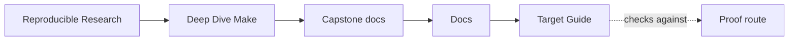
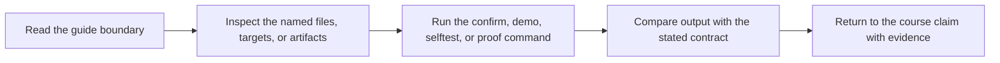

# Target Guide

<!-- page-maps:start -->
## Guide Maps




<!-- page-maps:end -->

Use this guide when `make help` gives you names, but not judgment. The point is not to
memorize every target. The point is to pick the smallest command that answers the
question honestly.

---

## Choose by question

| Question | Start here | Escalate if needed |
| --- | --- | --- |
| what does this repository promise publicly | `make inspect` | `make contract-audit` |
| what are the stable public targets | `make help` | `make inspect` |
| does the ordinary build succeed | `make all` | `make test` |
| does the build graph still tell the truth | `make selftest` | `make verify-report` |
| does the selftest close its own rejection gate | `make selftest-harness-tests` | inspect the controlled drift report |
| does one candidate satisfy archive and install policy | `make release-check` | `make confirm` |
| do existing candidate bytes pass without a rebuild | `make verify-dist` | `make install-rehearsal` |
| do malformed candidates and destinations fail correctly | `make release-selftest` | `make release-check` |
| what do the governed build states cost in this attributable context | `make perf` | inspect provenance and requested work before timings |
| do all governed input classes select exactly the necessary work | `make performance-incremental` | inspect the policy, complete summary, and any failing case trace |
| did cost change under compatible context and equivalent work | `make performance-compare` | inspect both bundles and the comparison report |
| do performance evidence gates reject dishonest inputs | `make performance-selftest` | inspect the rejection tests |
| is the clean planning trace bounded and attributable | `make trace-report` | inspect trace evidence and raw trace |
| do I need the proof saved as a review bundle | `make verify-report` | `make proof` |
| what is the shortest human-first route into the capstone | `make walkthrough` | `make tour` |
| which failure class does the repro pack teach | `make incident-audit` | `make repro` |
| what does this repository assume about tools or variable sources | `make profile-audit` | `make portability-audit` and `make show-origins` |
| can this tree be published as source without local residue | `make source-baseline-check` | `make source-bundle` |
| what is the strongest shared stewardship route | `make confirm` | none; this is the top route |

---

## Stable review targets

| Target | What it produces | Use when |
| --- | --- | --- |
| `help` | the published target list and key variables | you need the supported surface |
| `all` | the ordinary build outputs and convergence sentinel | you need the baseline build result |
| `test` | runtime behavior checks | you need product-facing validation |
| `selftest` | convergence, schedule equivalence, hidden-input checks, and raw evidence | you need build-system proof |
| `selftest-harness-tests` | acceptance of truthful schedules and rejection of injected drift | you need proof that the harness itself discriminates |
| `dist` | one governed candidate and SHA-256 sidecar | you need producer output |
| `verify-dist` | existing-byte identity, member, type, mode, and metadata evidence | you need consumer verification without rebuilding |
| `install-rehearsal` | contained installed tree and rerun comparison | you need destination evidence |
| `accept-release` | one final record bound to candidate and install reports | you need a bounded local decision |
| `release-selftest` | ten acceptance and rejection tests | you need executable release guardrails |
| `release-check` | complete local candidate production and acceptance | you need the full local release claim |
| `perf` | provenance, complete requested-work matrix, repeated timings, convergence, and inventories | you need an attributable local baseline |
| `performance-incremental` | per-input missing and unexpected rebuild classifications across one output universe | you need requested-work proof |
| `performance-compare` | timing deltas guarded by context and semantic equivalence | you have a compatible prior evidence bundle |
| `performance-selftest` | context, rebuild, capture, and comparison gate tests | you need to review the evidence gate |
| `trace-report` | clean-plan trace, semantic checks, and bundle manifest | you need causality evidence without execution |
| `walkthrough` | the bounded first-pass bundle | you need an ordered entry route |
| `tour` | the shortest printed walkthrough plus supporting bundle | you need quick orientation |
| `contract-audit` | the public-contract review bundle | you are reviewing promises and boundaries |
| `inspect` | the same contract route under review naming | you want the smallest honest review route |
| `incident-audit` | one executed incident bundle | you want one failure class with evidence |
| `profile-audit` | the execution-profile review bundle | you are reviewing portability and precedence |
| `selftest-report` | a complete passing or failing selftest evidence bundle | you need durable proof output |
| `verify-report` | the same selftest bundle under shared catalog naming | you need the catalog label used elsewhere |
| `proof` | the sanctioned multi-bundle review set | one question now spans multiple routes |
| `hardened` | selftest, audits, attestation, and runtime checks | you want the strongest built-in validation body |
| `confirm` | the same strongest route under shared naming | you are closing stewardship review |

---

## Distinctions that matter

- `all` builds outputs once; `selftest` proves the build contract
- `selftest` tests the build; `selftest-harness-tests` tests whether that proof gate closes
- `dist` produces candidate bytes; `verify-dist` observes existing bytes
- `install-rehearsal` proves a destination mapping; `accept-release` records the bounded decision
- `release-selftest` proves gate behavior; `release-check` applies those gates to the capstone candidate
- `perf` establishes one baseline; `performance-compare` can support a change claim
- `performance-compare` rejects provenance, environment, requested-work, and artifact drift before reporting timing deltas
- `walkthrough` writes a first-pass bundle; `tour` prints the shortest route and focused follow-ups
- `contract-audit` and `inspect` are the same route with different naming context
- `selftest-report` and `verify-report` are the same saved evidence bundle, including on failure
- `profile-audit` is about declared execution boundary and variable sources, not raw performance benchmarking
- `proof` is not "better selftest"; it is the point where one review question has become several
- `hardened` and `confirm` are the strongest built-in routes, not the default starting point

---

## Source packaging route

Use this route when the question is not "does the build pass?" but "would the tracked
source tree be safe to hand to another reviewer?"

Run these commands from the capstone directory:

```bash
gmake clean
gmake source-baseline-check
gmake source-bundle
```

They do different jobs:

- `gmake clean` removes generated build state
- `gmake source-baseline-check` proves the tree no longer carries local build residue
- `gmake source-bundle` writes a tracked-source archive from `git ls-files`

What must stay out of the source bundle:

- `build/` and `stamps/` because they are derived state, not source inputs
- `app` and `all` because they are generated deliverables
- release candidates and evidence under the repository `artifacts/` tree
- temporary files such as `*.tmp`, `*.tmp.*`, and `*.d.tmp` because they are local residue

What belongs in the source bundle:

- `Makefile` and `mk/` because they define the build contract
- `README.md`, [TARGET_GUIDE.md](target-guide.md), and [PROOF_GUIDE.md](proof-guide.md) because they explain the repository surface
- `src/`, `include/`, `tests/`, `repro/`, and helper scripts because they are tracked project inputs

---

## Useful companions

- [RELEASE_GUIDE.md](release-guide.md)
- [PROOF_GUIDE.md](proof-guide.md)
- [WALKTHROUGH_GUIDE.md](walkthrough-guide.md)
- [SELFTEST_GUIDE.md](selftest-guide.md)
- [CONTRACT_AUDIT_GUIDE.md](contract-audit-guide.md)
- [INCIDENT_REVIEW_GUIDE.md](incident-review-guide.md)
- [PROFILE_AUDIT_GUIDE.md](profile-audit-guide.md)
