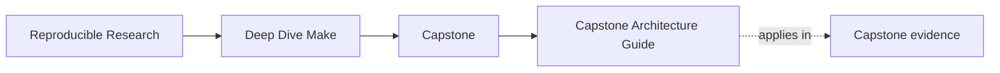
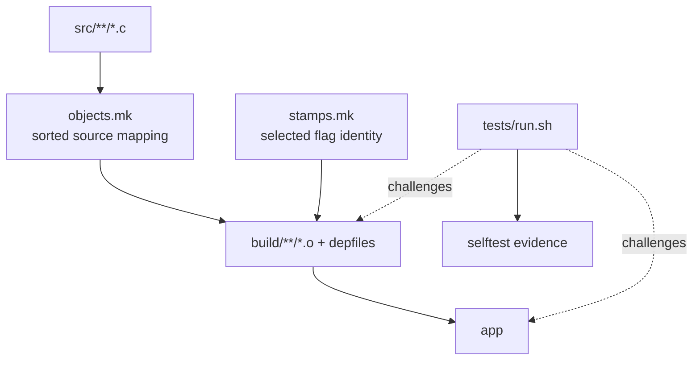

# Capstone Architecture Guide


<!-- page-maps:start -->
## Page Maps




<!-- page-maps:end -->

Use this page when the question is about build ownership rather than about one command.
The Make capstone stays reviewable only if public targets, graph modeling, helper logic,
proof, and failure specimens each keep a readable home.

## The architecture has two axes

The directory tree is only one axis. The other is the lifecycle of a build decision:

```mermaid
flowchart LR
  parse["Parse and expand"]
  graph["Construct graph"]
  schedule["Choose runnable work"]
  execute["Execute recipes"]
  publish["Publish outputs"]
  verify["Verify claims"]

  parse --> graph --> schedule --> execute --> publish --> verify
```

A good architecture tells you both:

1. **where responsibility lives** in the repository
2. **when that responsibility acts** in Make's lifecycle

For example, `mk/objects.mk` owns deterministic source membership during parsing.
Object rules in `Makefile` own compilation and publication during execution.
`tests/run.sh` challenges the resulting behavior after execution. Calling all three
“build logic” would hide the lifecycle boundaries that make the repository reviewable.

## Boundary map

| Boundary | First files to inspect | Lifecycle | What that boundary owns | What it must not silently own |
| --- | --- | --- | --- | --- |
| public build contract | `capstone/Makefile` | parse and graph | supported targets, composition, primary rules | undocumented remote deployment |
| capability contract | `capstone/mk/contract.mk` | parse | required advertised Make features | guesses from version prefixes |
| shared compile policy | `capstone/mk/common.mk` | parse | include paths and shared flags | graph membership |
| recipe helpers | `capstone/mk/macros.mk` | recipe expansion and execution | small, named shell contracts | target discovery or hidden side effects |
| graph membership | `capstone/mk/objects.mk` | parse and graph | rooted, sorted source-to-output mapping | publication recipes |
| modeled hidden inputs | `capstone/mk/stamps.mk` | parse, graph, execution | flag identity and invalidation edges | all environment provenance |
| optional rule generation | `capstone/mk/rules_eval.mk` | parse and graph | quarantined generated-rule demonstration | ordinary core targets |
| proof harness | `capstone/tests/run.sh` and Python tests | execution and verification | convergence, equivalence, rejection behavior | implementation policy |
| release policy and actions | `capstone/release/` and release scripts | graph, execution, verification | package membership, candidate identity, contained install | remote publication |
| failure specimens | `capstone/repro/` | controlled execution | one broken mechanism per specimen | healthy build behavior |

The final column is as important as ownership. Boundaries erode when a convenient file
starts making decisions that reviewers would reasonably look for elsewhere.

## Read include order as dependency direction

The top-level Makefile includes the ordinary layers in this order:

```text
contract.mk → common.mk → macros.mk → objects.mk → stamps.mk
```

Read the order as a dependency rule:

- the capability contract can stand alone
- shared compile policy may rely on top-level layout variables
- helpers may rely on the chosen shell contract
- graph membership relies on layout names, not on recipes
- state stamps rely on the final tool and flag values

`rules_eval.mk` is different. It is included only when `USE_EVAL=yes`, so its generated
rules cannot become an invisible prerequisite for the ordinary build.

### An include-direction check

For any variable referenced by an included file:

1. find where it is first assigned
2. identify whether callers may override it
3. verify that its final value exists before a state identity is computed
4. check whether the include mutates a public variable globally

This is why `stamps.mk` comes after the final link-flag scrubbing in `Makefile`: the
stamp must represent the flags recipes will actually consume.

## Trace one output across the architecture

Use `app` as a worked example.

### Membership

`mk/objects.mk` discovers rooted C sources, sorts them, and maps them to object paths.
The stable ordering supports review and reproducible command construction. It does not
compile anything.

### Invalidation

Each object depends on its source, compiler-observed depfile edges, and the canonical
flag stamp. `mk/stamps.mk` turns selected non-file inputs into a content-bearing file so
a flag change becomes graph-visible.

### Production

The object and link rules live in `Makefile`. Their recipes publish through
process-specific candidates and rename only after success. The graph owns when work is
needed; the recipe owns how a complete output becomes visible.

### Proof

`tests/run.sh` exercises convergence and schedule equivalence. That is stronger than
running `gmake app`, because successful production alone cannot show that a second build
is quiet or that `-j` preserves the same inventory.



The dashed arrows mean “tests a claim about,” not “is a Make prerequisite of.”

## Architecture decisions worth noticing

### One top-level composition surface

Public target composition remains in `Makefile`. Included files contribute policy,
membership, helpers, or state modeling without creating a second public entrance.

### Generated content and publication are separate

Python generators decide bytes. Make rules decide prerequisites, output paths, and
publication timing. This makes it possible to test content generation separately from
graph correctness.

### Evidence leaves the source tree

Audit, proof, performance, and release evidence are rooted under repository
`artifacts/`. The source tree remains an input surface rather than accumulating the
results used to judge it.

### Broken examples remain outside the healthy graph

Files under `repro/` are invoked explicitly. A failure specimen may be intentionally
unsafe, but it must not become a prerequisite or include of the ordinary build.

## Review a proposed change by impact

Suppose you add a generated version header.

| Question | Architectural answer |
| --- | --- |
| who defines its bytes? | a named generator under `scripts/` |
| who declares its prerequisites and output? | a rule in the graph-owning Make surface |
| which binaries consume it? | explicit edges or compiler depfiles |
| which policy inputs affect it? | a content-bearing manifest or stamp if they are non-file state |
| how is incomplete output hidden? | process-local candidate plus atomic rename |
| how is rebuild scope tested? | a focused incremental assertion |
| does it enter a release? | only through declared package policy |

If the proposed change cannot answer one row, it is not architecturally complete.

## Architecture smells and first questions

| Smell | First question |
| --- | --- |
| an include file defines user-facing targets and compile flags | which responsibility should move back to the public contract or policy layer? |
| a helper macro discovers files with `$(shell find ...)` | who owns the discovery root and ordering? |
| a generator writes directly into an authored source directory | is generated state being confused with source ownership? |
| a proof script repairs outputs before inspecting them | can the check still reject the original failure? |
| a release script decides membership by walking a directory | where is package policy declared independently? |
| a repro file is included by the healthy build | can the failure remain isolated and explicitly invoked? |

## Read the repository in this order

1. Start with `Makefile` and `gmake help` to see the public contract.
2. Choose one target; do not review the whole graph at once.
3. Follow its membership and invalidation through the relevant `mk/` files.
4. Read its recipe or called script for publication behavior.
5. Read the matching proof before making a trust claim.
6. Read `repro/` only when the question is about a named failure class.

## What this guide should prevent

- mistaking helper reuse for ownership clarity
- treating repro files as part of the healthy build path
- judging parallel safety without checking the proof harness
- reading include order as arbitrary file organization
- allowing proof scripts to own production policy
- treating a directory boundary as sufficient evidence of a responsibility boundary

## Architecture review drill

Choose `app`, one dynamic binary, the selftest report, or the release candidate. Draw
five boxes:

```text
contract → membership/invalidation → production → proof → evidence
```

Write one owning file in each box and one prohibited responsibility beneath it. Then
compare your drawing with [Capstone File Guide](capstone-file-guide.md) and the actual
repository.

You are ready to stop when you can explain one output without saying “the Makefile does
it” or “the scripts handle it.” Those phrases are too broad to support a review.
