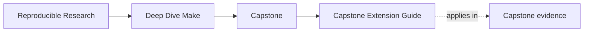

# Capstone Extension Guide


<!-- page-maps:start -->
## Page Maps




<!-- page-maps:end -->

Use this page before changing the capstone. The goal is not to freeze the repository. The
goal is to keep new work readable, provable, and clearly owned two years from now.

## Start with a behavior delta

Write the change as observable behavior before choosing files:

```text
current caller behavior:
requested caller behavior:
behavior that must remain unchanged:
new failure that must be rejected:
evidence required before adoption:
```

“Add a script” or “split the Makefile” describes implementation movement. It does not
say what the repository should do differently or why a learner should trust the result.

## What must survive every change

Unless the course itself is being redesigned, a capstone change should preserve these
properties:

- truthful dependency modeling
- atomic publication for real outputs
- serial and parallel equivalence where the build claims it
- a small public target surface
- a repository shape you can still audit end to end

If a proposed change weakens one of those, treat that as a design change, not routine
maintenance.

## Classify the change by contract impact

| Change class | Example | Minimum review obligation |
| --- | --- | --- |
| internal mechanism | replace repeated recipe text with a bounded macro | prove public behavior and expansion remain equivalent |
| graph contract | add a generated input or change an edge | prove clean, affected-change, unrelated-change, and unchanged rerun behavior |
| public API | add, rename, or alter a supported target | update help, callers, contract audit, and compatibility decision |
| environment contract | require a new tool or feature | add an early capability gate and observable identity |
| evidence contract | change a report field or acceptance rule | preserve schema intent and prove dishonest evidence is rejected |
| release contract | change membership, install mapping, or candidate identity | exercise production, consumer verification, rejection, and containment |
| ownership handoff | move behavior to another tool or service | define immutable input, receipt, retries, and proof on both sides |

The class is determined by what callers and reviewers must now rely on, not by the
number of edited lines.

## Put changes in the right place

| If you are changing... | Start in... | Why |
| --- | --- | --- |
| public target names or user-facing help text | `capstone/Makefile` | the public contract belongs at the top level |
| tool, shell, or portability policy | `capstone/mk/contract.mk` | policy should stay explicit and centralized |
| reusable recipe helpers | `capstone/mk/macros.mk` or `capstone/mk/common.mk` | reuse belongs in named helpers, not copied shell |
| discovery or object selection | `capstone/mk/objects.mk` | graph membership should have one owning file |
| hidden inputs or rebuild state evidence | `capstone/mk/stamps.mk` | state tracking should stay reviewable |
| proof behavior | `capstone/tests/run.sh` | proof belongs to the harness, not to prose |
| a new failure specimen | `capstone/repro/` plus [Capstone Proof Guide](capstone-proof-guide.md) | failure specimens should stay isolated from the healthy build |

## Build an impact map before editing

```mermaid
flowchart LR
  behavior["Behavior delta"]
  callers["Affected callers"]
  owner["Owning boundary"]
  graph["Changed inputs or outputs"]
  proof["Proof obligations"]
  docs["Learner route and handoff"]

  behavior --> callers --> owner --> graph --> proof --> docs
```

For each arrow, name one file or record. If the proof arrow has no destination, the
change is not ready to implement.

## Good capstone changes

These usually improve the repository:

- clarifying a target description or route page
- adding one more explicit dependency or boundary file
- improving a proof message without weakening the check
- adding a distinct repro that exposes a real failure class
- tightening file ownership so review requires less guessing

## Risky changes

Slow down when a change does any of these:

- adds abstraction that hides the graph more than it reduces repetition
- turns internal helper behavior into an undocumented public surface
- weakens selftest because one environment is inconvenient
- mixes proof residue into source or release identity
- adds repository bulk without adding a sharper lesson

## Worked extension: add generated build metadata

Assume the requested behavior is:

> `app` should embed a build channel selected by `CHANNEL=stable`, and changing the
> channel should rebuild only the generated metadata and its consumers.

This is not merely “add a generator.” It changes the graph and environment contract.

### Define ownership

| Responsibility | Durable owner |
| --- | --- |
| accepted channel values and default | explicit policy near the public contract |
| channel identity visible to Make | content-bearing manifest or signature-specific stamp |
| generated header bytes | one script under `scripts/` |
| generated-header target and publication | one Make rule |
| consumer relationship | depfile or explicit prerequisite |
| rebuild-scope proof | focused incremental test |
| release membership | existing package policy, changed only if the header belongs in the candidate |

Do not read `CHANNEL` only inside a recipe. Make cannot invalidate an existing output
from state it never modeled.

### Predict the evidence

Before implementation, write the expected matrix:

| Transition | Expected work |
| --- | --- |
| clean → `CHANNEL=stable` | generate metadata and build consumers |
| stable → stable | no metadata generation or consumer rebuild |
| stable → candidate | regenerate metadata and rebuild only consumers |
| candidate → candidate | no work |
| source change unrelated to metadata | rebuild only its ordinary consumers |

The matrix guards against both stale output and the lazy repair of rebuilding
everything.

### Choose publication behavior

The generator writes to a process-local candidate. The Make rule renames the candidate
only after successful generation. A failing generator must leave the previous accepted
header intact or leave no header on a clean build.

### Add rejection evidence

Test at least:

- an unsupported channel is rejected before a misleading artifact is published
- a generator failure does not expose partial header content
- unchanged state converges
- a channel change produces the predicted bounded rebuild set

Only after these checks should help text or learner routes present the feature as part
of the capstone contract.

## Worked handoff: move remote publication out of Make

The capstone intentionally stops at local release acceptance. If a surrounding system
later owns publication, keep Make responsible for producing an accepted candidate and
an immutable digest-bound record. The receiver owns upload, remote retry, and remote
receipt.

The boundary needs:

| Sender provides | Receiver returns |
| --- | --- |
| candidate path or transport reference | destination identity |
| candidate digest | received digest |
| local acceptance record | publication status |
| package-policy identity | remote receipt identity |

Make may invoke the receiver, but it should not infer remote success from a zero exit
alone. The durable handoff evidence is a receipt bound to the same candidate digest.

## Review checklist before you commit

Answer these in your own words:

1. what review or maintenance question became easier after this change
2. which file now owns the behavior
3. which proof route still corroborates the claim
4. whether the filename and commit message would still make sense later
5. whether the change can be understood without oral history

If you cannot answer those, the change is probably not placed cleanly yet.

## Require an executable rollback

Rollback is not “revert if needed.” Record:

- which public behavior returns to its earlier contract
- which generated outputs or evidence schemas become incompatible
- how stale artifacts are detected rather than silently reused
- which proof route must pass after rollback

For an ownership handoff, keep the old producer available until the receiver can prove
equivalent identity, failure reporting, and retry behavior. Retirement follows evidence;
it does not create it.

## Best rerun commands

From repository root:

```sh
make PROGRAM=reproducible-research/deep-dive-make capstone-walkthrough
make PROGRAM=reproducible-research/deep-dive-make inspect
make PROGRAM=reproducible-research/deep-dive-make test
make PROGRAM=reproducible-research/deep-dive-make proof
```

Those four routes cover entry, public contract, executable proof, and steward review.

Add the narrow route for the changed boundary before running all four. A generated-input
change needs incremental evidence; a release-policy change needs release selftests; an
architecture change needs the architecture contract audit.

## Extension handoff

Finish with:

```text
behavior delta:
change class:
owning files:
public compatibility decision:
new negative control:
proof route and evidence path:
rollback trigger and command:
remaining unsupported claim:
```

The handoff is complete when another maintainer can challenge the change without
guessing which command, artifact, or acceptance rule matters.
