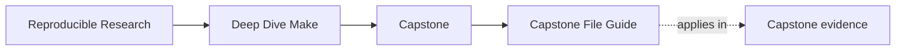

# Capstone File Guide


<!-- page-maps:start -->
## Page Maps




<!-- page-maps:end -->

Use this page when you know the repository is the right surface but do not yet know which
file owns the answer. The goal is to shorten the path from question to owning file.

## Ownership is a chain

One file rarely owns an entire behavior. Trace six distinct responsibilities:

```mermaid
flowchart LR
  contract["Contract\nwhat is promised"]
  policy["Policy\nwhat is allowed"]
  graph["Graph\nwhat depends on what"]
  action["Action\nhow work is performed"]
  proof["Proof\nhow the claim is challenged"]
  evidence["Evidence\nwhat a reviewer receives"]

  contract --> policy --> graph --> action --> proof --> evidence
```

For a focused review, identify the file that owns each relevant responsibility. Do not
call every file in the chain “the implementation.” That phrase hides the boundary you
need to inspect.

Use this trace form:

| Responsibility | File or generated record | Question |
| --- | --- | --- |
| contract |  | what may a caller rely on? |
| policy |  | which inputs, members, or conditions are permitted? |
| graph |  | which prerequisite makes the behavior current or stale? |
| action |  | which recipe or script performs the work? |
| proof |  | which check can reject a false claim? |
| evidence |  | which saved record lets another reviewer confirm the result? |

## Start with the file that owns the question

| If the question is about... | Open this file first | Then open |
| --- | --- | --- |
| what the capstone publicly supports | `capstone/Makefile` | [Command Guide](command-guide.md) |
| what the build proves about itself | `capstone/tests/run.sh` | [Capstone Proof Guide](capstone-proof-guide.md) |
| tool, shell, and policy assumptions | `capstone/mk/contract.mk` | `capstone/Makefile` |
| shared helper behavior such as atomic writes | `capstone/mk/macros.mk` | `capstone/mk/common.mk` |
| which sources and objects enter the graph | `capstone/mk/objects.mk` | `capstone/src/` |
| how hidden inputs and state evidence are modeled | `capstone/mk/stamps.mk` | `capstone/tests/run.sh` |
| generated-header behavior | `capstone/scripts/gen_dynamic_h.py` | `capstone/Makefile` |
| which files may enter a release candidate | `capstone/release/package-policy.tsv` | `capstone/scripts/mkdist.py` |
| where archive members may be installed | `capstone/release/install-policy.tsv` | `capstone/scripts/rehearse_release_install.py` |
| how existing candidate bytes are accepted or rejected | `capstone/scripts/verify_release_candidate.py` | `capstone/tests/test_release_candidate.py` |
| how candidate and install evidence become one decision | `capstone/scripts/write_release_acceptance.py` | [Capstone Release Acceptance](capstone-release-acceptance.md) |
| one failure class in isolation | `capstone/repro/shared-log-interleaving.mk` or another repro file | [Capstone Proof Guide](capstone-proof-guide.md) |

## Distinguish authored and observed files

The capstone contains several kinds of file. Their review meanings differ:

| File kind | Examples | Review question |
| --- | --- | --- |
| authored contract | `Makefile`, `release/*.tsv` | is the promise or policy explicit and coherent? |
| authored implementation | `mk/*.mk`, `scripts/*.py` | does the mechanism implement the declared boundary? |
| authored proof | `tests/run.sh`, `tests/test_*.py` | can the check reject a plausible false claim? |
| generated product | `app`, dynamic binaries, release candidate | was it produced from the intended inputs? |
| generated evidence | JSON reports, summaries, findings | is it bound to the exact execution or artifact under review? |
| broken specimen | files under `repro/` | which one failure mechanism is isolated here? |

Generated evidence is not automatically a source of truth. Its authority depends on the
authored proof that produced it and the identity it records.

## Directory responsibilities

| Path | What belongs there |
| --- | --- |
| `capstone/Makefile` | public targets and top-level composition |
| `capstone/mk/` | layered policy, graph, and helper mechanics |
| `capstone/src/` and `capstone/include/` | the small C program used to exercise build behavior |
| `capstone/scripts/` | explicit generator and packaging helpers |
| `capstone/release/` | governed package membership, modes, and contained install mapping |
| `capstone/tests/` | the proof harness for build-system behavior |
| `capstone/repro/` | controlled failure specimens for one lesson at a time |
| `capstone/docs/` | repository-local guide pages for bounded review routes |

## Good first reading order

If this is your first serious repository pass, use this sequence:

1. `capstone/Makefile`
2. `capstone/tests/run.sh`
3. `capstone/mk/contract.mk`
4. `capstone/mk/objects.mk`
5. `capstone/mk/stamps.mk`
6. one file under `capstone/repro/`
7. one script under `capstone/scripts/`

After Module 08, replace the final two items with this release-specific order:

1. `capstone/release/package-policy.tsv`
2. `capstone/release/install-policy.tsv`
3. `capstone/scripts/mkdist.py`
4. `capstone/scripts/verify_release_candidate.py`
5. `capstone/scripts/rehearse_release_install.py`
6. `capstone/tests/test_release_candidate.py`
7. `capstone/tests/test_release_install.py`

Policy comes before implementation because the scripts are meaningful only in relation
to the contracts they enforce.

That order keeps contract first, proof second, policy third, and failure specimens last.

## Worked ownership trace: the generated header

Carry this question: **Why should a dynamic binary rebuild when the generated header
changes, and how can a reviewer verify the claim?**

### Contract

`capstone/Makefile` presents `dyn` as the entrypoint for the dynamic binaries. The
contract is bounded: it promises those binaries, not every possible generated source
workflow.

### Graph

The dynamic binary rule names the generated header as a prerequisite. Its depfile is
also included so compiler-observed header relationships remain visible to Make. This is
the part that answers the rebuild question.

### Action

`scripts/gen_dynamic_h.py` produces header content, while the Make recipe controls
publication into `build/include/`. The script owns content generation; the Make rule
owns graph placement and publication.

### Proof

`tests/run.sh` is the first place to inspect before claiming that a rebuild path is
tested. For broader input-class evidence, use the governed incremental route rather
than inferring coverage from the recipe.

### Observation drill

From `capstone/`, run:

```sh
gmake clean
gmake --trace dyn
gmake --trace dyn
```

Before the second invocation, predict which recipes should be absent. If generation or
linking repeats, use the trace to identify the prerequisite Make considers stale. Do
not edit the generator first; the first question is whether ownership or invalidation
is wrong.

The completed trace should name contract, graph, action, proof, and observed evidence.
If one is missing, say which claim remains unsupported.

## Worked ownership trace: candidate acceptance

The release path makes a different ownership split:

| Responsibility | Owner |
| --- | --- |
| allowed archive membership | `release/package-policy.tsv` |
| candidate construction | `scripts/mkdist.py` |
| candidate identity | checksum sidecar and digest fields |
| consumer-only verification | `scripts/verify_release_candidate.py` |
| rejection behavior | `tests/test_release_candidate.py` |
| accepted-candidate record | generated candidate acceptance JSON |

Notice that the producer does not own the acceptance decision. Keeping those files
separate lets verification reject an existing candidate without quietly replacing it.

## Wrong reading orders

Avoid these:

- opening random `mk/*.mk` files before reading `Makefile`
- starting with `repro/` before you know what the healthy build promises
- reading helper scripts before you know why the build calls them
- using directory names as a substitute for ownership
- treating the newest generated report as more authoritative than the check that wrote it
- tracing every include when one target-centered chain would answer the question

If you are still browsing by folder name, the repository has not become legible yet.

## File-guide checkpoint

Choose one of `app`, a dynamic binary, the selftest report, or the release candidate.
Without opening new files, write the current owner for:

1. its public contract
2. its graph or policy membership
3. its production action
4. its rejection test
5. its saved evidence

Then inspect the repository and correct your prediction. The differences between the
prediction and the actual ownership chain are the lesson.
