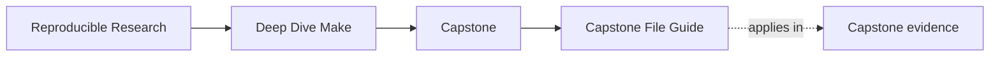

# Capstone File Guide

<!-- page-maps:start -->
## Page Maps

<!-- page-maps:end -->

Use this page when you know the repository is the right surface but do not yet know which
file owns the answer. The goal is to shorten the path from question to owning file.

## Start with the file that owns the question

| If the question is about... | Open this file first | Then open |
| --- | --- | --- |
| what the capstone publicly supports | `capstone/Makefile` | [Command Guide](command-guide.md) |
| what the build proves about itself | `capstone/tests/run.sh` | [Capstone Proof Guide](capstone-proof-guide.md) |
| tool, shell, and policy assumptions | `capstone/mk/contract.mk` | `capstone/Makefile` |
| shared helper behavior such as atomic writes | `capstone/mk/macros.mk` | `capstone/mk/common.mk` |
| which sources and objects enter the graph | `capstone/mk/objects.mk` | `capstone/src/` |
| how hidden inputs and state evidence are modeled | `capstone/mk/stamps.mk` | `capstone/tests/run.sh` |
| generated-header behavior | `capstone/scripts/gen_dynamic_h.py` | `capstone/Makefile` |
| which files may enter a release candidate | `capstone/release/package-policy.tsv` | `capstone/scripts/mkdist.py` |
| where archive members may be installed | `capstone/release/install-policy.tsv` | `capstone/scripts/rehearse_release_install.py` |
| how existing candidate bytes are accepted or rejected | `capstone/scripts/verify_release_candidate.py` | `capstone/tests/test_release_candidate.py` |
| how candidate and install evidence become one decision | `capstone/scripts/write_release_acceptance.py` | [Capstone Release Acceptance](capstone-release-acceptance.md) |
| one failure class in isolation | `capstone/repro/shared-log-interleaving.mk` or another repro file | [Capstone Proof Guide](capstone-proof-guide.md) |

## Directory responsibilities

| Path | What belongs there |
| --- | --- |
| `capstone/Makefile` | public targets and top-level composition |
| `capstone/mk/` | layered policy, graph, and helper mechanics |
| `capstone/src/` and `capstone/include/` | the small C program used to exercise build behavior |
| `capstone/scripts/` | explicit generator and packaging helpers |
| `capstone/release/` | governed package membership, modes, and contained install mapping |
| `capstone/tests/` | the proof harness for build-system behavior |
| `capstone/repro/` | controlled failure specimens for one lesson at a time |
| `capstone/docs/` | repository-local guide pages for bounded review routes |

## Good first reading order

If this is your first serious repository pass, use this sequence:

1. `capstone/Makefile`
2. `capstone/tests/run.sh`
3. `capstone/mk/contract.mk`
4. `capstone/mk/objects.mk`
5. `capstone/mk/stamps.mk`
6. one file under `capstone/repro/`
7. one script under `capstone/scripts/`

After Module 08, replace the final two items with this release-specific order:

1. `capstone/release/package-policy.tsv`
2. `capstone/release/install-policy.tsv`
3. `capstone/scripts/mkdist.py`
4. `capstone/scripts/verify_release_candidate.py`
5. `capstone/scripts/rehearse_release_install.py`
6. `capstone/tests/test_release_candidate.py`
7. `capstone/tests/test_release_install.py`

Policy comes before implementation because the scripts are meaningful only in relation
to the contracts they enforce.

That order keeps contract first, proof second, policy third, and failure specimens last.

## Wrong reading orders

Avoid these:

- opening random `mk/*.mk` files before reading `Makefile`
- starting with `repro/` before you know what the healthy build promises
- reading helper scripts before you know why the build calls them
- using directory names as a substitute for ownership

If you are still browsing by folder name, the repository has not become legible yet.
