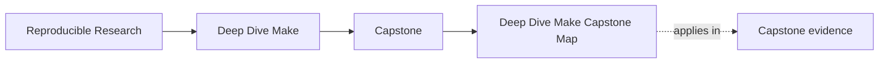
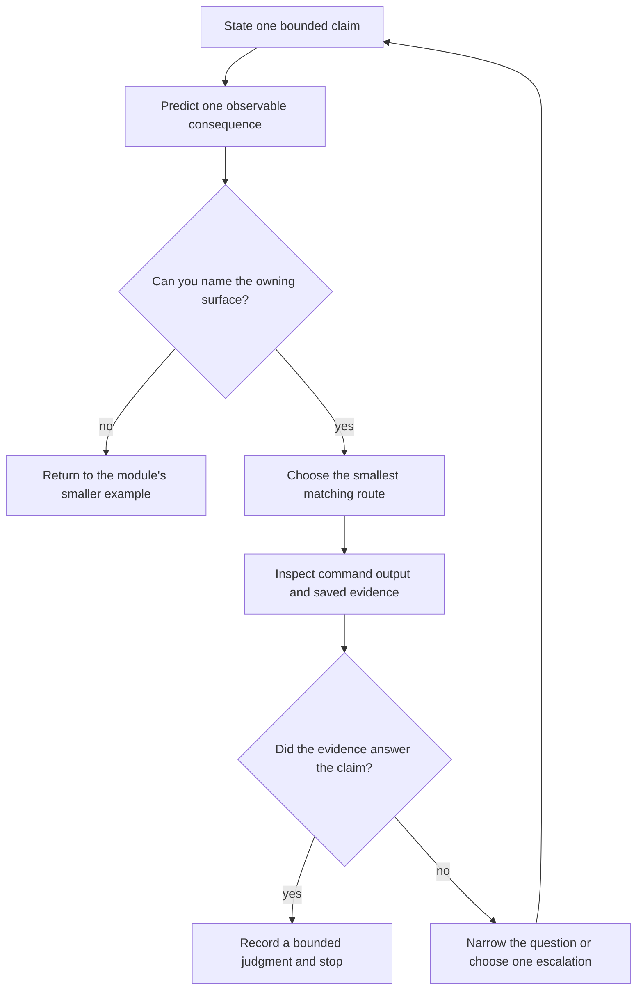

# Deep Dive Make Capstone Map

<!-- page-maps:start -->
## Page Maps




<!-- page-maps:end -->

Read the first diagram as a timing map: the capstone is a corroboration surface, not the
first lesson. Read the second diagram as the route rule: choose one capstone route by
module or question, inspect the matching surface, then stop when one honest proof route
is visible.

## Enter the capstone at the right time

Enter only when the module idea is already legible in the local exercise.

Return to the module first if:

- you cannot yet explain the concept on a smaller graph
- you do not know which command should prove the behavior
- the repository feels larger than the concept you are studying

## Carry a route card

Before entering the repository, fill in this card:

```text
claim:
module model I am applying:
predicted observation:
owning surface:
smallest command:
saved evidence:
stop condition:
```

The `predicted observation` and `stop condition` matter most. Without them, it is easy to
keep opening files until the capstone feels familiar while never deciding whether the
claim was supported.

Use this route-selection loop:



## Choose the route by question

| If the question is... | Start here | Evidence to expect | Escalate only if needed |
| --- | --- | --- | --- |
| what this repository promises | [Capstone Guide](index.md) | a claim-and-limit table | [Capstone Walkthrough](capstone-walkthrough.md) |
| which repository surface matches the current module | the table below | one owning file and one route | [Command Guide](command-guide.md) |
| which command should prove the current claim | [Command Guide](command-guide.md) | command meaning, output location, and limit | [Capstone Proof Guide](capstone-proof-guide.md) |
| whether one release candidate passed local acceptance | [Capstone Release Acceptance](capstone-release-acceptance.md) | three records bound to one digest | [repository-local Release Acceptance Guide](../capstone-docs/release-guide.md) |
| which files own the behavior | [Capstone File Guide](capstone-file-guide.md) | a writer-reader-policy trace | [Capstone Architecture Guide](capstone-architecture-guide.md) |
| whether the whole repository holds together as a specimen | [Capstone Review Worksheet](capstone-review-worksheet.md) | a supported trust decision with named limits | [Capstone Extension Guide](capstone-extension-guide.md) |

## Choose the route by module arc

| Module arc | What should already be clear locally | First capstone route |
| --- | --- | --- |
| Modules 01-02 | truthful edges, atomic publication, and one parallel race you can explain | [Capstone Walkthrough](capstone-walkthrough.md) |
| Modules 03-05 | selftests, public targets, portability boundaries, and one negative proof | [Command Guide](command-guide.md) then [Capstone Proof Guide](capstone-proof-guide.md) |
| Modules 06-08 | generator boundaries, layered `mk/` design, and release contracts | [Capstone File Guide](capstone-file-guide.md), then [Capstone Release Acceptance](capstone-release-acceptance.md) |
| Modules 09-10 | incident judgment, stewardship review, and migration boundaries | [Capstone Review Worksheet](capstone-review-worksheet.md) |

## Module-to-capstone map

Commands in this table run from the repository root. That fixed context prevents a
correct target name from becoming an unusable instruction.

| Module | Question to carry in | Prediction to make | Owning surface | First command |
| --- | --- | --- | --- | --- |
| 01 Foundations | what makes a graph truthful instead of lucky | which files should rebuild after one header change | `Makefile`, `src/`, `include/` | `make PROGRAM=reproducible-research/deep-dive-make capstone-walkthrough` |
| 02 Scaling | what breaks under `-j` when the graph lies | whether serial and parallel inventories should agree | `repro/`, `mk/objects.mk`, `tests/run.sh` | `make PROGRAM=reproducible-research/deep-dive-make test` |
| 03 Production Practice | how a build proves convergence and equivalence | which second-run work should be absent | `tests/run.sh`, [Capstone Proof Guide](capstone-proof-guide.md) | `make PROGRAM=reproducible-research/deep-dive-make capstone-verify-report` |
| 04 Semantics Under Pressure | how precedence and rule choice stay legible | which origin and rule will win | `Makefile`, `mk/rules_eval.mk` | `make PROGRAM=reproducible-research/deep-dive-make inspect` |
| 05 Hardening | where portability and hidden-input boundaries live | which policy change should invalidate which output | `mk/contract.mk`, `mk/stamps.mk` | `make PROGRAM=reproducible-research/deep-dive-make capstone-contract-audit` |
| 06 Generated Files | how generation enters the graph honestly | which producer owns each generated output | generator scripts, stamps, and depfiles | `make PROGRAM=reproducible-research/deep-dive-make proof` |
| 07 Build Architecture | how layered includes become a public build surface | which layer owns policy, membership, and state | `mk/*.mk`, [Capstone Architecture Guide](capstone-architecture-guide.md) | `make PROGRAM=reproducible-research/deep-dive-make capstone-architecture-contract-audit` |
| 08 Release Engineering | how one candidate moves through verification and contained installation | whether all acceptance records identify one digest | `release/*.tsv`, release scripts, and tests | `make PROGRAM=reproducible-research/deep-dive-make capstone-release-check` |
| 09 Incident Response | how process results and artifact state expose distinct failures | which signature and preserved artifact identify the first failed boundary | incident audit bundle | `make PROGRAM=reproducible-research/deep-dive-make capstone-incident-audit` |
| 10 Governance | whether another maintainer could extend or migrate the build safely | which proof obligation a proposed ownership change would inherit | `mk/`, `tests/`, `repro/`, public targets | `make PROGRAM=reproducible-research/deep-dive-make capstone-confirm` |

## Two worked routing decisions

### “Why did one object rebuild?”

Do not begin with the full proof route. Carry the Module 01 edge model into
`mk/objects.mk`, inspect the generated depfile for that object, and predict the
prerequisite that made it stale. Escalate to the incremental audit only if the observed
edge is missing or the rebuild set contradicts the prediction.

### “Can I trust this release?”

Do not begin with the general selftest. A build selftest cannot establish package
membership, extraction safety, install containment, or candidate identity. Use the
release-acceptance route and require candidate, install, and composed records to name
the same digest. Escalate only when a specific record rejects the candidate.

## Good stopping point

Stop when your route card contains:

- one claim and one predicted observation
- one owning surface and one proportionate command
- one piece of evidence you actually inspected
- one limit on the judgment

If you still feel pulled toward the whole repository, step back to the smaller module
example. More capstone surface is not a substitute for a sharper question.
