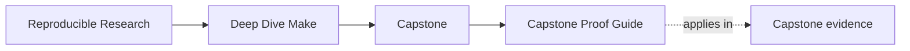
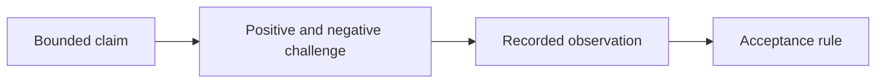

# Capstone Proof Guide

<!-- page-maps:start -->
## Page Maps




<!-- page-maps:end -->

Read the first diagram as a timing map: this guide is for one end-to-end proof pass,
not for first contact. Read the second diagram as the rule: run the bounded proof route,
inspect the evidence in order, then leave with one explicit judgment about trust.

Use this guide after Module 03, or later when you need a steward-level review route
before incident, profile, or migration questions.

After Module 08, use the release acceptance route below for claims about candidate
identity, package policy, or contained installation. The general `proof` bundle does
not substitute for release evidence.

## Proof has four parts

Every trustworthy route connects four different things:



- A **claim** says what behavior is under review and where it stops.
- A **challenge** creates conditions that could expose a false claim.
- An **observation** preserves what happened without rewriting the subject.
- An **acceptance rule** explains why that observation supports pass, rejection, or
  unresolved status.

A command ending in zero is only the decision signal. You still need to inspect the
other three parts.

## Choose the narrowest proof

The narrow commands below run from
`programs/reproducible-research/deep-dive-make/capstone/` with GNU Make.

| Claim | Narrow route | Evidence to inspect | Negative control or rejection path | Claim limit |
| --- | --- | --- | --- | --- |
| a second build converges and tested schedules agree | `gmake selftest` | selftest summary, logs, schedule comparison | selftest harness fault seam | tested configuration and declared comparisons |
| public targets and portability assumptions are inspectable | `gmake contract-audit` | help, portability, discovery, route | missing required capability | does not prove artifact correctness |
| a missing edge creates stale output and its repair rebuilds correctly | `gmake incremental-fault-audit` | case findings, traces, preserved workspace | broken and repaired specimens | covered edge classes only |
| state, edge kind, and rule selection have the predicted semantics | `gmake semantic-fault-audit` | semantic findings and traces | semantic audit selftest | included semantic specimens only |
| non-file state, recursion, and required tools obey contracts | `gmake environment-contract-audit` | environment findings and traces | environment audit selftest | declared environment classes only |
| public API, include direction, and output mapping have owners | `gmake architecture-contract-audit` | architecture findings | architecture audit selftest | declared architecture cases only |
| explicit and generated rule abstractions preserve their contract | `gmake abstraction-contract-audit` | abstraction findings | abstraction audit selftest | included abstraction cases only |
| concurrency specimens produce their declared signatures | `gmake incident-audit` | summary, findings, raw logs, workspace | healthy case plus failing cases | named incident mechanisms only |
| observed execution matches the declared profile | `gmake profile-audit` | profile report and captured context | profile policy checks | captured environment and run |

If the claim is one row, do not cite the entire `proof` target without identifying that
row's evidence.

## Bounded proof pass

1. Run `make PROGRAM=reproducible-research/deep-dive-make proof`.
2. Read the terminal summary as an index of bundles, not as the evidence itself.
3. Choose one claim from the table above.
4. Read the route or guide copied into that bundle.
5. Inspect its summary before individual logs.
6. Select one finding and follow every referenced trace or observed file.
7. Locate the authored script or harness that applies the acceptance rule.
8. Write what the route establishes and what it leaves open.
9. Inspect a second bundle only if your question crosses a real boundary.

The composed target currently writes these families:

```text
artifacts/
├── walkthrough/reproducible-research/deep-dive-make/
├── proof/reproducible-research/deep-dive-make/selftest/
└── audit/reproducible-research/deep-dive-make/
    ├── contract/
    ├── incident/
    ├── incremental-faults/
    ├── semantic-faults/
    ├── environment-contracts/
    ├── architecture-contracts/
    ├── abstraction-contracts/
    └── profile/
```

The tree is a catalog, not a reading order. Your claim chooses the bundle.

## Questions this proof pass should answer

- what `selftest` proves that `all` does not
- where the public contract becomes inspectable
- where hidden inputs and generated boundaries are made visible
- which saved bundle would matter most to another maintainer
- which repro teaches a real failure class instead of a toy surprise
- which acceptance rule could reject superficially plausible evidence
- which claim remains outside the chosen proof route

## Read one finding all the way through

Use this sequence for JSON or tabular audit bundles:

1. **Summary:** identify the case name, expected mechanism, and result.
2. **Finding:** read the structured observation, not only its status.
3. **Trace:** open the referenced command output or filesystem record.
4. **Specimen:** locate the authored broken or healthy model.
5. **Auditor:** find the condition that converts the observation into pass or rejection.
6. **Counterfactual:** state one dishonest change the auditor should reject.

For example, a missing-edge audit is not strong merely because the broken case stays
stale. The repaired case must rebuild for the declared input and remain quiet for an
equivalent state. Otherwise the route might reward rebuilding everything.

## Distinguish positive, negative, and metamorphic checks

| Check kind | Question | Capstone-shaped example |
| --- | --- | --- |
| positive | does valid behavior succeed? | a clean build produces the expected inventory |
| negative | does a named defect get rejected? | a corrupted candidate fails verification |
| metamorphic | does a controlled input change produce the right change in behavior? | changing a header rebuilds affected outputs while an unchanged rerun stays quiet |

Strong proof routes often need more than one kind. A positive build alone cannot detect
an overbroad or under-declared rebuild policy.

## Avoid self-fulfilling evidence

Evidence is weak when the same action:

- repairs the subject before observing the failure
- derives expected values from the result it is checking
- rebuilds a candidate during “verification”
- deletes the preserved workspace after summarizing it
- treats any nonzero exit as the expected failure

When reviewing a bundle, ask whether producer, observer, and acceptance rule are
sufficiently separate to catch a plausible lie.

## Release acceptance proof

Run:

```sh
make PROGRAM=reproducible-research/deep-dive-make capstone-release-check
```

Then inspect these records in order:

```text
artifacts/release/reproducible-research/deep-dive-make/evidence/
├── candidate-acceptance.json
├── install-acceptance.json
└── release-acceptance.json
```

The first report proves policy over existing candidate bytes. The second proves a
contained install mapping and repeated-application convergence. The third refuses to
compose the first two unless they identify the same candidate digest.

Do not infer remote publication from these records. The final report explicitly records
that publication was not attempted.

Read [Capstone Release Acceptance](capstone-release-acceptance.md) for the complete
learner route, including the consumer-only verification experiment and rejection tests.

## Failure-study route

Use this route when the open question is whether a controlled concurrency failure has been
reproduced honestly:

1. Run `make PROGRAM=reproducible-research/deep-dive-make capstone-incident-audit`.
2. Read `summary.tsv` and predict why one case expects zero while two expect nonzero.
3. Verify every finding against its file under `evidence/`, not only its raw log.
4. Inspect the preserved workspace and copied specimen for the ownership defect.
5. State the defect class and repair graph before reading the repair guidance.
6. Return to `capstone/tests/run.sh` and the selftest bundle for healthy-build proof.

## Write a proof judgment

Use this shape:

```text
claim:
execution context:
challenge:
observed evidence:
acceptance rule:
result:
limit:
follow-up, if any:
```

Avoid “all checks passed.” A maintainer needs to know which check, against which claim,
under which context.

## Good stopping point

Stop when you can write one explicit judgment in your own words:

- trust the build contract as-is
- trust it with one named boundary to revisit
- do not trust it yet because one specific proof surface is still missing

Support the judgment with one claim, one challenge, one observed record, and one limit.
If you cannot, narrow the claim before adding more commands.

## Best follow-up routes

- Read [Capstone File Guide](capstone-file-guide.md) when the open question is file ownership.
- Read [Proof Matrix](../guides/proof-matrix.md) when the open question is claim-to-evidence routing.
- Read [Capstone Review Worksheet](capstone-review-worksheet.md) when the open question is
  failure-class study or steward judgment.
- Read [Capstone Release Acceptance](capstone-release-acceptance.md) when the open question
  is one candidate's package, identity, or install contract.
