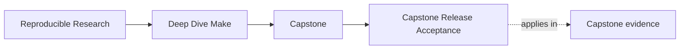
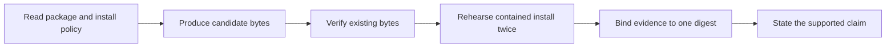
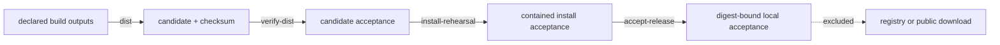

# Capstone Release Acceptance

<!-- page-maps:start -->
## Page Maps




<!-- page-maps:end -->

Use this route after Module 08, when you can already explain deterministic archive
creation on a smaller example. The capstone adds the review problem that a release is
not one command. Production, verification, installation, and acceptance have different
trust responsibilities.

The question for this route is narrow:

> Can another maintainer inspect one exact candidate, prove that it obeys declared
> package and install policy, and see clearly that no remote publication occurred?

This is not a deployment exercise. It is a local release-acceptance exercise.

## Read the trust transitions before running them



The dashed edge matters. A green local route does not prove publication, signing,
authorization, or package-manager behavior.

| Boundary | May create candidate bytes? | Evidence it owns |
| --- | --- | --- |
| `dist` | yes | archive plus SHA-256 sidecar |
| `verify-dist` | no | candidate contract report |
| `install-rehearsal` | no | installed-tree and convergence report |
| `accept-release` | no | one bounded record tying both reports to one digest |
| `release-selftest` | only isolated test specimens | acceptance and rejection test results |
| `release-check` | composes all local boundaries | locally accepted candidate |

If a consumer target rebuilt the candidate, a failure could disappear while being
investigated. That is why `verify-dist`, `install-rehearsal`, and `accept-release` have
no producer prerequisites.

## Orient on the governed files

Work from:

```sh
cd programs/reproducible-research/deep-dive-make/capstone
```

On macOS, use `gmake`; the capstone requires GNU Make.

Read these files before the scripts:

```text
release/package-policy.tsv
release/install-policy.tsv
```

The package policy declares each archive path, source path, and mode. It admits four
payloads explicitly:

```text
deep-dive-make-capstone/app
deep-dive-make-capstone/bin/dyn1
deep-dive-make-capstone/bin/dyn2
deep-dive-make-capstone/include/dynamic.h
```

This is safer than archiving `build/bin/`: dependency files or future diagnostic
outputs cannot join the release merely because they share a directory with an
executable.

The install policy maps those archive paths below a controlled install root. It does
not write to host `/usr/local`, even though the logical destinations begin with
`usr/local/`.

## Produce and inspect one candidate

Run:

```sh
gmake dist
```

The public candidate packet is outside the source tree:

```text
artifacts/release/reproducible-research/deep-dive-make/
└── candidate/
    ├── deep-dive-make-capstone.tar.gz
    └── deep-dive-make-capstone.tar.gz.sha256
```

From `capstone/`, inspect its members:

```sh
tar -tvzf \
  ../../../../artifacts/release/reproducible-research/deep-dive-make/candidate/deep-dive-make-capstone.tar.gz
```

Do not accept the archive because its listing looks plausible. The listing helps you
form expectations; the verifier enforces them.

## Prove verification is consumer-only

First verify:

```sh
gmake verify-dist
```

Then remove local build products and verify the preserved candidate again:

```sh
gmake clean
gmake verify-dist
```

The second verification must pass without recreating `app`, `all`, or `build/`. This
demonstrates that verification consumes the candidate and sidecar rather than silently
asking Make to produce replacements.

Inspect:

```text
artifacts/release/reproducible-research/deep-dive-make/
└── evidence/
    └── candidate-acceptance.json
```

The report covers exact digest and filename, exact member set, safe relative paths,
regular-file types, declared modes, fixed timestamps, and normalized ownership.

## Study rejection before trusting acceptance

Run:

```sh
gmake release-selftest
```

The test suite constructs controlled bad candidates and destinations. It must reject:

- changed bytes paired with an old checksum
- undeclared archive members
- traversal paths
- mode drift
- symbolic-link destination ancestors
- destination files not owned by the install policy
- candidate and install reports that name different digests

It also proves that changing the output filename does not change archive bytes and that
complete install rehearsals converge.

A rejection test is not an optional edge case. It demonstrates that the gate closes
when a named contract is false.

## Rehearse installation without touching the host

Regenerate and verify a candidate, then run the contained install route:

```sh
gmake dist
gmake verify-dist
gmake install-rehearsal
```

The rehearsal reads governed payloads from the archive, writes them atomically below
the repository-owned install root, applies the same mapping twice, and compares paths,
modes, and SHA-256 values.

Inspect:

```text
artifacts/release/reproducible-research/deep-dive-make/
├── install-root/
│   └── usr/local/
└── evidence/
    └── install-acceptance.json
```

This proves a contained mapping and rerun convergence. It does not prove rollback,
uninstall, upgrade migration, privileged installation, or package-manager ownership.

## Run the composed acceptance route

From the repository root, the stable course entrypoint is:

```sh
make PROGRAM=reproducible-research/deep-dive-make capstone-release-check
```

From the program directory:

```sh
gmake capstone-release-check
```

From `capstone/`:

```sh
gmake release-check
```

The composed route runs product tests, build-system selftests, ten release acceptance
and rejection tests, candidate production, independent verification, contained
installation, and final evidence composition.

Its final evidence directory contains:

```text
evidence/
├── candidate-acceptance.json
├── install-acceptance.json
└── release-acceptance.json
```

Read all three. The candidate filename and SHA-256 digest must agree across them. The
final record must also say that remote publication was not attempted.

## Diagnose the boundary that failed

| Symptom | Inspect first | Do not do |
| --- | --- | --- |
| archive has an unexpected member | `release/package-policy.tsv` and candidate report | widen a directory glob |
| checksum mismatch | candidate and sidecar bytes | rerun `dist` before preserving the failed specimen |
| unsafe path or mode rejection | archive listing and package policy | weaken verifier checks to accept the candidate |
| install ancestor rejection | install root and install policy | follow or replace the symbolic link |
| install convergence failure | both install snapshots in the report | call the second application redundant |
| report digest mismatch | all three JSON reports | hand-edit evidence to make digests agree |

The failed transition identifies the owner. Preserve the candidate while diagnosing
consumer failures; rebuild only when you deliberately start a new candidate.

## Make the review judgment

Complete these statements in your own words:

1. The archive member set is governed by ________, not by ________.
2. `verify-dist` is demonstrably consumer-only because ________.
3. The install rehearsal remains contained because ________.
4. The rejection test that gives me the most confidence is ________ because ________.
5. The three acceptance records identify the same bytes by ________.
6. The strongest unsupported claim is ________.

If you cannot fill one blank from a policy file, command result, or saved report, the
local release claim is not yet reviewable.

## Stop at the supported claim

After a passing route, you may claim:

- one candidate contains exactly the governed payloads
- its identity and archive contract were checked without rebuilding it
- its contained install mapping converged across complete applications
- named malformed candidates and destinations were rejected
- all acceptance records identify the same candidate digest

You may not claim:

- external source authenticity
- signature authorization
- public package completeness
- registry or download publication
- transactional host installation

For script-by-script detail and exact report fields, continue to the
[repository-local Release Acceptance Guide](../capstone-docs/release-guide.md).
