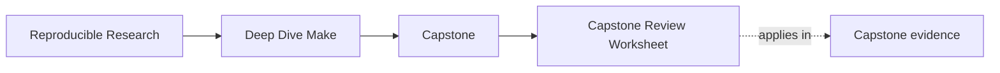
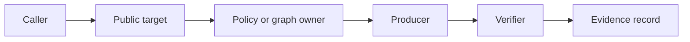

# Capstone Review Worksheet


<!-- page-maps:start -->
## Page Maps




<!-- page-maps:end -->

Use this page when you want to review the capstone as an inherited build, not just read
it as course material. The point is to leave with explicit judgments you could defend in
code review, maintenance planning, or a handoff.

## Review one proposed reliance

“Is this build good?” is too broad. Start with something a caller wants to rely on:

- developers want `gmake all` to converge after an unchanged build
- CI wants `gmake selftest` to reject schedule-dependent outputs
- a release reviewer wants `gmake verify-dist` to inspect existing candidate bytes
- a maintainer wants to add one generated source without creating a second writer

The review asks whether that reliance is supported. A repository may support one and
remain weak for another.

## How to use the worksheet

Work top to bottom. For each section:

1. answer the question in your own words
2. name the file or saved bundle that supports the answer
3. challenge the answer with one plausible counterexample
4. record one risk only if you can point to the owning boundary

If you cannot name the evidence, the judgment is still too soft.

## Grade evidence before conclusions

Use these grades to stop weak observations from carrying strong conclusions:

| Grade | Evidence shape | Permitted use |
| --- | --- | --- |
| observed | terminal output or file seen once | describe that execution only |
| repeatable | command and context are recorded and rerun consistently | support a local behavior claim |
| challenged | positive, negative, or metamorphic cases can reject false behavior | support a bounded trust judgment |
| governed | schema, policy, identity, and acceptance rule are reviewable | support maintenance or handoff decisions |

Do not average grades. If release identity is governed but install containment is only
observed, the composed release judgment is limited by install evidence.

## Review record

Copy this before beginning:

```text
proposed reliance:
execution context:
public contract:
owning boundary:
evidence route:
counterexample attempted:
observation:
evidence grade:
judgment:
limit:
follow-up owner:
```

## Public contract

Ask:

- which targets are clearly public for review and maintenance
- whether `help` and the command docs are enough to start correctly
- which commands are aliases for a guided route rather than separate contracts

Best evidence:

- `capstone/Makefile`
- [Command Guide](command-guide.md)
- `artifacts/audit/reproducible-research/deep-dive-make/contract/help.txt`

Record:

| Field | Your finding |
| --- | --- |
| caller | |
| target and supported variables | |
| promised output or evidence | |
| excluded responsibility | |
| compatibility risk | |

## Truth and convergence

Ask:

- where hidden inputs are modeled
- what file acts as the convergence proof surface
- what would make the build appear healthy while still lying

Best evidence:

- `capstone/mk/stamps.mk`
- `capstone/tests/run.sh`
- `artifacts/proof/reproducible-research/deep-dive-make/selftest/summary.txt`
- `artifacts/proof/reproducible-research/deep-dive-make/selftest/schedule-comparison.json`
- `artifacts/proof/reproducible-research/deep-dive-make/selftest/logs/`

Challenge at least one calm-path result. A useful challenge changes one modeled input,
reruns, then runs again unchanged. The first rerun should perform the bounded necessary
work; the second should converge. “Both commands exited zero” does not answer whether
the rebuild set was honest.

## Parallel safety

Ask:

- which outputs have one clear writer
- which failures only appear under `-j`
- whether the repro pack teaches the same failure classes the healthy build protects against

Best evidence:

- `capstone/Makefile`
- `capstone/repro/`
- [Capstone Proof Guide](capstone-proof-guide.md)

Separate these claims:

| Claim | Evidence needed |
| --- | --- |
| no two recipes own the same output path | writer inventory or architecture audit |
| serial and parallel schedules publish equivalent inventories | schedule comparison |
| shared logs or staging directories do not corrupt evidence | focused incident specimens and repaired design |
| recursion preserves the parent job budget | environment contract evidence |

One passing `-j` run establishes none of them by itself.

## Architecture and ownership

Ask:

- whether each `mk/*.mk` file has one readable job
- whether macros reduce repetition without hiding control flow
- whether a new maintainer could locate policy, discovery, and proof without guesswork

Best evidence:

- `capstone/mk/contract.mk`
- `capstone/mk/objects.mk`
- `capstone/mk/macros.mk`
- [Capstone File Guide](capstone-file-guide.md)

Draw one responsibility trace:



Write a real file or record in every box. If two unrelated responsibilities point to
the same opaque helper, inspect that boundary before concluding the architecture is
maintainable.

## Release and stewardship

Ask:

- whether package membership comes from declared policy rather than directory contents
- whether candidate verification can run after local build outputs are cleaned
- whether the install route remains below its controlled root and converges when repeated
- whether candidate, install, and final acceptance records identify the same digest
- whether the final record distinguishes local acceptance from remote publication
- whether the build can be extended without weakening the review bar

Best evidence:

- `capstone/release/package-policy.tsv`
- `capstone/release/install-policy.tsv`
- `artifacts/release/reproducible-research/deep-dive-make/evidence/`
- [Capstone Release Acceptance](capstone-release-acceptance.md)
- [Capstone Extension Guide](capstone-extension-guide.md)

Record release judgments separately:

| Judgment | Result | Digest or evidence reference | Limit |
| --- | --- | --- | --- |
| package membership | | | |
| candidate identity | | | |
| extraction eligibility | | | |
| contained install | | | |
| repeated install convergence | | | |
| composed local acceptance | | | |
| remote publication | not attempted | | outside this capstone |

## Record the result

Finish each proposed reliance with one of these judgments:

- **supported:** the bounded reliance has challenged or governed evidence
- **supported with limit:** the reliance is narrower than the caller first requested
- **not supported:** evidence rejects the claim or a required boundary is unproved
- **not reviewed:** the route was not run or its output was unavailable

Do not use “trust with one named follow-up” when the follow-up is necessary for the
current claim. That claim is not supported yet.

If your conclusion is longer than a short paragraph, the review probably drifted away from
one bounded question.

## Worked judgment: unchanged-build convergence

Suppose the proposed reliance is:

> After a successful build under the recorded tool and flag context, an unchanged
> second invocation schedules no compilation, generation, or linking work.

A weak review runs `gmake all` twice, sees two zero exits, and marks the claim supported.
Exit status cannot reveal whether the second run repeated successful work.

A stronger review:

1. identifies `all`, object rules, depfiles, and the flag stamp as the owning graph
   surfaces
2. predicts an empty second-run work inventory
3. runs the selftest route that records second-build work
4. inspects the captured log or structured finding
5. checks the harness rejection seam so an injected second-run action fails
6. limits the judgment to the captured configuration and modeled inputs

The result can earn “challenged” evidence because the harness can reject a plausible
false convergence result.

## Failure-study prompts

Use these when the review question is about a broken specimen rather than the healthy
build:

- Which output or directory has more than one effective writer?
- Which edge should affect staleness rather than only sequencing?
- Which repair would make the graph more truthful instead of only hiding the symptom?

## Review handoff

Another maintainer should be able to continue without replaying your terminal history.
Provide:

- the proposed reliance and bounded judgment
- the exact command layer, target, and overrides
- the evidence path and relevant finding identifiers
- the first failed or uncertain boundary
- the owner and acceptance condition for any follow-up

Leave out unrelated logs. A smaller, attributable packet is easier to audit than a
directory copied without explanation.
