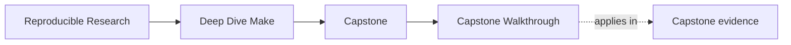

# Capstone Walkthrough

<!-- page-maps:start -->
## Page Maps




<!-- page-maps:end -->

Read the first diagram as a timing map: this page gives the capstone a guided route,
not just a repository map. Read the second diagram as the rule: choose one walkthrough
depth, read the matching guide and artifact, then stop when one honest repository story
is visible.

## First pass versus deeper pass

- First pass: use the 30-minute route when you need one bounded story from public targets to proof.
- Deeper pass: use the longer routes only when the question changes from entry to architecture or stewardship.

## Prepare a disposable observation record

The commands write governed output under `artifacts/`, but your reasoning still needs a
place to live. Use a short note outside the source tree or add these fields to your
course notebook:

```text
command:
prediction:
exit status:
saved evidence:
one observed fact:
one unsupported inference:
```

The final field is deliberate. If `selftest` passes, “this Makefile is correct on every
platform” is still unsupported. Naming that limit is part of learning to review build
evidence.

## A 30-minute first pass

Run this pass from the repository root. Each stop has a question, an action, and an
observation. Do not move on until you can record the observation in your own words.

### Stop 1: identify the public entrance

Run:

```sh
make PROGRAM=reproducible-research/deep-dive-make capstone-walkthrough
```

Before running it, predict whether this command compiles the C program or assembles a
learner bundle. Then inspect:

```text
artifacts/walkthrough/reproducible-research/deep-dive-make/
```

The useful observation is not merely that files exist. Identify which copied file
describes target meaning and which copied file contains executable proof. The bundle is
a reading surface; it is not the proof result itself.

### Stop 2: inspect the public contract

Run:

```sh
make PROGRAM=reproducible-research/deep-dive-make inspect
```

Read the generated `help.txt`, `portability.txt`, and `discovery.txt` before reading the
implementation. Ask:

- which target names are presented as stable entrances
- which platform assumptions are observed rather than guaranteed
- which source-discovery property is checked

Now open `capstone/Makefile`. Find the recipes that produced those three records. This
outside-in order teaches an important review habit: understand the claimed interface
before inspecting how it is implemented.

### Stop 3: predict the proof obligations

Before opening `capstone/tests/run.sh`, write down what a serious build selftest should
check beyond “the program compiled.” At minimum, consider:

- a clean build
- a second invocation with no unintended work
- agreement between serial and parallel schedules
- a controlled failure that the harness must reject

Then read `tests/run.sh` and mark each predicted obligation as present, absent, or
narrower than expected. This comparison is more educational than reading the script
without a hypothesis.

### Stop 4: execute the proof

Run:

```sh
make PROGRAM=reproducible-research/deep-dive-make test
```

The wrapper delegates to the capstone selftest. Read the terminal result, then inspect
the proof bundle rather than treating `PASS` as the whole result:

```text
artifacts/proof/reproducible-research/deep-dive-make/selftest/
```

Find the summary, the schedule comparison, and at least one captured log. State which
claim each file supports. If a file cannot be connected to a claim, it is residue for
your current question, not evidence you need to cite.

### Stop 5: write the repository story

Complete these sentences:

> The public entry I used was …
>
> It promised …
>
> The owning implementation surface was …
>
> The proof harness tested …
>
> The saved evidence showed …
>
> This route did not establish …

If you can fill those lines with file names and observations, the first pass is
complete. If not, repeat only the stop whose transition is unclear.

## Architecture pass

Use this only after Modules 06-08.

Carry this question: **Which file owns membership, invalidation, production, and proof
for one generated binary?**

1. Read [Capstone Architecture Guide](capstone-architecture-guide.md) before widening
   into the repository.
2. Choose one dynamic binary under `build/bin/`; do not trace every target.
3. Follow its source membership through `capstone/mk/objects.mk`.
4. Follow its modeled hidden inputs through `capstone/mk/stamps.mk`.
5. Trace generated-header production from `capstone/scripts/gen_dynamic_h.py`.
6. From `programs/reproducible-research/deep-dive-make/capstone/`, predict the rule and
   prerequisites that `gmake --trace dyn` should report, then run it.
7. Change no source. Run the command again and explain any remaining work.

The pass is complete when you can draw one target-centered ownership trace. It is not
complete merely because you have read every file under `mk/`.

## Release acceptance pass

Use this after Module 08, not as a first repository tour.

1. Read [Capstone Release Acceptance](capstone-release-acceptance.md).
2. Compare `capstone/release/package-policy.tsv` with the archive members.
3. Run `gmake dist`, then `gmake verify-dist` from `capstone/`.
4. Run `gmake clean verify-dist` and confirm verification did not rebuild the candidate.
5. Run `gmake release-selftest` to study the gates from their rejection paths.
6. Run `gmake release-check`.
7. Compare the digest in candidate, install, and final acceptance reports.

Record four distinct judgments:

| Judgment | Evidence |
| --- | --- |
| candidate membership matches policy | observed member comparison |
| candidate bytes match recorded identity | checksum and candidate report |
| contained install matches mapping and converges | install report |
| composed local acceptance binds the same candidate | final acceptance report |

The pass is complete when you can explain why these are separate trust roles and state
that remote publication and host installation remain unsupported.

## Stewardship pass

Use this only after Modules 09-10.

1. Read [Command Guide](command-guide.md).
2. Read [Capstone File Guide](capstone-file-guide.md).
3. Review `capstone/mk/*.mk`, `capstone/tests/`, and `capstone/repro/`.
4. Run `make PROGRAM=reproducible-research/deep-dive-make capstone-confirm`.

Do not use the large command as a substitute for a review question. Choose one proposed
change—such as adding a generated source, changing a public target, or handing release
publication to another tool—and write:

- the current owner
- the proposed owner
- the proof obligations that must cross the boundary
- the evidence that would justify retiring the old route

The pass is complete when you can make a supported keep, change, or handoff judgment.

## If a pass fails

Use the first failed transition to choose the next action:

| Failure | Next action |
| --- | --- |
| command is unknown | read [Command Guide](command-guide.md) and `gmake help` |
| target meaning is unclear | inspect `Makefile` and the matching repository-local target guide |
| output exists but its claim is unclear | read [Capstone Proof Guide](capstone-proof-guide.md) |
| evidence contradicts your prediction | preserve the output and narrow the claim before rerunning |
| a large route fails after several smaller checks pass | identify the first failed subtarget; do not rebuild everything immediately |

## Good stopping point

Stop when you can explain one complete repository story:

- the public target you started from
- the build behavior it is supposed to prove
- the file or proof surface that makes that claim inspectable
- the observation that supports your judgment
- the limit that keeps the judgment honest

If you cannot tell that story yet, do not widen the tour. Repeat the smaller pass.
