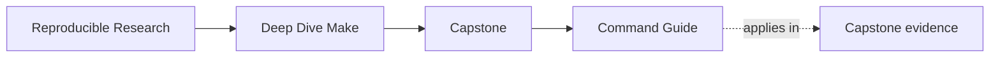

# Command Guide

<!-- page-maps:start -->
## Page Maps




<!-- page-maps:end -->

Read the first diagram as a timing map: this page is for command choice, not for learning
the whole capstone. Read the second diagram as the rule: choose the command layer that
matches the current job, run the smallest honest command, then escalate only if the
question changes.

Deep Dive Make has three command layers: repository root, program directory, and capstone
directory. The layers exist so you do not have to guess where a command belongs.

## Read a command as a contract

A command has more meaning than its target name. Read all five parts:

```text
working directory + Make executable + target + variable overrides + expected evidence
```

For example:

```sh
cd programs/reproducible-research/deep-dive-make/capstone
gmake PERFORMANCE_SAMPLES=7 performance-evidence
```

This means:

- interpret `capstone/Makefile`, not the repository wrapper
- use GNU Make explicitly
- request the governed performance-evidence route
- override the sample-count input for this invocation
- expect evidence under the repository `artifacts/` tree

Copying only `performance-evidence` loses most of the command contract.

## Choose the command layer

| If you need... | Use this layer | What the layer adds | What it hides |
| --- | --- | --- | --- |
| one stable entrypoint from the repository root | repository root | consistent program selection | the delegated capstone target name |
| course-local commands while staying inside the program | `programs/reproducible-research/deep-dive-make/` | course aliases and local tool setup | the raw capstone recipe |
| the executable reference build or a narrow audit | `capstone/` | direct targets and variable seams | repository-wide program routing |

Moving down a layer is useful for diagnosis, but it also accepts more responsibility.
At the capstone layer, you must choose GNU Make, know the target contract, and interpret
the resulting evidence yourself.

## Distinguish command roles

The public targets fall into different roles. A larger role does not make a smaller one
obsolete.

| Role | Examples | Main question | Typical output |
| --- | --- | --- | --- |
| orientation | `walkthrough`, `help`, `inspect` | what should I read or review? | guide or audit bundle |
| production | `all`, `dist` | can the requested artifact be produced? | build or candidate artifact |
| focused proof | `selftest`, `incremental-fault-audit`, `release-selftest` | does one bounded claim survive its checks? | logs, findings, reports |
| composed proof | `proof`, `release-check`, `confirm` | do several required claims hold together? | several governed evidence bundles |
| diagnosis | `show`, `trace-report`, audit targets | why did Make make this decision? | inspectable state or trace evidence |
| maintenance | `clean` | can governed outputs be removed? | changed workspace state, not proof |

Do not cite a production target as proof of convergence, or an orientation bundle as
proof that the build passed.

## Start by job, not by directory

| If the job is... | Start here | Do not start with |
| --- | --- | --- |
| first-pass capstone reading | `make PROGRAM=reproducible-research/deep-dive-make capstone-walkthrough` | `make PROGRAM=reproducible-research/deep-dive-make capstone-confirm` |
| public-contract review | `make PROGRAM=reproducible-research/deep-dive-make inspect` | `make PROGRAM=reproducible-research/deep-dive-make proof` |
| build-system proof | `make PROGRAM=reproducible-research/deep-dive-make test` | `make PROGRAM=reproducible-research/deep-dive-make capstone-discovery-audit` |
| local release acceptance after Module 08 | `make PROGRAM=reproducible-research/deep-dive-make capstone-release-check` | manually chaining scripts without their Make target contracts |
| steward-level review | `make PROGRAM=reproducible-research/deep-dive-make proof` | ad hoc jumps into `capstone-contract-audit`, `capstone-profile-audit`, or `capstone-confirm` before you know which stronger route you need |
| strongest final confirmation | `make PROGRAM=reproducible-research/deep-dive-make capstone-confirm` | `make PROGRAM=reproducible-research/deep-dive-make capstone-walkthrough` |

## Predict effects before execution

Use this table to avoid surprising workspace changes:

| Command family | Builds program outputs? | Writes evidence under `artifacts/`? | May intentionally run failing cases? |
| --- | ---: | ---: | ---: |
| walkthrough and inspect | no program build required for the route | yes | no |
| selftest and proof | yes, in controlled workspaces or the capstone | yes | yes |
| incident and semantic audits | only what the specimen requires | yes | yes |
| performance evidence | yes, according to governed scenarios | yes | no, unless a gate rejects evidence |
| release check | yes, including one candidate | yes | yes, through rejection selftests |
| clean | removes capstone or course outputs according to the selected layer | no | no |

“May intentionally run failing cases” means a nonzero child process can be expected
evidence while the enclosing audit still succeeds. Read the audit finding before
classifying the whole route as broken.

## Repository root

Use root-level commands when you want one entrypoint that works across programs.

- `make PROGRAM=reproducible-research/deep-dive-make capstone-walkthrough`
- `make PROGRAM=reproducible-research/deep-dive-make inspect`
- `make PROGRAM=reproducible-research/deep-dive-make test`
- `make PROGRAM=reproducible-research/deep-dive-make proof`
- `make PROGRAM=reproducible-research/deep-dive-make capstone-release-check`
- `make PROGRAM=reproducible-research/deep-dive-make capstone-confirm`

## Program directory

Use `programs/reproducible-research/deep-dive-make/` when you want the course-local
surface.

- `gmake capstone-walkthrough`
- `gmake inspect`
- `gmake test`
- `gmake proof`
- `gmake capstone-release-check`
- `gmake capstone-confirm`

## Capstone directory

Use `capstone/` when you want the raw reference build. On macOS, use `gmake`.

- `gmake walkthrough`
- `gmake inspect`
- `gmake selftest`
- `gmake incremental-fault-audit`
- `gmake verify-report`
- `gmake proof`
- `gmake dist`
- `gmake verify-dist`
- `gmake release-selftest`
- `gmake release-check`
- `gmake confirm`

Use the narrow release targets while investigating one boundary. Use `release-check`
only when you need the complete local acceptance claim. See
[Capstone Release Acceptance](capstone-release-acceptance.md) for the evidence route.

## Do not confuse preview with proof

`gmake -n target` prints many recipes Make would consider, but it is not a harmless
semantic oracle:

- Make still parses included files and expands make-level functions
- `$(shell ...)` can run during expansion
- printed recipes are not executed, so their runtime preconditions remain untested
- a preview cannot prove atomic publication, convergence, or failure cleanup

Use `-n` to inspect a plan when the Makefile is already trusted enough to parse. Use
the targeted selftest or audit when the question is whether the behavior is correct.

Likewise, `gmake --trace target` explains selected rule activity; it does not by itself
prove that the target set was complete or that two schedules are equivalent.

## A command-selection drill

Suppose a second build unexpectedly relinks `app`.

1. Start with the capstone layer because the question concerns one raw build decision.
2. Use `gmake --trace app` to identify the prerequisite Make considers newer.
3. Inspect the owning stamp, depfile, or source edge.
4. Use `gmake selftest` only after you have a concrete convergence hypothesis.
5. Escalate to `gmake proof` only if the question expands beyond convergence.

Starting with `confirm` would produce more output while making the original question
harder to see.

## When a command fails

Record these before rerunning:

```text
working directory:
Make executable and version:
target and overrides:
first failing target or check:
exit status:
preserved evidence path:
```

Then classify the failure:

- **selection failure:** wrong directory, executable, or target name
- **contract failure:** a required feature, tool, or policy input is missing
- **production failure:** an artifact recipe failed
- **proof rejection:** the route completed its investigation and rejected the claim
- **evidence failure:** the command ran, but its required report or finding is incomplete

These classes lead to different next actions. Repeating the same large command erases
that distinction.

## Good stopping point

Stop when you can state:

- why the chosen layer is proportionate to the question
- whether the target produces, proves, diagnoses, or removes
- which outputs and evidence should change
- what a pass and a rejection would each mean

If the layer still feels too large, step down one layer before opening more targets.
