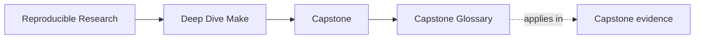
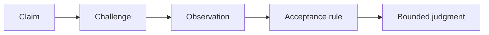

# Capstone Glossary

<!-- page-maps:start -->
## Page Maps

<!-- page-maps:end -->

Use this page when the Deep Dive Make capstone routes start sounding interchangeable.
The goal is to keep the build reviewable under pressure instead of relying on oral
history or terminal folklore.

## Contracts and ownership

| Term | Meaning in this capstone | Do not confuse it with |
| --- | --- | --- |
| public target | a supported Make target whose meaning callers may rely on | every target that happens to be invocable |
| target contract | the target's inputs, outputs, side effects, evidence, and failure meaning | the recipe text alone |
| owning boundary | the file or component responsible for one decision | every file that participates in the behavior |
| policy | authored rules that define allowed membership, inputs, or acceptance | an observation of what one run happened to contain |
| graph membership | the sources, generated inputs, and outputs represented to Make | package membership in a release candidate |
| writer | the one rule or process authorized to publish an output path | any process that reads or verifies that output |
| handoff contract | immutable input identity, receiver responsibility, retry ownership, and receipt requirements across tools | a shell command that launches the receiver |

## Build truth

| Term | Meaning in this capstone | Diagnostic question |
| --- | --- | --- |
| graph truth | declared prerequisites and writers represent the behavior needed for correct scheduling and invalidation | which input or writer is invisible to Make? |
| modeled input | file or content-bearing state that can make an output stale | would changing it cause the intended rebuild? |
| hidden input | behavior-affecting state not yet represented in the graph | can the output change while Make sees no prerequisite change? |
| convergence | an unchanged rerun schedules no unintended production work and leaves the accepted state stable | what work appears on the second invocation? |
| bounded rebuild | a relevant change rebuilds required consumers without rebuilding unrelated outputs | is the rebuild set too small or too broad? |
| schedule equivalence | tested serial and parallel schedules produce equivalent accepted inventories | are outputs and evidence the same, not merely both successful? |
| parallel safety | concurrent execution preserves writer ownership, publication integrity, and declared ordering | which shared path or undeclared edge could race? |
| atomic publication | incomplete candidate output stays private until a complete result replaces the public path | can a reader observe partial bytes? |

## Proof and evidence

| Term | Meaning in this capstone | What makes it useful |
| --- | --- | --- |
| proof route | an executable challenge and evidence path for one or more claims | it can distinguish supported behavior from a plausible false result |
| positive check | valid behavior is expected to succeed | establishes the ordinary path |
| negative control | a named defect or dishonest record is expected to be rejected | shows that success is not automatic |
| metamorphic check | a controlled input change must cause a predicted behavior change | tests invalidation and rebuild scope |
| observation | recorded command, state, trace, or artifact from an execution | it is attributable to a context |
| finding | structured interpretation of observations for one case | it names mechanism, result, and referenced evidence |
| acceptance rule | the condition that converts observations into pass, rejection, or unresolved status | a reviewer can inspect and challenge it |
| evidence bundle | governed directory containing routes, summaries, findings, and referenced observations | another reviewer can follow it without terminal history |
| evidence identity | digest, context, or case identifier binding evidence to its subject | it prevents results from drifting between subjects |
| self-fulfilling evidence | a check that repairs, rebuilds, or derives expectations from the subject before judging it | nothing; redesign the check |

## Routes and review

| Term | Meaning in this capstone |
| --- | --- |
| walkthrough | bounded first contact that connects a public target, owning surface, and proof route |
| inspection route | contract-oriented evidence such as help, portability, and discovery records |
| focused audit | one named family of claims, specimens, findings, and rejection rules |
| composed proof | a target that produces several governed bundles without turning them into one universal claim |
| repro | a deliberately broken miniature Makefile that isolates one failure mechanism |
| failure packet | specimen, execution context, raw observation, structured finding, and preserved workspace needed for diagnosis |
| stewardship review | a supported judgment about whether a caller may rely on, extend, or hand off a bounded behavior |
| proposed reliance | the exact behavior a caller wants to trust; the subject of a review |
| evidence grade | observed, repeatable, challenged, or governed strength assigned before the conclusion |
| bounded judgment | supported, supported with a limit, not supported, or not reviewed for one proposed reliance |

## Release boundaries

| Term | Meaning in this capstone | Boundary |
| --- | --- | --- |
| source bundle | tracked source distribution after contamination checks | not the executable release candidate |
| candidate | exact archive bytes proposed for local acceptance | not accepted merely because production succeeded |
| candidate identity | digest naming the exact bytes under review | not package correctness |
| package policy | authored member paths and modes allowed in the candidate | not an observed archive listing |
| consumer-only verification | verification of existing candidate bytes without rebuilding or replacing them | not a second production route |
| extraction eligibility | archive members are safe to unpack under a controlled root | not proof of installed-tree correctness |
| contained install | mapped files remain beneath a controlled install root | not host installation |
| install convergence | repeated application yields the same governed installed tree | not merely two zero exit statuses |
| local acceptance | candidate, package, extraction, and contained-install evidence agree on one identity | not remote publication |
| release residue | build leftovers or local evidence that must not masquerade as publishable source | governed release evidence under `artifacts/` |
| publication receipt | remote receiver evidence bound to candidate identity | intentionally outside the current capstone |

## Capability language

| Term | Meaning |
| --- | --- |
| tool identity | observed name and version, useful for diagnosis |
| advertised capability | a feature token or probe result stating that one behavior is available |
| required capability | an advertised behavior the core build must have before parsing can continue |
| support policy | the environments maintainers commit to test and help users run |
| unprobed capability | optional behavior for which the capstone intentionally makes no support claim |

GNU Make's version is identity. `$(.FEATURES)` is capability evidence for advertised
features such as `grouped-target`. Neither says which operating systems the maintainers
support.

## Confusable pairs

| Pair | Distinction |
| --- | --- |
| production / verification | production may create candidate bytes; verification must judge the existing subject without replacing it |
| success / acceptance | success is process status; acceptance applies a reviewable rule to observations |
| ordering / invalidation | order-only edges sequence work; ordinary prerequisite edges can also make targets stale |
| helper / owner | a helper performs bounded mechanics; an owner decides policy or graph meaning |
| trace / proof | a trace explains selected activity; proof challenges a claim with an acceptance rule |
| digest / provenance | a digest names bytes; provenance describes selected production context |
| local acceptance / publication | local acceptance stops with governed evidence; publication changes remote state and needs a receipt |
| cleanup / recovery | cleanup removes state; recovery preserves evidence, repairs the boundary, and re-establishes trust |

## Vocabulary drill

Replace each vague sentence with a bounded one:

| Vague | More reviewable |
| --- | --- |
| “The build is deterministic.” | “The tested clean serial and parallel schedules produced equivalent inventories under the recorded context.” |
| “The release passed.” | “Candidate, install, and composed local-acceptance records identify the same digest; remote publication was not attempted.” |
| “The test caught the bug.” | “The negative control reproduced the declared shared-writer signature and the audit rejected evidence when that signature was absent.” |
| “The script owns packaging.” | “Package policy owns allowed membership; the assembly script produces candidate bytes from that policy.” |
| “Make 4.4 is supported.” | “The running Make advertises the required feature tokens; support policy is recorded separately.” |

You understand the vocabulary when you can name the subject, boundary, evidence, and
limit without using “works,” “safe,” or “verified” as complete explanations.
