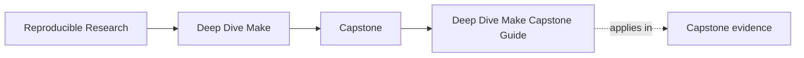
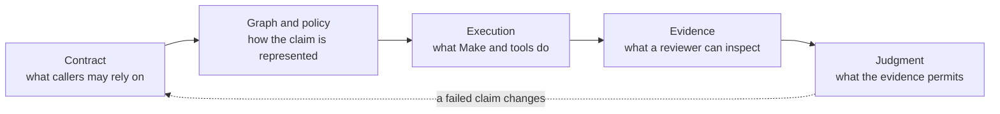

# Deep Dive Make Capstone Guide

<!-- page-maps:start -->
## Page Maps

<!-- page-maps:end -->

This capstone is the executable reference build for Deep Dive Make. It keeps graph truth,
atomic publication, parallel safety, determinism, self-testing, and local release
acceptance in one compact repository so the course can point to real evidence instead
of slogans.

Use this guide once the local module idea is already legible. The capstone should answer
one build question at a time, not become a full repository tour by default.

## The capstone is an argument, not a trophy

A large example is easy to admire and hard to learn from. Treat this repository as a
set of linked claims:

The arrows are questions, not assurances. A target name does not prove its contract.
A successful recipe does not prove convergence. A saved report does not prove that its
inputs were the intended ones. Your work in the capstone is to follow one claim across
all five boxes and stop at the first unsupported transition.

## Your learner contract

For each capstone visit, produce a short review note with these five fields:

| Field | What to record |
| --- | --- |
| question | one behavior you are trying to understand |
| prediction | what you expect before running a command |
| smallest route | one guide, owning file, and command |
| observation | the exact output or saved evidence that changed or confirmed your model |
| bounded judgment | what is proved, rejected, or still unknown |

For example:

> **Question:** Does the build converge after a successful build?
>
> **Prediction:** A second invocation should schedule no compilation or linking work.
>
> **Smallest route:** `tests/run.sh` through `gmake selftest`.
>
> **Observation:** The convergence check records an empty second-build work set.
>
> **Bounded judgment:** The tested configuration converges; this does not prove every
> compiler, flag set, or platform converges.

This note prevents two common self-study failures: running everything without knowing
what to inspect, and turning one passing run into a universal claim.

## What this capstone proves

The repository contains proof routes for the following bounded claims:

| Claim | First owning surface | Corroborating route | Important limit |
| --- | --- | --- | --- |
| public targets have inspectable meanings | `Makefile` and `help` | `gmake contract-audit` | internal helper targets are not thereby public |
| modeled inputs drive rebuilds | `mk/objects.mk`, `mk/stamps.mk`, depfiles | `gmake selftest` and `gmake incremental-fault-audit` | only declared input classes are covered |
| tested serial and parallel schedules agree | graph rules plus publication recipes | `gmake selftest` | this is not a proof for arbitrary external tools |
| one candidate can be checked without rebuilding it | release policy and verification scripts | `gmake release-check` | no remote publication occurs |
| known failure classes can be recognized from preserved evidence | isolated files under `repro/` | the matching audit target | a specimen explains one mechanism, not every incident |

Read the limit column before using the command. It marks the boundary between evidence
and inference.

## Choose a first investigation

If you are studying alone, begin with one of these investigations rather than browsing:

| Investigation | Predict before running | Inspect afterward |
| --- | --- | --- |
| convergence | whether a second build has real work | selftest summary and captured logs |
| parallel equivalence | whether serial and parallel inventories match | schedule comparison evidence |
| hidden input | which artifact should rebuild after policy changes | stamp rules and incremental audit findings |
| release identity | whether verification can consume existing bytes after build cleanup | candidate digest and acceptance record |
| incident ownership | which writer or edge caused the failure | finding, specimen, and preserved workspace |

Write your prediction down. A prediction makes a passing result informative because it
reveals whether your mental model, not merely the build, was correct.

## Choose the right capstone route

| If your question is... | Best page |
| --- | --- |
| Which capstone surface matches the current module? | [Capstone Map](capstone-map.md) |
| Which targets or commands are public? | [Command Guide](command-guide.md) |
| Which files own the build behavior? | [Capstone File Guide](capstone-file-guide.md) |
| Where do contract, graph, proof, and repro ownership live? | [Capstone Architecture Guide](capstone-architecture-guide.md) |
| Which proof route is honest for this claim? | [Capstone Proof Guide](capstone-proof-guide.md) |
| How do I review one exact release candidate after Module 08? | [Capstone Release Acceptance](capstone-release-acceptance.md) |
| How should I review the repository as a steward? | [Capstone Review Worksheet](capstone-review-worksheet.md) |
| Where should a new change land? | [Capstone Extension Guide](capstone-extension-guide.md) |

## Start by module range

| Module range | Best capstone focus |
| --- | --- |
| Modules 01-02 | truthful edges, atomic publication, and one explainable race condition |
| Modules 03-05 | selftests, public targets, portability, and hidden-input proof |
| Modules 06-08 | generator boundaries, layered `mk/` design, and release acceptance |
| Modules 09-10 | incident review, stewardship judgment, and extension pressure |

## Core commands

| If you need... | From the repository root | From the capstone directory |
| --- | --- | --- |
| the first bounded pass | `make PROGRAM=reproducible-research/deep-dive-make capstone-walkthrough` | `gmake walkthrough` |
| public-contract review | `make PROGRAM=reproducible-research/deep-dive-make inspect` | `gmake inspect` |
| paired missing-edge and recovery study | enter `capstone/` for the bounded specimen workspace | `gmake incremental-fault-audit` |
| the steward-level proof route | `make PROGRAM=reproducible-research/deep-dive-make proof` | `gmake proof` |
| one local release acceptance | `make PROGRAM=reproducible-research/deep-dive-make capstone-release-check` | `gmake release-check` |

On macOS, use `gmake` inside `capstone/` because `/usr/bin/make` is BSD Make.

## Guide set

- [Capstone Map](capstone-map.md)
- [Capstone Walkthrough](capstone-walkthrough.md)
- [Command Guide](command-guide.md)
- [Capstone File Guide](capstone-file-guide.md)
- [Capstone Architecture Guide](capstone-architecture-guide.md)
- [Capstone Proof Guide](capstone-proof-guide.md)
- [Capstone Release Acceptance](capstone-release-acceptance.md)
- [Capstone Review Worksheet](capstone-review-worksheet.md)
- [Capstone Extension Guide](capstone-extension-guide.md)
- [Glossary](glossary.md)

## Review questions

- Which targets are truly public, and what evidence distinguishes them from helpers?
- Which file defines the tested convergence claim, and which file merely implements it?
- Which failure class is the healthy build defending against, and where is its negative
  control?
- Which exact digest do candidate, install, and final release evidence identify?
- What remains unknown after the chosen route passes?

## Stop here when

- you can state the current build claim and its limit in plain language
- you can name the owning file and the evidence-producing command
- you have recorded one observation rather than only a pass/fail result
- you know whether the evidence supports trust, rejection, or a narrower follow-up
