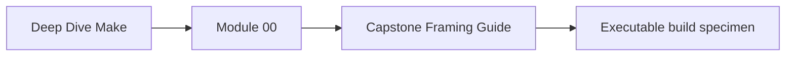
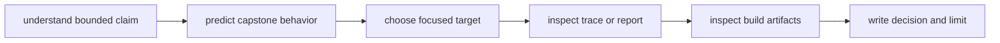
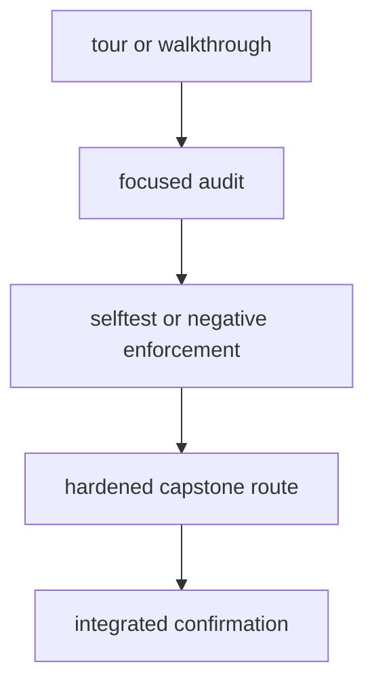

# Capstone Framing Guide

The capstone is a repository-scale GNU Make system with build, generated-file, testing,
architecture, release, profile, and incident evidence. Use it to corroborate a concept
you can already state.

Do not use the capstone as the first explanation of targets, prerequisites, timestamps,
or recipes.

## Page maps





## Know what the capstone can teach

It provides:

- a layered but inspectable Make graph;
- public targets used by humans and automation;
- generated files and multi-output ownership;
- deterministic and parallel selftests;
- environment and portability checks;
- release candidates, manifests, and checksums;
- execution profiles and incident reproductions;
- negative audits that enforce failure signatures.

It does not prove:

- every Make architecture should look the same;
- all supported platforms have been exercised locally;
- recipe tools are hermetic merely because Make invokes them;
- a full passing route explains one failure causally;
- Make should own deployment, secrets, or every repository workflow.

## Choose the smallest useful route

| Need | Target |
| --- | --- |
| see the learner-facing repository story | `capstone-walkthrough` |
| inspect public target behavior | `capstone-contract-audit` |
| reproduce concurrency incident signatures | `capstone-incident-audit` |
| distinguish state, edge, and rule-selection faults | `capstone-semantic-fault-audit` |
| inspect environment, recursion, and tool contracts | `capstone-environment-contract-audit` |
| inspect layers, public API, and output ownership | `capstone-architecture-contract-audit` |
| inspect explicit and generated rule abstractions | `capstone-abstraction-contract-audit` |
| inspect deterministic discovery | `capstone-discovery-audit` |
| inspect portability boundaries | `capstone-portability-audit` |
| profile execution cost | `capstone-profile-audit` |
| accept a local release candidate | `capstone-release-check` |
| run strongest integrated confirmation | `capstone-confirm` |

Invoke from the repository root:

```bash
make PROGRAM=reproducible-research/deep-dive-make <target>
```

## Route by module claim

| Module | Useful route | Read for |
| ---: | --- | --- |
| 01 | contract and semantic-fault audits | public request, graph edges, stale-state faults |
| 02 | incident and semantic-fault audits | scheduling, races, missing semantic edges |
| 03 | capstone selftest and discovery audit | convergence, deterministic discovery, build tests |
| 04 | semantic-fault and abstraction audits | rule selection, expansion, generated-rule behavior |
| 05 | environment and portability audits | tool, shell, recursion, and supported-platform boundaries |
| 06 | architecture audit | generated output ownership and publication |
| 07 | architecture and abstraction audits | public API, includes, macros, and namespacing |
| 08 | release check | candidate members, manifest, checksums, consumer acceptance |
| 09 | profile and incident audits | cost attribution, signatures, operational evidence |
| 10 | architecture, contract, and confirm routes | invariants that migration must preserve |

The route may support several modules. Read only the evidence relevant to the current
claim.

## Use routes in increasing strength



| Strength | Supports |
| --- | --- |
| walkthrough | repository shape and visible proof surfaces |
| focused audit | one bounded causal or contract claim |
| negative selftest | detector rejects a known weakened condition |
| hardened route | several invariants hold together |
| confirmation | strongest documented local acceptance route passes |

A stronger command is not automatically better teaching evidence. The smallest causal
contrast is often easier to review.

## Distinguish source, outputs, and audit bundles

| Surface | Role |
| --- | --- |
| `capstone/Makefile` and included Makefiles | governed build declarations |
| capstone source and fixtures | input state |
| capstone generated directories | ordinary build outputs |
| capstone tests and audit helpers | enforcement logic |
| repository `artifacts/audit/` | generated review bundles and logs |
| repository `artifacts/learning/` | learner sandboxes and packets |
| course-book capstone guides | reader-facing explanation |

When an exercise requires breaking a contract, use an audit specimen or copied sandbox.
Do not weaken the governed capstone source and leave it broken.

## Predict before reading reports

Create:

```text
claim:
requested target:
expected graph decision:
expected artifact:
negative case:
expected finding:
claim still outside route:
```

For audits that contain deliberate defects, predict whether the checker should accept or
reject each case. A successful detector can preserve a rejected build claim.

## Read a generated bundle

Use this order:

1. route or guide;
2. source Makefile and fixture;
3. prediction;
4. raw trace, stdout, and stderr;
5. artifact or identity evidence;
6. finding summary;
7. enforcement test.

Starting with a compact verdict encourages answer-reading rather than graph reasoning.

## Preserve serial and parallel context

For concurrency evidence, record:

```text
requested target:
job count:
serial baseline:
delay or schedule control:
first failing signature:
parallel artifact:
repaired artifact:
repeat count:
```

One successful parallel schedule is weak evidence. The audit should expose the failure
deterministically or with a bounded repeated route.

## Read release evidence as a consumer

The release check should be interpreted through:

- candidate identity;
- declared archive member contract;
- observed member listing;
- deterministic metadata policy;
- manifest and checksum;
- safe extraction or install destination;
- rejection evidence for unsafe candidates.

Producer success is not the final release claim.

## Handle generated worktree drift

Before and after repository-scale commands:

```bash
git status --short
```

If tracked files change:

- inspect exact paths and diff;
- separate intentional governed outputs from incidental synchronization;
- preserve user work;
- never use a broad destructive reset to quiet the tree.

Generated logs belong in `artifacts/`.

## Interpret failure by boundary

| Failure | Preserve and inspect |
| --- | --- |
| parser or semantic fault | Make version, include order, variable origin, selected rule |
| missing tool | capability check, path, supported-environment contract |
| race | job count, delay, shared output, first failure |
| partial generator | publication boundary and missing coupled outputs |
| release rejection | member, checksum, path, mode, or manifest violation |
| profile regression | comparable workload and cost layer |
| integrated confirmation failure | first focused invariant that failed |

Do not bypass the failure before preserving the state it reveals.

## Build a cross-module packet

```text
capstone-review/
├── public-targets.md
├── graph-and-semantics/
├── parallel-and-determinism/
├── environment-and-generation/
├── architecture/
├── release/
├── profile-and-incidents/
└── stewardship-decision.md
```

Link the shortest supporting evidence rather than copying every generated file.

## Capstone checkpoint

You are using the capstone well when you can:

- choose a target from a bounded claim;
- predict graph and artifact evidence;
- distinguish source, output, and audit bundles;
- prefer focused causality over theatrical full execution;
- read concurrency and release evidence at the correct boundary;
- preserve failures and worktree state;
- integrate proof routes into a review another maintainer can repeat.
