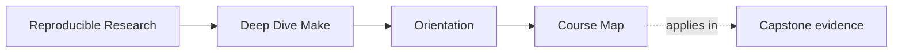
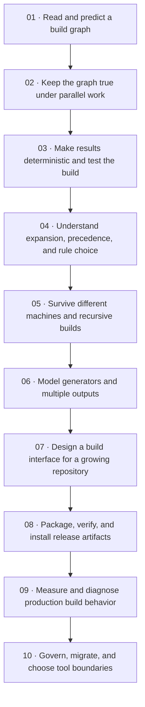

# Course Map

<!-- page-maps:start -->
## Page Maps




<!-- page-maps:end -->

The modules form one continuous project: you begin with a three-line rule and finish by
reviewing a build system that other people depend on. Each day introduces a pressure
that the previous day’s model cannot yet handle.

## Course progression



## The ten study days

| Module | Begin with | Finish able to |
| --- | --- | --- |
| 01 · Build graph foundations | one target, prerequisite, and recipe | predict rebuilds and explain missing dependencies |
| 02 · Parallel safety | a correct serial build | expose and repair races without adding false ordering |
| 03 · Determinism and self-testing | a parallel-safe graph | prove convergence and create a useful build selftest |
| 04 · Rule semantics | familiar rules and variables | explain expansion timing, precedence, includes, and rule selection |
| 05 · Portability and failure modes | a build that works locally | define supported environments and preserve jobserver behavior |
| 06 · Generated files | one command that creates outputs | model generators, coupled outputs, manifests, and atomic publication |
| 07 · Build architecture | one growing Makefile | split responsibilities while preserving one understandable graph |
| 08 · Release engineering | trustworthy local outputs | construct, checksum, inspect, and safely install a release bundle |
| 09 · Operations | a correct production build | measure cost, investigate incidents, and write a practical runbook |
| 10 · Migration and governance | an inherited system | preserve proof while changing ownership or tools |

## Skills accumulate

Later modules do not replace earlier ones. A release target in Module 08 still needs the
graph truth from Module 01, the race safety from Module 02, and the deterministic evidence
from Module 03.

```mermaid
flowchart LR
  graph["Graph truth"] --> parallel["Parallel safety"]
  graph --> deterministic["Determinism"]
  parallel --> generated["Generated outputs"]
  deterministic --> release["Release evidence"]
  generated --> architecture["Build architecture"]
  architecture --> operations["Operations"]
  release --> operations
  operations --> stewardship["Stewardship"]
```

When a later lesson feels unclear, move backward along this diagram. Do not solve a weak
dependency edge with a more complicated release script.

## Exercise progression in every module

The ten exercises intentionally change character:

- Exercises 1-2 check vocabulary and observation.
- Exercises 3-4 ask you to predict behavior before running it.
- Exercises 5-6 ask you to diagnose and repair a broken build.
- Exercises 7-8 ask you to design and test a small extension.
- Exercises 9-10 ask you to explain trade-offs and apply the skill to an unfamiliar case.

Completing only the first half gives you recognition. Completing all ten builds transfer.

## Where the capstone enters

Use the small module examples first. Enter the capstone only when you can state the
question you want it to answer.

| After module | Useful capstone question |
| --- | --- |
| 02 | Which declared edges make serial and parallel builds agree? |
| 04 | Where do variable values and generated includes enter the graph? |
| 06 | How are generated headers and multiple outputs published? |
| 08 | Which target creates the bundle, checksum, and manifest? |
| 10 | Which responsibilities should remain in Make? |

Continue to the [first-contact map](first-contact-map.md) for a short preview or begin
[Module 01](../module-01-build-graph-foundations-truth/index.md) for the full course.
