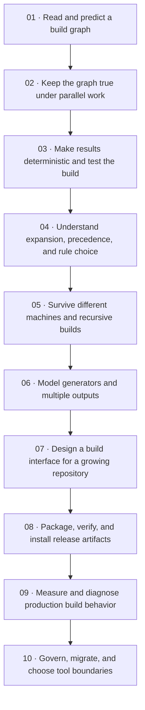
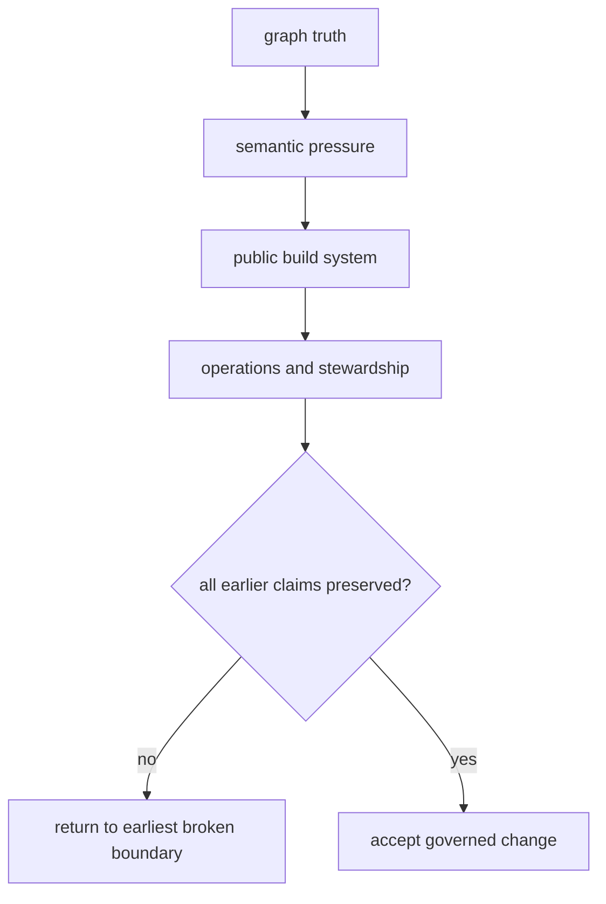
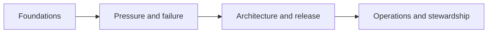

# Course Map
The modules form one continuous project: you begin with a three-line rule and finish by
reviewing a build system that other people depend on. Each day introduces a pressure
that the previous day’s model cannot yet handle.

## Course progression



## The ten study days

| Module | Begin with | Finish able to | Classroom-style turning point |
| --- | --- | --- |
| 01 · Build graph foundations | one target, prerequisite, and recipe | predict rebuilds and explain missing dependencies | a missing edge causes a stale file |
| 02 · Parallel safety | a correct serial build | expose and repair races without adding false ordering | `make -j` becomes a truth test |
| 03 · Determinism and self-testing | a parallel-safe graph | prove convergence and create a useful build selftest | a passing binary stops being enough evidence |
| 04 · Rule semantics | familiar rules and variables | explain expansion timing, precedence, includes, and rule selection | surprising behavior gets traced to a named rule |
| 05 · Portability and failure modes | a build that works locally | define supported environments and preserve jobserver behavior | machine-specific assumptions become visible policy |
| 06 · Generated files | one command that creates outputs | model generators, coupled outputs, manifests, and atomic publication | generators stop being side-effect magic |
| 07 · Build architecture | one growing Makefile | split responsibilities while preserving one understandable graph | the build gains an intentional public API |
| 08 · Release engineering | trustworthy local outputs | construct, checksum, inspect, and safely install a release bundle | artifacts are judged from the consumer side |
| 09 · Operations | a correct production build | measure cost, investigate incidents, and write a practical runbook | evidence replaces folklore under pressure |
| 10 · Migration and governance | an inherited system | preserve proof while changing ownership or tools | tool boundaries become explicit design decisions |

## Four learning arcs

### Graph truth: Modules 01–03

You move from a single file target to a build that remains correct under parallel
execution and can test its own convergence.

Leave this arc with:

- a drawn dependency graph;
- a missing-edge diagnosis;
- a serial-versus-parallel equivalence proof;
- a deterministic discovery rule;
- a selftest that can fail for a meaningful build defect.

Readiness gate:

> Given a changed input, can you predict exactly which targets should rebuild, show the
> trace, and prove an unchanged second run is a no-op?

If not, later abstraction can hide rather than repair the graph.

### Semantic pressure: Modules 04–06

You learn why GNU Make selected a value or rule, which machine assumptions belong in the
contract, and how generators publish several outputs without side-effect folklore.

Leave this arc with:

- an expansion and precedence explanation;
- an include-remake or rule-selection proof;
- a supported-environment contract;
- an honest non-file input model;
- a generator boundary with atomic publication and failure evidence.

Readiness gate:

> Can you explain a surprising build result by a named expansion, precedence, include,
> rule-selection, environment, or generator boundary?

### Public build system: Modules 07–08

You turn a growing collection of Makefiles into one build API and then evaluate its
release artifacts from the consumer side.

Leave this arc with:

- public target contracts;
- include ownership and namespace boundaries;
- a release candidate manifest;
- checksum and archive-member evidence;
- a safe install or extraction route.

Readiness gate:

> Can a new contributor discover the supported targets, and can a consumer verify the
> package without trusting the producer's workspace?

### Operations and stewardship: Modules 09–10

You measure parse, scheduling, recipe, and proof cost; investigate incidents; and decide
whether Make should retain or transfer responsibility.

Leave this arc with:

- an execution profile;
- an incident evidence packet;
- a runbook with stop conditions;
- a migration invariant table;
- a cutover, rollback, and ownership decision.

Readiness gate:

> Can you change performance or tool ownership without weakening graph truth, public
> targets, or artifact evidence?



## Skills accumulate

Later modules do not replace earlier ones. A release target in Module 08 still needs the
graph truth from Module 01, the race safety from Module 02, and the deterministic evidence
from Module 03.

```mermaid
flowchart LR
  graph["Graph truth"] --> parallel["Parallel safety"]
  graph --> deterministic["Determinism"]
  parallel --> generated["Generated outputs"]
  deterministic --> release["Release evidence"]
  generated --> architecture["Build architecture"]
  architecture --> operations["Operations"]
  release --> operations
  operations --> stewardship["Stewardship"]
```

When a later lesson feels unclear, move backward along this diagram. Do not solve a weak
dependency edge with a more complicated release script.

## How the course grows in difficulty

The first three modules teach you how Make decides. The next three teach you how that
decision process holds up under pressure. The last four teach you how to steward a build
that other people will use, review, or inherit.



## Exercise progression in every module

The ten exercises intentionally change character:

- Exercises 1-2 check vocabulary and observation.
- Exercises 3-4 ask you to predict behavior before running it.
- Exercises 5-6 ask you to diagnose and repair a broken build.
- Exercises 7-8 ask you to design and test a small extension.
- Exercises 9-10 ask you to explain trade-offs and apply the skill to an unfamiliar case.

Completing only the first half gives you recognition. Completing all ten builds transfer.

## Track capabilities rather than pages

| Boundary | Explain | Predict | Demonstrate | Review |
| --- | --- | --- | --- | --- |
| incremental graph | | | | |
| parallel safety | | | | |
| determinism and selftests | | | | |
| GNU Make semantics | | | | |
| portability and environment | | | | |
| generated output ownership | | | | |
| public build API | | | | |
| release artifact contract | | | | |
| performance and incident evidence | | | | |
| migration and governance | | | | |

An empty cell is a route signal. Return to the earliest missing capability because later
claims depend on it.

## Suggested schedules

| Schedule | Rhythm | Keep intact |
| --- | --- | --- |
| ten-week | one technical module each week | complete exercise packet and review |
| five-week | one adjacent module pair each week | worked investigations and exit gates |
| intensive | one learning arc per long block | predictions, negative tests, and evidence interpretation |
| repository-led | follow the earliest observed build failure | prerequisites required by that failure |

Accelerated study may reduce repeated reading. It should not remove controlled mutations,
parallel tests, clean-state checks, or consumer verification.

## Where the capstone enters

Use the small module examples first. Enter the capstone only when you can state the
question you want it to answer.

| After module | Useful capstone question |
| --- | --- |
| 02 | Which declared edges make serial and parallel builds agree? |
| 04 | Where do variable values and generated includes enter the graph? |
| 06 | How are generated headers and multiple outputs published? |
| 08 | Which target creates the bundle, checksum, and manifest? |
| 10 | Which responsibilities should remain in Make? |

Continue to the [first-contact map](first-contact-map.md) for a short preview or begin
[Module 01](../module-01-build-graph-foundations-truth/index.md) for the full course.
