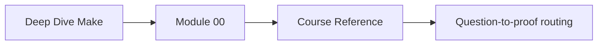
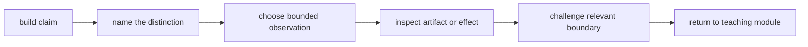

# Course Reference

Use this page when you know the build question but cannot remember which Make
distinction, command, course module, or capstone proof route applies. It is a routing
reference, not a substitute for predicting behavior and inspecting the resulting
artifact.

## Page maps





## Recurring distinctions

| Do not collapse | The useful question |
| --- | --- |
| requested target and produced file | What did the consumer request, and what durable result should exist? |
| declared prerequisite and recipe read | Does every meaningful read have a graph edge? |
| normal and order-only prerequisite | Can prerequisite content change the target, or must it merely exist first? |
| phony and file target | Is this an action request or a timestamped artifact? |
| successful recipe and correct artifact | Did the shell exit cleanly, and is the result actually acceptable? |
| no-op and complete graph | Did Make skip work for the right dependency reasons? |
| clean-build success and incremental truth | Does the graph respond correctly to relevant and irrelevant changes? |
| serial success and parallel correctness | Does concurrency preserve the same accepted result? |
| stable discovery and deterministic bytes | Are the same inputs selected, and do they produce identical content? |
| producer proof and consumer proof | Can the output be built, and can a fresh consumer use it? |
| mechanism and policy | Can Make express this behavior, and should the build own it? |

These distinctions recur because many build failures look alike from the final shell
exit. The correct repair depends on which boundary is false.

## Observation command boundaries

Run commands from the repository root unless its documentation says otherwise.

| Command shape | Supports | Does not prove |
| --- | --- | --- |
| `make help` | documented public requests | that those requests are correct |
| `make --trace TARGET` | selected rules and update reasons | undeclared reads or artifact meaning |
| `make -n TARGET` | recipes Make expects to run | shell success, side effects, or output validity |
| `make -B TARGET` | forced execution for diagnosis | that dependency edges are complete |
| `make -j TARGET` | behavior under available concurrency | deterministic content without identity checks |
| repeated `make TARGET` | observed convergence for current state | response to a changed relevant input |
| `make -pRrq` | expanded database for deep rule inspection | that running recipes is safe or correct |

Replace `TARGET` with a real documented target. `-B` is a diagnostic comparison, not a
repair for missing prerequisites. A dry run is an execution prediction, not execution
evidence.

## Evidence packet

Preserve enough information for another learner to reproduce the decision:

```text
Claim:
Repository revision and worktree:
Requested target:
Prediction:
Command and Make version:
Selected rule evidence:
Recipe exit:
Artifact path and acceptance check:
Second-run observation:
Controlled challenge:
Replay result:
Decision:
Known limit:
```

Store learning evidence under `artifacts/learning/deep-dive-make/`. Repository audit
logs belong under `artifacts/audit/`; built documentation belongs under
`artifacts/site/`. Do not commit run products unless the repository explicitly governs
them as source.

## Module routing

| Build question | Teaching module | Proof emphasis |
| --- | ---: | --- |
| Why did this rebuild or remain stale? | 01 | edge truth and convergence |
| Why do serial and parallel runs disagree? | 02 | scheduling and artifact identity |
| How can the build diagnose itself? | 03 | discovery, debugging, and selftests |
| Which value or rule did Make choose? | 04 | precedence, expansion, includes, selection |
| Which machine or recursive-build assumption leaked in? | 05 | environment and tool contracts |
| Who owns this generated output? | 06 | atomic publication and lifecycle |
| How should public targets and includes be organized? | 07 | API and architecture boundaries |
| Can a fresh consumer trust the release or install? | 08 | packaging and consumer proof |
| What caused this slow or intermittent failure? | 09 | profiling and incident evidence |
| Should Make continue to own this responsibility? | 10 | stewardship and migration |

Return to the earliest module whose claim you cannot yet demonstrate. Later vocabulary
does not compensate for a false graph edge.

## Capstone target reference

Run capstone routes through the repository entry point:

```bash
make PROGRAM=reproducible-research/deep-dive-make capstone-walkthrough
```

| Target | Use it to learn or prove |
| --- | --- |
| `capstone-tour` | print the guided capstone tour |
| `capstone-walkthrough` | build the learner-facing walkthrough bundle |
| `capstone-selftest` | test convergence, parallel determinism, and a negative case |
| `capstone-semantic-fault-audit` | distinguish state, edge, and rule-selection faults |
| `capstone-environment-contract-audit` | test non-file, recursion, and tool assumptions |
| `capstone-architecture-contract-audit` | inspect public API, layer, and output ownership |
| `capstone-abstraction-contract-audit` | inspect explicit and generated rule contracts |
| `capstone-discovery-audit` | test deterministic input discovery |
| `capstone-portability-audit` | test the claimed portability boundary |
| `capstone-profile-audit` | preserve execution-profile evidence |
| `capstone-incident-audit` | preserve and verify concurrency incident signatures |
| `capstone-verify-report` | assemble the verification report |
| `capstone-source-bundle` | build the tracked-source release bundle |
| `capstone-release-check` | build and accept one local release candidate |
| `capstone-confirm` | run the strongest integrated confirmation route |
| `capstone-hardened` | run selftests, audits, attestation, and runtime tests |

Choose the narrowest route that can answer the question. Use `capstone-confirm` or
`capstone-hardened` only when an integrated claim is actually under review.

## Failure-to-evidence routing

```mermaid
flowchart TD
  failure["observed failure"] --> stale{"stale or needless?"}
  stale -->|yes| graph["trace edges and changed inputs"]
  stale -->|no| race{"serial/parallel split?"}
  race -->|yes| schedule["compare schedule and artifact identity"]
  race -->|no| content{"wrong artifact?"}
  content -->|yes| acceptance["inspect producer inputs and acceptance check"]
  content -->|no| boundary["inspect environment, consumer, or ownership boundary"]
```

| Symptom | First evidence | Dangerous shortcut |
| --- | --- | --- |
| stale result | changed input, trace, artifact identity | adding `-B` permanently |
| needless rebuild | timestamps, normal prerequisites, second run | suppressing recipes without finding the edge |
| serial/parallel disagreement | both traces, exits, hashes, controlled delay | adding global `.NOTPARALLEL` without ownership analysis |
| wrong variable value | origin, flavor, expansion point, command context | moving assignments until output changes |
| partial output | failure injection and publication path | deleting the damaged file after every failure |
| machine-specific behavior | tool, shell, locale, environment evidence | documenting one developer laptop as the contract |
| bad release | archive inventory and fresh-consumer test | trusting archive creation alone |
| slow build | timestamped execution profile | optimizing the longest visible recipe by intuition |

## Verification routes for this course

The repository-level routes are:

```bash
make PROGRAM=reproducible-research/deep-dive-make test
make PROGRAM=reproducible-research/deep-dive-make docs-build
```

The first exercises the program capstone selftest. The second builds the rendered
course and can reveal navigation, Markdown, diagram, or link failures. Neither replaces
the specific artifact checks required by a lesson exercise.

When reviewing documentation, confirm:

- the target named in prose exists;
- the command is run from its stated directory;
- generated evidence stays under the repository artifact boundary;
- the page states what a successful command does and does not establish;
- the answer explains the reasoning route, not only the expected output.

## Decision language

End a review with one of these precise outcomes:

- **accept** — evidence supports the stated claim within its boundary;
- **reject** — evidence contradicts the claim;
- **repair** — a named defect has a bounded correction and replay route;
- **abstain** — evidence is insufficient, with the missing observation named;
- **migrate** — the responsibility belongs behind a different owner;
- **retire** — the target or responsibility no longer has a consumer.

“Looks good” and “Make passed” do not identify the claim, evidence, or boundary.

## Reference checkpoint

You are using this reference effectively when you can:

- name the distinction behind a build question;
- choose an observation that cannot overclaim;
- preserve selection, execution, artifact, and challenge evidence separately;
- route the question to one teaching module;
- choose a proportionate capstone audit;
- end with a decision and an explicit limit.
