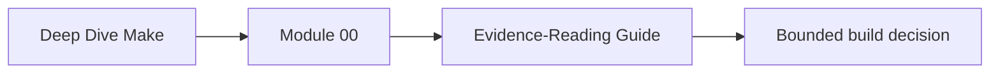
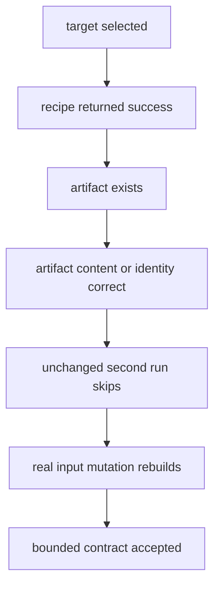

# Evidence-Reading Guide

GNU Make reports how it interpreted a declared graph. Recipes and artifact checks report
what external tools did. Build review requires both.

## Page maps



```mermaid
flowchart LR
  claim["build claim"] --> prediction["predicted graph decision"]
  graph["Makefile and includes"] --> selection["Make selection receipt"]
  selection --> recipe["recipe execution"]
  recipe --> artifact["artifact evidence"]
  prediction --> decision["accept, reject, or repair"]
  artifact --> decision
```

## Separate evidence roles

| Role | Typical surface | Question |
| --- | --- | --- |
| claim | target contract or lesson assertion | what behavior is relied on? |
| declaration | rules, prerequisites, variables, includes | what graph and semantics are written? |
| selection | trace or debug receipt | what did Make choose and why? |
| execution | recipe output and status | what external command ran? |
| artifact | files, hashes, members, modes, content | what was produced? |
| challenge | changed input, concurrency, failure, platform | does the contract react correctly? |
| consumer | public target, extraction, installation | can another user rely on it? |

“Make succeeded” combines only part of selection and execution evidence.

## Read evidence in time order

For an incremental fault:

1. preserve Makefile, includes, and input timestamps;
2. write the expected target decision;
3. capture trace before repair;
4. inspect current artifact meaning;
5. mutate one real input;
6. run the ordinary requested target;
7. inspect the artifact again;
8. repair the edge or rule;
9. replay the original mutation;
10. prove an unchanged second run converges.

For a race:

1. establish serial expected artifacts;
2. preserve requested target and job count;
3. introduce controlled delay without changing ownership;
4. run parallel reproduction repeatedly;
5. preserve the first failing signature;
6. repair ownership or dependency;
7. compare serial and parallel identities;
8. repeat the negative selftest.

Successful repair output must not erase original failure evidence.

## Read `make --trace`

Trace supports:

- requested target update reasons;
- target and prerequisite names involved;
- recipe text selected for execution;
- Makefile location of the rule.

It does not support:

- completeness of prerequisites;
- semantic correctness of the recipe;
- deterministic artifact bytes;
- parallel safety;
- portability.

Example:

```text
Makefile:7: update target 'report.txt' due to: source.csv
```

Observation: `source.csv` is a declared reason to update `report.txt`.

Inference requiring another test: every meaningful report input is declared.

## Read dry-run output carefully

`make -n` can preview selected recipe commands. It is useful for:

- reviewing target reachability;
- checking paths and flags before execution;
- seeing broad command shape.

It is not execution evidence. Shell expansion, generated includes, recursive Make, and
recipe side effects can make dry-run interpretation incomplete or surprising.

Do not cite a dry run as proof that an artifact can be built.

## Use debug output for a bounded question

Debug modes can reveal rule search, prerequisite consideration, and database decisions.
They can also produce too much output to review.

Before enabling them, name the question:

- which rule matched this target?
- why is this prerequisite considered newer?
- which included Makefile was remade?
- why does Make say no rule exists?

Capture the output under `artifacts/command-logs/` and extract the relevant decision with
surrounding context. Do not paste an unbounded log in place of explanation.

## Inspect Make's database without treating it as intent

Make can print its internal database of variables and rules. This helps locate:

- variable origins and expanded values;
- implicit and explicit rules;
- target prerequisite sets;
- built-in behavior.

The database includes implementation detail and built-ins. It shows interpreted state,
not which surfaces are public or why a rule is safe.

## Join selection to artifacts



Each arrow needs evidence:

- exit status does not prove file publication completed atomically;
- existence does not prove all coupled outputs exist;
- expected content once does not prove convergence;
- convergence does not prove hidden inputs are absent.

## Interpret timestamps and hashes

Make usually reasons about file existence and modification times. Reviewers may also need
content identities.

| Evidence | Useful for | Limitation |
| --- | --- | --- |
| timestamp | explaining ordinary freshness decisions | clock granularity and preserved times can mislead |
| byte hash | comparing artifact identity | equal bytes do not explain how they were produced |
| file size | quick anomaly detection | collisions and semantic differences remain |
| archive listing | member contract | does not prove safe extraction or deterministic metadata |
| manifest | declared release members and identities | must itself be governed and verified |

Use the evidence that matches the claim.

## Read selftest reports as contract results

A strong build selftest names:

```text
claim
setup
controlled mutation
expected observation
actual observation
decision
preserved evidence
```

Some audits intentionally reproduce a fault and report success for the detector. Read the
finding name and decision, not only the command exit.

A negative test that never sees the broken condition is not useful enforcement.

## Distinguish no-op evidence

An unchanged second build that does no work supports convergence over declared state.

It does not prove:

- declared state is complete;
- artifact content is correct;
- a clean build can reconstruct the same result;
- serial and parallel builds agree;
- another platform is supported.

The no-op is one required observation, not a universal verdict.

## Write observation, inference, and decision separately

```text
Observation:
After schema.json changed, make --trace reported no work and generated.h retained the old
field list.

Inference:
The generator reads schema.json, but the producing target has no dependency edge to it.

Decision:
Reject the generated-header freshness claim.

Repair:
Declare schema.json and replay the same mutation.

Limit:
This test covers schema freshness, not parallel publication or toolchain portability.
```

This form prevents “Make ignored the file” from hiding the actual graph defect.

## Detect inflated claims

| Observation | Inflated claim | Bounded claim |
| --- | --- | --- |
| default target passes | build system is correct | one requested route succeeded |
| second build is no-op | graph is complete | declared settled state converged |
| `make -j` passed once | parallel build is safe | one schedule completed |
| archive hash is stable | release is reproducible | tested runs produced equal bytes |
| dry-run command looks right | build works | Make selected the displayed command shape |
| clean build passes | incremental build is correct | reconstruction from clean state succeeded |

## Evidence-reading checkpoint

You can interpret Make evidence when you can:

- separate declaration, selection, execution, artifact, challenge, and consumer roles;
- preserve state before repair;
- bound trace, dry-run, debug, and database evidence;
- join Make decisions to artifact checks;
- distinguish timestamp from content identity;
- read selftest findings rather than only exit status;
- state observation, inference, decision, repair, and limit.
