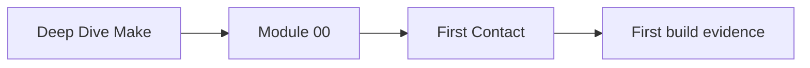
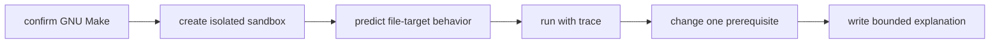
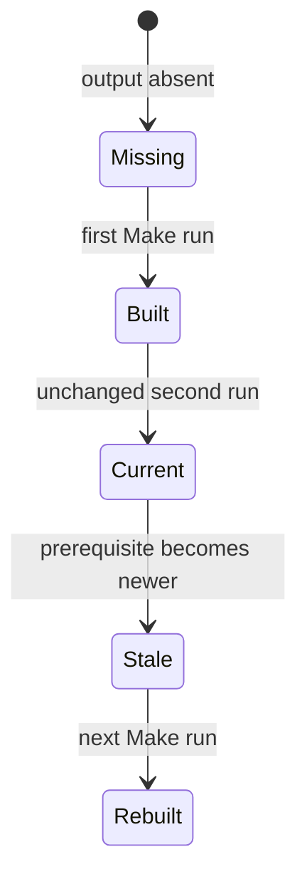

# First-Contact Map

Use this page for one honest first session. The outcome is not “I ran Make.” It is:

> I predicted one graph decision, observed it, changed one prerequisite, and explained
> why the next decision changed.

Allow 60–90 minutes.

## Page maps





## Confirm the course route

From the repository root:

```bash
git branch --show-current
git status --short
make PROGRAM=reproducible-research/deep-dive-make help
```

Then check GNU Make:

```bash
make --version
```

On systems where `make` is not GNU Make 4 or newer, follow
[Platform Setup](../guides/platform-setup.md). The repository targets choose the
appropriate supported command; do not silently translate course semantics to another
Make implementation.

## Create an isolated practice build

Use a disposable directory under repository artifacts:

```bash
mkdir -p artifacts/learning/deep-dive-make/first-contact
cd artifacts/learning/deep-dive-make/first-contact
```

Create `message.txt`:

```text
build graphs should explain their decisions
```

Create `Makefile`:

```make
.DEFAULT_GOAL := all
.PHONY: all

all: message.upper.txt

message.upper.txt: message.txt
	tr '[:lower:]' '[:upper:]' < $< > $@
```

The recipe begins with a real tab.

## Predict before running

Create `prediction.md`:

```text
Requested target:
First run:
Second unchanged run:
After message.txt changes:
Artifact content expected:
Claim this does not prove:
```

A reasonable prediction is:

- `all` requires `message.upper.txt`;
- the first run creates the missing file;
- the second run does no recipe work;
- a newer `message.txt` makes the output stale;
- the recipe transforms current input content.

Do not write “Make sees changes.” Name missing and newer file states.

## Observe the three decisions

Run:

```bash
make --trace
make --trace
printf 'and remain reviewable\n' >> message.txt
make --trace
```

Preserve the output in your notes.

Expected decision sequence:



Inspect:

```bash
cat message.upper.txt
stat message.txt message.upper.txt
```

The exact `stat` format differs by platform. You need the relative freshness and artifact
content, not identical prose.

## Explain what each surface establishes

| Surface | Evidence |
| --- | --- |
| Makefile | declared target and prerequisite relationship |
| `make --trace` | selected update reason and recipe |
| output file | result produced by the recipe |
| second run | convergence for unchanged declared state |
| input mutation | declared edge triggers a rebuild |

Limits:

- `make --trace` does not discover hidden file reads inside the recipe;
- successful `tr` does not prove portability to every platform;
- one serial build does not prove parallel safety;
- current timestamps do not prove byte-for-byte deterministic output.

That boundary is the course in miniature.

## Break the graph deliberately

Copy the Makefile into your notes, then remove `message.txt` from the prerequisite list:

```make
message.upper.txt:
	tr '[:lower:]' '[:upper:]' < message.txt > $@
```

Run until current, change `message.txt`, then run `make --trace` again.

The recipe reads the file, but the graph no longer names it. Make may skip a result whose
meaning is stale.

Restore the prerequisite and repeat the same mutation. This is your first controlled
repair:

```text
failure:
missing edge:
original mutation:
status before repair:
same mutation after repair:
```

## Run one course-scale corroboration

Return to the repository root and run:

```bash
make PROGRAM=reproducible-research/deep-dive-make capstone-walkthrough
```

Use it to identify:

- a public target;
- a file target;
- a declared prerequisite;
- an evidence or selftest target.

Do not treat the walkthrough as proof of every module. It shows that a larger repository
uses the same graph vocabulary.

## Write the first decision

Append:

```text
Accepted:
The declared message prerequisite caused the expected missing, current, stale, and rebuilt
decisions in this sandbox.

Rejected:
The broken rule cannot support freshness after message.txt changes.

Still untested:
Parallel safety, deterministic bytes, portability, release contracts, and recovery.
```

This is stronger than “Make worked” because it names the tested condition and limit.

## Choose the next route

| Current question | Continue with |
| --- | --- |
| why targets rebuild or skip | Module 01 |
| why `-j` exposes a failure | Module 02 |
| why results or discovery vary | Module 03 |
| how the full course progresses | [Course Map](course-map.md) |
| how to set up a study schedule | [Start Here](../guides/start-here.md) |

New learners should continue with Module 01 even if a later pressure feels urgent.

## First-contact checkpoint

Leave this route when you can:

- read target, prerequisite, and recipe positions;
- predict missing, current, and stale decisions;
- use `--trace` as bounded selection evidence;
- inspect the artifact rather than trusting exit status;
- demonstrate and repair one missing edge;
- state what the experiment does not prove.
