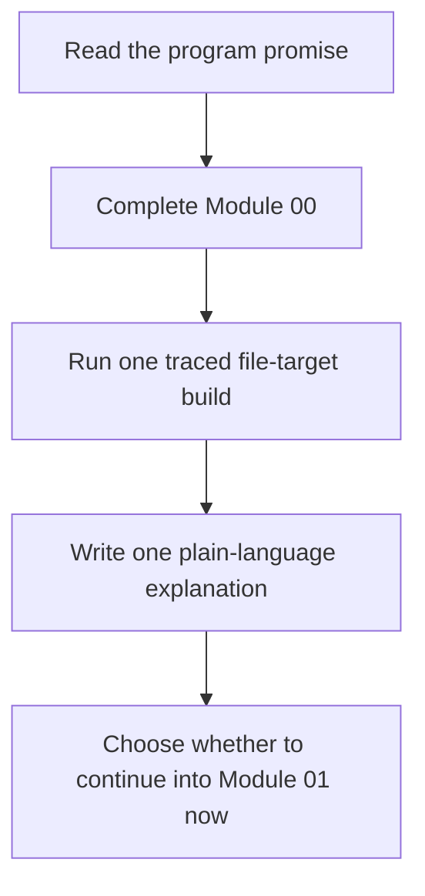

# First-Contact Map
Use this page for your first honest session with the course. The goal is not to cover as
much ground as possible. The goal is to leave the first hour coherent enough that later
reading choices feel deliberate instead of random.

## First session route



1. Read `../index.md` for the program promise.
2. Read `index.md` for the Module 00 role.
3. Read `course-map.md` to see the four course arcs.
4. Read `../guides/start-here.md` when you want the shortest starting route.
5. Read `../capstone/capstone-map.md` only if a repository specimen will clarify, not blur, the current idea.
6. Run one bounded command:

```sh
make PROGRAM=reproducible-research/deep-dive-make capstone-walkthrough
```

## What you should know before Module 01

Before the first technical module, you should be able to answer:

- what this course treats as the core promises of a good build system
- why the capstone is an executable corroboration surface rather than the first thing to read
- which course arc matches your current pressure: graph truth, discipline, system design, or stewardship

## First-week rhythm

Repeat the same rhythm through the first modules:

1. read until the current build question is clear
2. inspect one matching example, exercise, or capstone surface immediately
3. run one bounded command instead of escalating to every proof route
4. stop when you can state one rule and one failure mode in plain language

## A strong first-session outcome

Your first session is successful if you can say all three of these without guessing:

- what a target is
- what a prerequisite is
- why Make sometimes does no work on a second run

That may sound small. It is not small. It is the seed of every later topic in the
course.

## When to leave this route

Move to [mid-course-map.md](mid-course-map.md) once Modules 01 to 03 feel stable and the
main question becomes semantics under pressure, hardening, release trust, or incidents.
