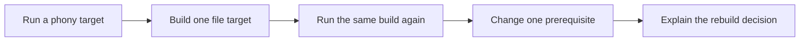
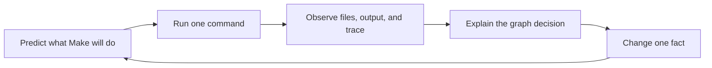
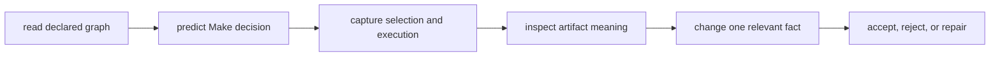

# Module 00: Orientation and Study Practice
You do not need previous experience with Make, C, build systems, or continuous
integration. You need a terminal, a text editor, and enough time to change a small file
and observe what happens.

Make is a program that answers one question:

> Which requested files are missing or older than the files needed to create them?

It answers that question from rules in a file normally named `Makefile`. The rules form a
graph. This course begins with that small idea and builds toward parallel execution,
generated files, releases, incident diagnosis, and responsible migration.

The learning target is not command recall. It is the ability to explain and test a build
claim:

| Part | Question |
| --- | --- |
| request | which target did the user or CI ask for? |
| graph | which prerequisites and rules make that target possible? |
| decision | why did Make rebuild, skip, or reject work? |
| recipe | which external command actually transformed state? |
| artifact | which file or public action now exists? |
| proof | which trace, file identity, selftest, or consumer check supports the claim? |
| limit | which hidden input, runtime assumption, or unsupported platform remains outside it? |

Every technical module returns to this chain under a different pressure.

## What this orientation module is for

Module 00 is not a warm-up you should rush through. It establishes the study habits that
make the rest of the course work:

- start from one small build, not from the capstone
- predict what Make will do before you run it
- inspect traces and files, not just terminal output
- explain one decision clearly before learning a bigger feature

If you do that here, later modules feel cumulative. If you skip it, later modules can
turn into disconnected facts.

## Before the first lesson

Open a terminal and check which implementation you have:

```console
$ make --version
GNU Make 4.4.1
```

The exact version may differ. The course uses GNU Make 4 or newer. On macOS, the command
installed by Homebrew is often `gmake`; follow the
[platform setup guide](../guides/platform-setup.md) if `make --version` does not say
`GNU Make`.

You should also be comfortable with these shell actions:

```sh
pwd                 # show the current directory
mkdir make-course   # create a directory
cd make-course      # enter it
printf 'hello\n'    # print text
rm -rf build        # remove a generated directory
```

The comments explain the commands; you do not need to memorize them.

## Your first Makefile

Create an empty practice directory, enter it, and create a file named `Makefile`:

```make
.PHONY: hello

hello:
	@printf 'Hello from Make\n'
```

The indentation before `@printf` must be a real tab. Run:

```console
$ make hello
Hello from Make
```

Read the rule from left to right:

- `hello` is the **target**, the name you request.
- The colon separates the target from its **prerequisites**; this target has none.
- The indented line is the **recipe**, the shell command Make runs.
- `.PHONY` says `hello` is an action name, not a file that should be considered complete.

If this works, your environment is ready. If it does not, compare the file character by
character and consult the platform guide before continuing.

## Your first file target

The `hello` target proves that Make can run a named action. It does not yet show the idea
that makes Make useful: deciding that an existing output is already current.

In the same practice directory, create `message.txt`:

```text
small builds can tell the truth
```

Replace the Makefile with this one. The whitespace before `tr` is again a real tab.

```make
.DEFAULT_GOAL := all
.PHONY: all

all: message.upper.txt

message.upper.txt: message.txt
	tr '[:lower:]' '[:upper:]' < $< > $@
```

Before running anything, make three predictions:

1. What command will the first `make` run?
2. What command will the second `make` run?
3. What will happen after you append another line to `message.txt`?

Now test the predictions:

```console
$ make --trace
Makefile:7: update target 'message.upper.txt' due to: message.txt
tr '[:lower:]' '[:upper:]' < message.txt > message.upper.txt
$ make --trace
make: Nothing to be done for 'all'.
$ printf 'and explain their decisions\n' >> message.txt
$ make --trace
Makefile:7: update target 'message.upper.txt' due to: message.txt
tr '[:lower:]' '[:upper:]' < message.txt > message.upper.txt
```

The line number in your trace may differ. The decision should not:

- the first run builds a missing output
- the second run sees an output newer than its input and does no work
- changing the input makes it newer, so the output rebuilds

The automatic variable `$<` means the first prerequisite, `message.txt`. `$@` means the
target, `message.upper.txt`. You will practice these names in Module 01; for now, read the
recipe as “transform the input into the output.”

If your second run executes `tr` again, stop and inspect timestamps with
`ls -lT` on macOS or `stat message.txt message.upper.txt` on Linux. A no-op second run is
your first proof that the graph describes reality.

## The first-day demo ladder

Use this sequence before you open Module 01:



Each step adds exactly one new idea:

- phony targets show how Make receives a request
- file targets show how Make reasons about freshness
- repeated runs show convergence
- changing one prerequisite shows dependency-driven rebuilds
- your explanation turns output into understanding

## How one module fills a study day

Each technical module is designed as a complete learning day. Adapt the times to your
pace; understanding matters more than finishing quickly.

| Study block | Suggested time | What you do |
| --- | ---: | --- |
| Recall and prediction | 20 minutes | Restate the previous module and predict today’s main behavior |
| Core reading | 90 minutes | Read the concept pages and run every short example |
| Guided demonstration | 60 minutes | Rebuild the worked example without copying blindly |
| Break and explanation | 30 minutes | Explain the graph aloud or in writing |
| Exercises 1-5 | 90 minutes | Establish syntax, observation, and diagnosis |
| Exercises 6-10 | 120 minutes | Repair, design, test, and transfer the idea to a new setting |
| Review | 30 minutes | Compare answers, record mistakes, and run the exit check |

Do not read ten exercises and call them complete. Create the files, run the commands,
change one input, and explain the observed output.

## The learning loop



Prediction is important. If you run commands first and explain afterward, it is easy to
invent a story that fits the output. Writing a prediction gives you something honest to
test.

The first file-target experiment is the pattern for the whole course. Later examples are
larger, but the learning move stays the same: predict the requested graph, run one bounded
command, inspect the evidence, and change one fact.

## Read evidence in layers

A build can print no errors and still have a stale output, hidden prerequisite, race, or
unsafe release boundary.

| Evidence layer | Typical surface | Question answered |
| --- | --- | --- |
| declaration | targets, prerequisites, variables, includes | what graph does the Makefile claim? |
| selection | `make --trace`, `make -n`, debug output | which rule and target did Make choose? |
| execution | recipe output and exit status | which shell command ran and did it report success? |
| artifact | files, timestamps, hashes, archive members | what state was actually produced? |
| convergence | unchanged second build | does settled declared state avoid needless work? |
| negative challenge | changed input, delay, missing tool, failed recipe | does the build fail or rebuild for the right reason? |
| consumer proof | install, extract, verify, or public target check | can the intended user rely on the result? |

One layer cannot prove all the others. A successful recipe does not prove that the graph
will rerun it when a hidden input changes. A no-op second build does not prove the output
is correct.



## Keep a learning evidence directory

Course commands write generated evidence under the repository-level `artifacts/`
directory. Keep your study packet there:

```text
artifacts/learning/deep-dive-make/
├── questions.md
├── predictions.md
├── module-decisions.md
├── command-logs/
└── review-packets/
```

For each investigation, record:

```text
claim:
requested target:
predicted graph decision:
observed trace:
artifact check:
controlled challenge:
decision:
remaining limit:
```

This packet replaces instructor memory and shell history. It lets a missed-class learner
resume from the last demonstrated capability.

## Day-zero checklist

Before you leave orientation, make sure all of these are true:

- `make --version` or `gmake --version` reports GNU Make 4 or newer
- you can create and run a phony target
- you can create and run a file target
- you can explain why the second file-target run does no work
- you can change one input and predict the rebuild before you run it
- you have one practice directory reserved for course experiments
- you can distinguish graph, recipe, artifact, and consumer evidence
- you know generated learning evidence belongs under `artifacts/`

## Choose a route

| Your starting point | Recommended route |
| --- | --- |
| I have never written a Makefile | Complete the first Makefile above, then follow Modules 01-10 in order |
| I use Make but rebuilds surprise me | Begin with Module 01 and do all exercises rather than skipping ahead |
| I maintain a large Make repository | Read the [course map](course-map.md), then use the diagnostic route in the [course guide](../guides/course-guide.md) |
| I need to review or migrate a build | Complete at least Modules 01, 02, 04, and 06 before entering Modules 09-10 |

## What you will be able to do

By the end of the course, you will be able to:

- write and explain explicit, pattern, and generated-file rules
- predict incremental rebuilds before running Make
- diagnose missing edges, unnecessary rebuilds, and parallel races
- design public targets that humans and CI can rely on
- create deterministic packages with checksums and manifests
- measure build performance without trading away correctness
- decide which responsibilities belong in Make and which belong elsewhere

## Keep a learning journal

After each module, record four short answers:

1. What did I predict incorrectly?
2. Which command revealed the mistake?
3. Which graph edge or rule repaired it?
4. Where could this failure occur in my own work?

That journal is more valuable than a list of commands. It captures the change in your
reasoning.

## Continue

Use the rest of Module 00 based on what you need:

- Read [Course Map](course-map.md) if you want the full ten-session arc.
- Read [First-Contact Map](first-contact-map.md) if you want the shortest route into the first week.
- Read [Self-Study Guide](self-study-guide.md) if you need pacing, missed-session recovery, or answer-review discipline.
- Read [Evidence-Reading Guide](evidence-reading-guide.md) if you need to interpret traces, dry runs, selftests, or artifacts.
- Read [Capstone Framing Guide](capstone-framing-guide.md) if you need to choose a proportionate repository-scale proof route.
- Read [Mid-Course Map](mid-course-map.md) if you are already comfortable with the basics and want to understand the second half of the course.
- Read [Mastery Map](mastery-map.md) if you are returning later for review, migration, or stewardship.

Then continue to [Module 01](../module-01-build-graph-foundations-truth/index.md).
