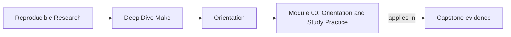
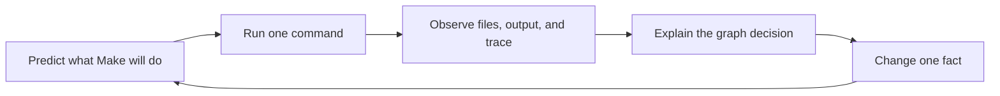

# Module 00: Orientation and Study Practice

<!-- page-maps:start -->
## Page Maps




<!-- page-maps:end -->

You do not need previous experience with Make, C, build systems, or continuous
integration. You need a terminal, a text editor, and enough time to change a small file
and observe what happens.

Make is a program that answers one question:

> Which requested files are missing or older than the files needed to create them?

It answers that question from rules in a file normally named `Makefile`. The rules form a
graph. This course begins with that small idea and builds toward parallel execution,
generated files, releases, incident diagnosis, and responsible migration.

## Before the first lesson

Open a terminal and check which implementation you have:

```console
$ make --version
GNU Make 4.4.1
```

The exact version may differ. The course uses GNU Make 4 or newer. On macOS, the command
installed by Homebrew is often `gmake`; follow the
[platform setup guide](../guides/platform-setup.md) if `make --version` does not say
`GNU Make`.

You should also be comfortable with these shell actions:

```sh
pwd                 # show the current directory
mkdir make-course   # create a directory
cd make-course      # enter it
printf 'hello\n'    # print text
rm -rf build        # remove a generated directory
```

The comments explain the commands; you do not need to memorize them.

## Your first Makefile

Create an empty practice directory, enter it, and create a file named `Makefile`:

```make
.PHONY: hello

hello:
	@printf 'Hello from Make\n'
```

The indentation before `@printf` must be a real tab. Run:

```console
$ make hello
Hello from Make
```

Read the rule from left to right:

- `hello` is the **target**, the name you request.
- The colon separates the target from its **prerequisites**; this target has none.
- The indented line is the **recipe**, the shell command Make runs.
- `.PHONY` says `hello` is an action name, not a file that should be considered complete.

If this works, your environment is ready. If it does not, compare the file character by
character and consult the platform guide before continuing.

## How one module fills a study day

Each technical module is designed as a complete learning day. Adapt the times to your
pace; understanding matters more than finishing quickly.

| Study block | Suggested time | What you do |
| --- | ---: | --- |
| Recall and prediction | 20 minutes | Restate the previous module and predict today’s main behavior |
| Core reading | 90 minutes | Read the concept pages and run every short example |
| Guided demonstration | 60 minutes | Rebuild the worked example without copying blindly |
| Break and explanation | 30 minutes | Explain the graph aloud or in writing |
| Exercises 1-5 | 90 minutes | Establish syntax, observation, and diagnosis |
| Exercises 6-10 | 120 minutes | Repair, design, test, and transfer the idea to a new setting |
| Review | 30 minutes | Compare answers, record mistakes, and run the exit check |

Do not read ten exercises and call them complete. Create the files, run the commands,
change one input, and explain the observed output.

## The learning loop



Prediction is important. If you run commands first and explain afterward, it is easy to
invent a story that fits the output. Writing a prediction gives you something honest to
test.

## Choose a route

| Your starting point | Recommended route |
| --- | --- |
| I have never written a Makefile | Complete the first Makefile above, then follow Modules 01-10 in order |
| I use Make but rebuilds surprise me | Begin with Module 01 and do all exercises rather than skipping ahead |
| I maintain a large Make repository | Read the [course map](course-map.md), then use the diagnostic route in the [course guide](../guides/course-guide.md) |
| I need to review or migrate a build | Complete at least Modules 01, 02, 04, and 06 before entering Modules 09-10 |

## What you will be able to do

By the end of the course, you will be able to:

- write and explain explicit, pattern, and generated-file rules
- predict incremental rebuilds before running Make
- diagnose missing edges, unnecessary rebuilds, and parallel races
- design public targets that humans and CI can rely on
- create deterministic packages with checksums and manifests
- measure build performance without trading away correctness
- decide which responsibilities belong in Make and which belong elsewhere

## Keep a learning journal

After each module, record four short answers:

1. What did I predict incorrectly?
2. Which command revealed the mistake?
3. Which graph edge or rule repaired it?
4. Where could this failure occur in my own work?

That journal is more valuable than a list of commands. It captures the change in your
reasoning.

## Continue

Read the [course map](course-map.md), then begin
[Module 01: Build Graph Foundations and Truth](../module-01-build-graph-foundations-truth/index.md).
Use the [first-contact map](first-contact-map.md) if you want a shorter preview before
committing to a full study day.
