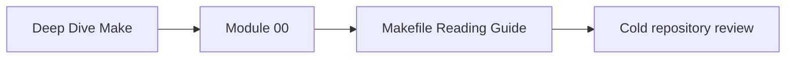
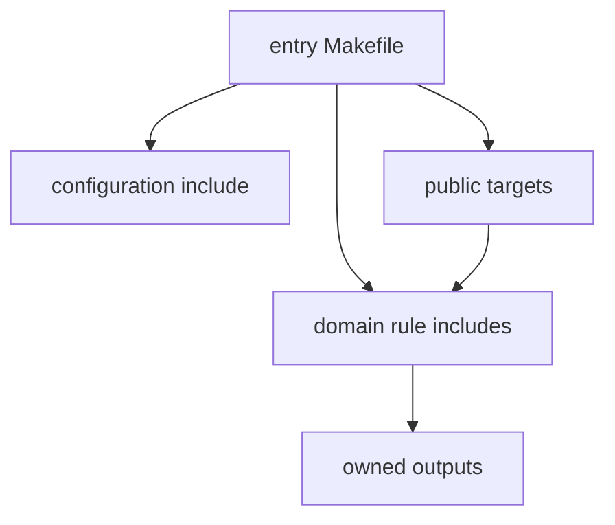

# Makefile Reading Guide

Use this guide when opening a Make-based repository you did not author. The goal is to
find its public requests, graph ownership, hidden assumptions, and proof routes before
changing or cleaning anything.

## Page maps



```mermaid
flowchart LR
  claim["identify relied-on target"] --> files["locate Makefiles and includes"]
  files --> graph["map targets and prerequisites"]
  graph --> semantics["inspect variables and rule selection"]
  semantics --> predict["predict bounded command"]
  predict --> evidence["trace and artifact check"]
  evidence --> decision["review decision"]
```

## Preserve initial state

Before running targets:

```bash
git rev-parse --show-toplevel
git branch --show-current
git status --short
git log -5 --oneline
```

Record:

- repository and revision;
- current branch;
- tracked and untracked changes;
- relevant recent build intent;
- which user or automation depends on the build.

Do not run `clean`, delete outputs, or reformat Makefiles to simplify inspection. Existing
state may contain the failure evidence.

## Name one relied-on request

Examples:

- contributor runs `make test`;
- CI runs `make verify`;
- release automation runs `make package`;
- operator runs `make deploy`;
- another Makefile invokes a public target recursively.

Write:

```text
consumer:
requested target:
expected prerequisites:
expected artifact or action:
incremental expectation:
parallel expectation:
failure expectation:
```

Review becomes concrete when a consumer depends on one target effect.

## Locate build declarations

Use fast file discovery:

```bash
rg --files -g 'Makefile' -g '*.mk' -g 'GNUmakefile'
rg -n '^[[:space:]]*(include|-include|sinclude)[[:space:]]' -g 'Makefile' -g '*.mk'
```

Identify:

- entry Makefile;
- included fragments;
- generated includes;
- recursive sub-builds;
- help or public-target documentation;
- test and audit helpers;
- packaging and deployment recipes.

Draw ownership:



Many files can form one DAG. File layout does not automatically define graph boundaries.

## Identify public targets

Look for documented targets, `.PHONY`, default goal, CI calls, scripts, and contributor
instructions.

Build:

| Target | Consumer | Declared prerequisites | Effect | Owner | Stability |
| --- | --- | --- | --- | --- | --- |

Questions:

- Is the default goal intentional?
- Does a public action target have a stable name and effect?
- Is a file target mistakenly marked phony?
- Does a public target hide cleanup or mutation unrelated to its name?
- Are CI and local users invoking the same contract?

Public targets are an API even if nobody named them that way.

## Map file ownership and edges

For one result, trace backward:

```text
requested target
  -> direct prerequisites
    -> producing rules
      -> source and generated inputs
        -> environment and tool assumptions
```

Then inspect the recipe for real reads and writes. Classify:

| Surface | Declared? | Owner | Consequence if hidden |
| --- | --- | --- | --- |

A recipe that reads `schema.json` without a prerequisite is a graph defect even if the
current output is correct.

## Read variables by origin and timing

For values affecting paths, flags, tools, discovery, or target lists, ask:

- where is the variable defined?
- can command line or environment override it?
- is expansion immediate or deferred?
- does an included fragment append to it?
- does a target-specific value change behavior?
- is it public configuration or internal derivation?

Do not assume the closest textual assignment wins. Module 04 teaches the precise
precedence and expansion model.

## Look for risk signatures

| Signature | Question |
| --- | --- |
| broad wildcard discovery | is ordering stable and are unintended files included? |
| recursive `$(MAKE)` | is jobserver and variable propagation preserved? |
| plain `make` in a recipe | is recursive invocation portable and coordinated? |
| direct writes to final output | can failure expose partial content? |
| one declared output, several writes | who owns coupled secondary files? |
| `.NOTPARALLEL` | which race or resource policy requires global serialization? |
| order-only prerequisite | is it setup-only, or does content affect freshness? |
| `eval` and generated rules | can reviewers inspect resulting graph and ownership? |
| shell pipelines without strict handling | can early command failure be hidden? |
| clean target with broad deletion | are targets resolved narrowly and safely? |

A signature is a review question, not automatic condemnation.

## Predict a non-destructive target

Prefer:

- help;
- inspection;
- status or doctor;
- focused selftest;
- bounded build in an isolated output directory.

Before execution:

```text
target:
rules expected:
recipes expected:
files expected:
worktree effect:
claim supported if successful:
```

Avoid first actions that clean, install, publish, deploy, or migrate.

## Observe selection and artifacts

Run the documented target with the repository's supported GNU Make command and trace
option when appropriate.

Capture:

- command and version;
- Makefile and included-file context;
- selected targets;
- recipe exit;
- generated or changed files;
- artifact content or identity;
- second-run behavior.

If the repository has a sanctioned audit, prefer it to ad hoc mutation.

## Challenge one boundary safely

Use a copied sandbox or provided fixture:

| Suspicion | Challenge |
| --- | --- |
| hidden input | mutate the real input and preserve trace |
| false dependency | mutate declared but irrelevant input |
| parallel race | add controlled delay and compare identities |
| nondeterministic discovery | vary file creation order |
| partial publication | fail producer before final rename |
| portability | remove one claimed tool capability |
| release leakage | add undeclared workspace residue and inspect archive |
| unsafe extraction | provide traversal member to rejection test |

Repair the cause, then replay the original challenge.

## Write the cold-review note

```text
Scope and consumer:
Initial revision and worktree:
Public target:
Graph owner:
Environment assumptions:
Prediction:
Observed selection:
Artifact evidence:
Controlled challenge:
Decision:
Limit:
Next highest-risk boundary:
```

One bounded finding is more useful than an unprioritized list of Make syntax.

## Route findings into the course

| Finding | Module |
| --- | ---: |
| stale or needless incremental result | 01 |
| serial/parallel disagreement | 02 |
| discovery or selftest weakness | 03 |
| precedence, expansion, include, or rule surprise | 04 |
| machine, shell, tool, or recursion assumption | 05 |
| generated output ownership | 06 |
| tangled includes or unstable public target | 07 |
| unverifiable release or unsafe install | 08 |
| unexplained performance or incident | 09 |
| ambiguous ownership or migration | 10 |

## Cold-review checkpoint

You can investigate an unfamiliar Make repository when you can:

- preserve initial state;
- begin from a consumer-facing target claim;
- locate entry, includes, public targets, and recursive boundaries;
- map actual reads and writes against graph edges;
- review variable origin and timing;
- recognize risk signatures without cargo-cult repair;
- run one bounded target and artifact check;
- challenge and replay one boundary safely.
