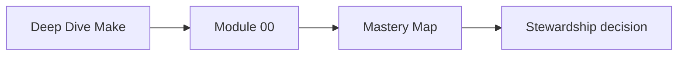
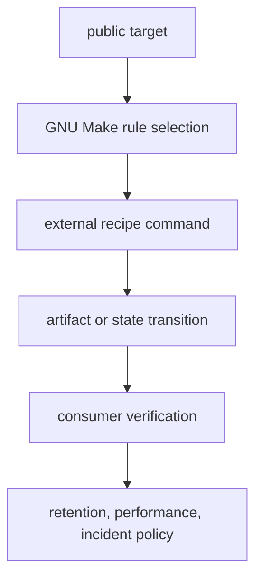

# Mastery Map

Mastery in this course is the ability to make a defensible build-system decision under
pressure. It is not memorizing GNU Make's rarest functions.

Use this map when reviewing an inherited build, responding to an incident, planning a
migration, or deciding whether Make should continue to own a responsibility.

## Page maps



```mermaid
flowchart LR
  claim["name relied-on build claim"] --> graph["locate graph and owner"]
  graph --> evidence["preserve selection and artifact evidence"]
  evidence --> challenge["apply adversarial challenge"]
  challenge --> decision["retain, repair, migrate, or retire"]
```

## Begin from a consumer or operator claim

Examples:

- “`make test` tests exactly the submitted product state”;
- “`make -j` produces the same artifacts as serial execution”;
- “the generated header and manifest are one coherent publication”;
- “the source archive contains exactly the governed members”;
- “a clean contributor can discover the supported targets”;
- “this migration preserves the public build API.”

For each claim, write:

```text
consumer:
requested target:
graph owner:
input and environment contract:
artifact or action:
proof route:
adversarial challenge:
decision:
limit:
```

“The build passes” is not bounded enough to review.

## Identify authority and ownership

Make coordinates work. It does not automatically own every concern invoked by recipes.

| Concern | Possible owner | Review question |
| --- | --- | --- |
| incremental dependency graph | Make rules | are every meaningful input and output edges declared? |
| compilation semantics | compiler and flags | are toolchain and flags part of supported configuration? |
| generated schema | generator plus publication contract | who owns all coupled outputs? |
| unit test meaning | product test framework | does Make only orchestrate or also conceal selection? |
| release contents | packaging contract | can a consumer verify members and identity? |
| deployment | deployment system | is Make a stable entry point or accidental authority? |
| secrets | secret manager | are values kept outside graph output and logs? |

If Makefiles, shell scripts, CI configuration, and another orchestrator can each redefine
the same action independently, ownership is ambiguous.

## Review in layers



Ask at every boundary:

- What is declared?
- What is observed?
- What remains hidden?
- Who may change it?
- Which negative test fails when the contract is broken?

Do not use a layer's passing evidence to excuse a failure elsewhere.

## Choose an adversarial challenge

| Claim | Useful challenge |
| --- | --- |
| graph is complete | mutate a real input and observe the requested rebuild |
| parallel build is safe | add controlled delay and compare serial/parallel artifacts |
| build is deterministic | vary discovery order and compare identities |
| environment is supported | remove or alter one declared capability |
| generator publication is atomic | fail between production and publication |
| public target is stable | call it from a clean consumer or CI-like workspace |
| release is safe | inspect members and reject traversal before extraction |
| optimization preserves truth | run semantic selftests before and after change |
| migration is safe | fail new route before cutover and exercise rollback |

The challenge should isolate the contract. Randomly deleting build files can create noise
without testing the relied-on claim.

## Distinguish stewardship decisions

| Decision | Meaning |
| --- | --- |
| `ACCEPT` | current evidence supports the bounded build claim |
| `REJECT` | a challenge demonstrates contract violation |
| `ABSTAIN` | required graph, environment, artifact, or consumer evidence is missing |
| `REPAIR` | Make remains the right owner but declarations or proof are defective |
| `MIGRATE` | another system should own the concern under preserved invariants |
| `RETIRE` | target, artifact, or compatibility promise has no justified consumer |

Do not migrate because the Makefile looks old. Do not retain Make ownership because a
recipe already exists.

## Review performance without trading away truth

Require separate evidence for:

- parse and expansion time;
- graph traversal and scheduling;
- recipe work;
- external tool work;
- verification and packaging.

Then ask which layer dominates.

Reject optimizations that:

- remove real prerequisites;
- disable parallelism globally to conceal a race;
- skip selftests in the common path without preserving a review route;
- replace atomic publication with direct writes;
- cache results without identifying all meaningful inputs;
- shorten releases by dropping consumer verification.

The fastest wrong incremental build is still wrong.

## Plan ownership change

Before a migration, state invariants:

```text
public target names and meanings remain discoverable
incremental rebuild behavior remains truthful
parallel safety remains demonstrated
generated outputs keep one owner
release identity and contents remain verifiable
old and new routes cannot both become ambiguous authority
rollback is tested before retirement
```

Build a decision table:

| Boundary | Before owner | New owner | Acceptance evidence | Rollback |
| --- | --- | --- | --- | --- |
| public entry point | | | | |
| dependency graph | | | | |
| generated files | | | | |
| testing | | | | |
| packaging | | | | |
| deployment | | | | |

A successful translated build does not prove incremental, parallel, failure, or consumer
equivalence.

## Know when Make is still appropriate

Make remains a useful owner when:

- targets correspond to files or stable public actions;
- prerequisites express meaningful causality;
- recipes delegate domain work to focused tools;
- incremental and parallel behavior are testable;
- contributors can inspect the graph;
- supported platforms and capabilities are explicit.

Reconsider ownership when:

- dynamic runtime state cannot be modeled honestly;
- remote distributed scheduling is the central concern;
- Make syntax hides more causality than it reveals;
- deployment or registry policy is being encoded as shell side effects;
- the public API cannot remain stable while internals evolve.

The answer can be hybrid: Make may retain a small public entry surface while another tool
owns a domain-specific workflow.

## Build a mastery packet

```text
build-claims.tsv
public-target-contract.md
graph-and-owner-map.md
environment-contract.md
adversarial-challenges.md
artifact-evidence/
incident-or-profile-evidence/
migration-or-repair-decision.md
residual-risks.md
```

Preserve original failure evidence before repair. A clean final trace without the broken
case cannot demonstrate that the test detects regression.

## Reject weak mastery signals

- “the default target passes”;
- “parallel is flaky, so we disabled it”;
- “the generator writes those files as side effects”;
- “the archive extracts on my machine”;
- “we moved the recipes, so migration is complete”;
- “nobody remembers why this target exists.”

Each statement identifies missing evidence or ownership.

## Mastery checkpoint

You are ready to lead a Make review when you can:

- begin from a relied-on target or artifact claim;
- map graph, recipe, artifact, and consumer ownership;
- choose a challenge that isolates the claim;
- distinguish acceptance, rejection, and abstention;
- preserve correctness while measuring performance;
- decide among retention, repair, migration, and retirement;
- state invariants, cutover evidence, and rollback;
- leave a packet another maintainer can use without oral history.
