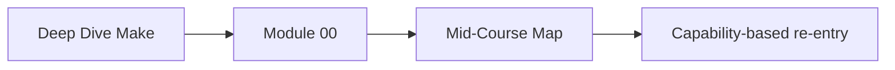
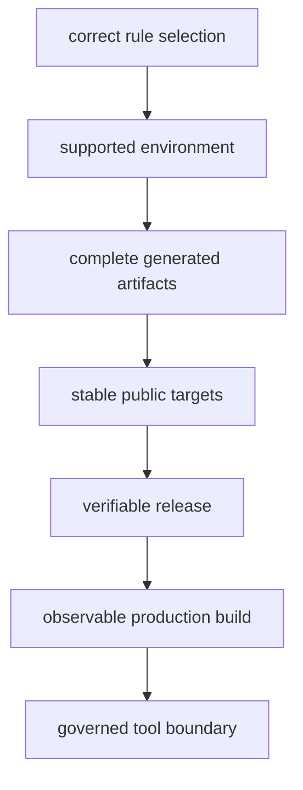

# Mid-Course Map

Use this page after Module 03, after a long interruption, or when a later Make feature
feels disconnected from graph truth.

The middle of the course changes the pressure:

- early modules establish correct incremental and parallel decisions;
- middle modules explain GNU Make semantics and growing build boundaries;
- later modules expose those boundaries to contributors, consumers, and operators.

## Page maps



```mermaid
flowchart LR
  graph["graph truth"] --> semantics["rule semantics"]
  semantics --> portable["portable environment"]
  portable --> generation["generated output ownership"]
  generation --> api["public build API"]
  api --> release["consumer artifact"]
  release --> operations["operational evidence"]
```

## Diagnose readiness

Without opening the earlier lessons, answer:

1. Why can a build converge and still be semantically stale?
2. What makes two independent prerequisites eligible to run concurrently?
3. Why does adding an ordering edge sometimes hide rather than repair a race?
4. What should a selftest assert after an unchanged second run?
5. Which evidence separates deterministic discovery from deterministic artifact bytes?

Route by the earliest weak answer:

| Weakness | Return to |
| --- | --- |
| freshness explanation relies on recipe order | Module 01 |
| parallel safety means “use `.NOTPARALLEL`” | Module 02 |
| selftest means only “binary tests pass” | Module 03 |
| all five answers use graph and artifact evidence | begin Module 04 |

These distinctions are prerequisites. Advanced syntax cannot compensate for a false DAG.

## Module 04: explain rule selection and expansion

Use Module 04 when you can see the graph but cannot explain why GNU Make selected a value,
include, or rule.

Evidence questions:

- when was the variable expanded?
- which origin won precedence?
- which conditional was parsed?
- was an included Makefile remade?
- which explicit, pattern, or implicit rule won?
- did a special target change semantics?

Focused capstone route:

```bash
make PROGRAM=reproducible-research/deep-dive-make capstone-semantic-fault-audit
```

Leave able to identify a semantic fault by named rule rather than “Make is weird.”

## Module 05: state the supported environment

Use Module 05 when the build works locally but relies on:

- one shell;
- one tool name or version;
- undeclared environment values;
- recursive Make that loses the jobserver;
- timestamp or locale behavior;
- a performance shortcut whose correctness cost is unclear.

Focused route:

```bash
make PROGRAM=reproducible-research/deep-dive-make capstone-environment-contract-audit
```

Leave with a supported-environment contract and one negative capability check.

## Module 06: make generated outputs owned

A generator command may write several artifacts while the graph names only one.

Review:

- which target owns invocation;
- which outputs form one publication set;
- which manifest or stamp has real semantic meaning;
- how partial failure is isolated;
- whether readers can observe half-published state;
- how a missing secondary output triggers repair.

Use Module 06 when generated headers, schemas, source files, or bundles behave like side
effects.

The architecture audit provides a repository-scale cross-check:

```bash
make PROGRAM=reproducible-research/deep-dive-make capstone-architecture-contract-audit
```

## Module 07: expose a build API

A large Make repository needs supported public targets and internal ownership boundaries.

Review:

| Boundary | Question |
| --- | --- |
| public target | may humans or CI depend on its name and effect? |
| internal target | which include owns it? |
| variable | is it public configuration, internal derivation, or accidental global state? |
| macro | does reuse reveal or hide graph edges? |
| discovery | is repository growth deterministic and namespaced? |

The build remains one DAG even when its source is layered across includes.

## Module 08: review artifacts as a consumer

Module 08 changes perspective. A successful producer workspace is no longer enough.

Ask:

- which candidate is being released?
- which members belong in the archive?
- are timestamps, ordering, ownership, and modes controlled?
- which checksum and manifest identify the result?
- can extraction reject unsafe paths before writing?
- can installation respect an explicit destination?

Focused route:

```bash
make PROGRAM=reproducible-research/deep-dive-make capstone-release-check
```

Leave able to verify the release without trusting undeclared build residue.

## Module 09: investigate before optimizing

Performance and incident response require preserving correctness evidence.

Separate:

- parse and expansion cost;
- graph scheduling;
- recipe duration;
- external tool work;
- proof and packaging cost.

During an incident, preserve:

```text
request and target
revision and worktree
environment
trace and timing
artifact state
concurrency level
first failing signature
```

Focused routes:

```bash
make PROGRAM=reproducible-research/deep-dive-make capstone-profile-audit
make PROGRAM=reproducible-research/deep-dive-make capstone-incident-audit
```

Do not remove edges, tests, or atomic publication merely because they consume time.

## Understand the dependency chain



A release failure may originate in a generator edge. An incident may originate in
variable precedence. Return to the earliest broken claim.

## Resume after a missed class

1. Open `artifacts/learning/deep-dive-make/module-decisions.md`.
2. Find the last capability with prediction, trace, artifact check, challenge, and limit.
3. Attempt the final exercise of the next module.
4. Use its failure to select a core page.
5. Re-run only the focused proof route needed for the missing capability.

If you have no packet, use the module's worked example and final exercise as a diagnostic.
Do not reread every page automatically.

## Keep a mid-course ledger

| Boundary | Claim | Focused receipt | Artifact check | Limit |
| --- | --- | --- | --- | --- |
| semantics | | | | |
| environment | | | | |
| generated outputs | | | | |
| build API | | | | |
| release | | | | |
| operations | | | | |

The artifact check prevents a detailed Make trace from becoming the whole conclusion.

## Leave this route when

Move to the [Mastery Map](mastery-map.md) when you can:

- explain a semantic surprise;
- state supported environment and recursion contracts;
- prove generator ownership and atomic publication;
- name public and internal build interfaces;
- verify a release as a consumer;
- preserve incident and performance evidence without weakening truth.
