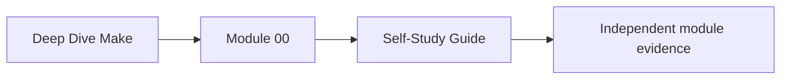
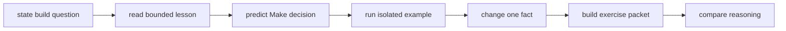
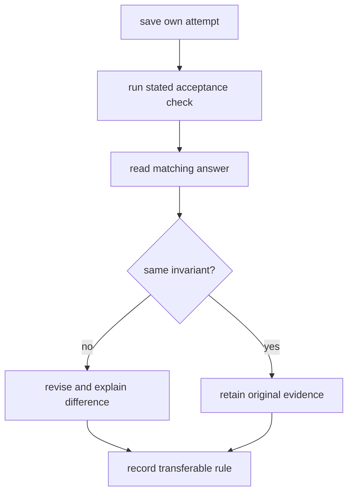

# Self-Study Guide

This guide supplies the pacing and review decisions an instructor would normally provide.
Use it for independent study, asynchronous classes, or recovery after missed sessions.

## Page maps





## Prepare one learning boundary

Keep all generated study material under:

```text
artifacts/learning/deep-dive-make/
├── questions.md
├── predictions.md
├── module-decisions.md
├── sandboxes/
├── command-logs/
└── review-packets/
```

Use a separate sandbox for each mutation. Do not practice destructive cleanup, extraction,
or migration commands against course source or an unrelated working repository.

At session start, write:

```text
module:
question:
last accepted capability:
time available:
workspace or sandbox:
expected evidence:
```

## Use one module rhythm

### Frame a graph question

Read the module index and rewrite its central question in terms of a target, graph,
environment, artifact, consumer, or owner.

Weak:

> Learn parallel Make.

Stronger:

> Which outputs can run concurrently, and what evidence proves serial and parallel
> builds publish equivalent results?

### Read core pages in order

For every core page, record:

```text
rule:
failure when violated:
observable receipt:
artifact consequence:
```

The receipt may be a trace, selftest report, archive listing, checksum, or incident
signature. “The command passes” is too broad.

### Predict before execution

Before a demonstration, state:

- requested target;
- prerequisites Make should consider;
- recipes expected to run or skip;
- files or actions expected afterward;
- negative mutation that should change the decision;
- claim the run cannot prove.

Prediction keeps explanation from being invented after output appears.

### Run in a controlled sandbox

Use module-provided examples, capstone audits, or a copied reproduction under
`artifacts/learning/`.

Preserve:

```text
Makefile before
input state before
command and concurrency
stdout and stderr
artifact identities
Makefile or input mutation
second receipt
decision
```

Do not use `make -B`, delete every output, or disable parallelism as the acceptance test
for a graph repair. Those actions bypass the decision under review.

### Complete all ten exercises

The exercises progress from observation to repair and transfer. Build the requested
files and evidence; do not answer only in prose when a command route is required.



Compare invariants, not exact formatting. Several Makefile designs may be defensible if
their graph and evidence contracts are equivalent.

### Close with a capability decision

Append:

```text
Module:
Capability accepted:
Evidence route:
Failure I can diagnose:
Shortcut I would reject:
Remaining limit:
Next module:
```

If the capability is not accepted, return to the smallest missing page or exercise. Do
not restart the entire course.

## Choose an honest session size

| Time | Scope |
| ---: | --- |
| 20 minutes | one core section, prediction, and plain-language rule |
| 45 minutes | one core page and its smallest runnable example |
| 90 minutes | one worked investigation or several linked exercises |
| 2–3 hours | complete exercise packet and answer review |
| half day | one full module when prerequisites are already stable |

Do not begin an incident, release, or migration simulation if there is no time to inspect
and preserve its evidence.

## Recover after a missed session

Use:

1. module completion checkpoint;
2. worked example;
3. final exercise and answer.

Attempt the final exercise first:

| Failure | Return to |
| --- | --- |
| cannot draw the graph | earliest graph lesson |
| cannot predict rule selection | semantics lesson |
| can predict but cannot read trace | evidence-reading route |
| trace is clear but artifact claim is not | output or consumer contract |
| solution works only serially | parallel safety |
| repair requires force or full clean | dependency or publication boundary |

This diagnosis is faster and more honest than rereading every page.

## Use answer pages responsibly

Before reading an answer:

- save your Makefile;
- save the trace or report;
- explain observed files;
- state the decision and limit.

Then ask:

- Did both designs name the same real prerequisites?
- Did both avoid false ordering?
- Did both preserve failure evidence?
- Did the model answer make a portability assumption you omitted?
- Is a difference stylistic or contractual?

If your design remains defensible, retain it with the justification.

## Work with a review partner

Send:

- requested target and claimed effect;
- Makefile or relevant rules;
- input state;
- prediction;
- raw receipt;
- artifact check;
- decision.

Do not explain missing dependencies orally before the reviewer tries the route. The
handoff is part of the evidence.

## Handle command blockers

| Block | Response |
| --- | --- |
| wrong Make implementation | follow platform setup; do not translate semantics silently |
| missing tool | preserve capability check; mark portability claim untested |
| unsupported shell feature | return to supported-environment contract |
| command writes tracked drift | inspect and isolate before continuing |
| race is intermittent | use controlled delay and repeated bounded selftest |
| full proof route is too expensive | run focused audit and record deferred integrated check |

`UNTESTED` is an honest outcome. A guessed pass is not.

## Weekly review

Answer:

- Which target can I now explain without the page?
- Which graph repair survived the original mutation?
- Which artifact or consumer check goes beyond recipe success?
- Which platform or concurrency boundary remains untested?
- What is the earliest empty capability in the course map?

Use the answers to select the next session.

## Completion standard

Self-study is working when you can:

- resume from an evidence packet;
- choose a bounded session;
- predict before running;
- preserve graph and artifact evidence;
- use answers to audit reasoning;
- classify blockers and limits honestly;
- choose readiness by demonstrated capability rather than pages viewed.
