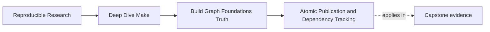
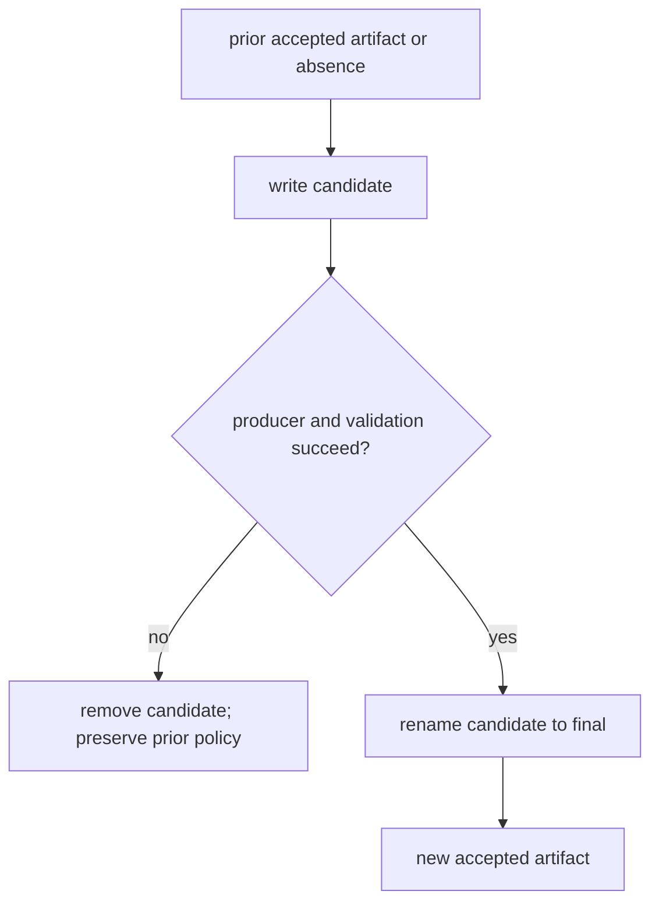
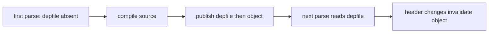

# Atomic Publication and Dependency Tracking


<!-- page-maps:start -->
## Page Maps




<!-- page-maps:end -->

Even a truthful graph can be damaged by bad publication hygiene.

This page covers the final piece of Module 01:

> a target should appear only when it is complete, and its dependency edges should be real
> enough that incremental rebuilds keep telling the truth.

## Why publication hygiene matters

Imagine a compile rule that writes directly to `build/main.o` and fails halfway through.
You now have a file at the target path, but it may be incomplete or stale. On the next
run, Make sees a file and may treat it as evidence.

That is how a build becomes poisoned.

## The failure you are trying to prevent

Imagine this sequence:

1. the compile starts writing `build/main.o`
2. the compiler fails halfway through
3. the path `build/main.o` still exists
4. the next incremental run reasons from that broken file

That is a terrible debugging loop because the target path now exists but the trust
contract behind it is false. Publication hygiene is how you break that loop.

## The safe publication pattern

Write to a temporary file first, then rename it into place only after the command
succeeds.

```make
app: $(OBJS)
	@candidate="$(@D)/.$(@F).candidate.$$$$"; \
	$(CC) $^ -o "$$candidate" && \
	./scripts/check_app.sh "$$candidate" && \
	mv -f "$$candidate" "$@" || { rm -f "$$candidate"; exit 1; }
```

This gives you a strong property:

- before success, the final path is untouched
- after success, the final path is fully published

That property becomes more important, not less, as the build grows.

The candidate is target-specific, process-unique, and located beside the final path.
Same-directory placement keeps rename on one filesystem. The validation command is part
of the example’s acceptance policy; replace it with an appropriate bounded check.

## Decide what failure preserves

Two common policies are:

| Initial state | Failed rebuild policy | Next-run behavior |
| --- | --- | --- |
| no accepted target | final path remains absent | Make retries because target is missing |
| prior accepted target | prior final value remains untouched | unchanged stale prerequisites still make it rebuild |

Both avoid publishing the rejected candidate. Do not delete a prior accepted artifact
before the new candidate has passed merely to make failure look clean.



Atomic rename protects visibility. It does not validate content, declare inputs, or solve
two independent producers racing to own the same final path.

## A compile rule that treats `.o` and `.d` as one publication unit

```make
$(BLD_DIR)/%.o: $(SRC_DIR)/%.c $(FLAGS_STAMP) | $(BLD_DIR)/
	@object_candidate="$@.candidate.$$$$"; \
	dep_candidate="$(@:.o=.d).candidate.$$$$"; \
	$(CC) $(CPPFLAGS) $(CFLAGS) $(DEPFLAGS) \
	  -MF "$$dep_candidate" -MT "$@" -c "$<" -o "$$object_candidate" && \
	mv -f "$$dep_candidate" "$(@:.o=.d)" && \
	mv -f "$$object_candidate" "$@" || { \
	  rm -f "$$object_candidate" "$$dep_candidate"; exit 1; \
	}
```

The object and depfile represent one compile result, but two separate renames are not one
atomic filesystem transaction. Publishing the depfile first and the object target last
is recovery-biased: if final object publication fails, the missing or still-stale object
causes another compile while the new depfile does not make a rejected object look
accepted.

State this limit honestly. A tool or format requiring truly atomic multi-file publication
needs a directory, archive, manifest pointer, or another transactional boundary.

## `.DELETE_ON_ERROR`

Add this near the top of serious Makefiles:

```make
.DELETE_ON_ERROR:
```

It tells Make not to keep a target that failed while being built. It is not enough by
itself, but it is a good baseline.

Think of `.DELETE_ON_ERROR` as guardrails, not as your whole design. You still need the
recipe to avoid publishing partial artifacts in the first place.

`.DELETE_ON_ERROR` knows the target Make is updating. It does not know candidate paths,
logs, side effects, sibling outputs, or external state. Recipe cleanup still owns those.

## Header dependencies are real dependencies

In C builds, source files are not the whole story. Headers change object meaning too.

If your rule says only this:

```make
build/%.o: src/%.c
```

then a header edit may not trigger the rebuild you need.

That is why depfiles matter. They let the compiler publish the discovered header edges
into `.d` files, which Make can include on the next run.

Without depfiles, header changes often create the most frustrating kind of build bug:

- the source file clearly uses the header
- the program output changes in meaning
- but Make has no recorded edge, so nothing rebuilds

That is a graph-truth failure, not a compiler failure.

## The core depfile shape

```make
DEPFLAGS := -MMD -MP
DEPS := $(OBJS:.o=.d)

$(BLD_DIR)/%.o: $(SRC_DIR)/%.c | $(BLD_DIR)/
	@object_candidate="$@.candidate.$$$$"; \
	dep_candidate="$(@:.o=.d).candidate.$$$$"; \
	$(CC) $(CPPFLAGS) $(CFLAGS) $(DEPFLAGS) \
	  -MF "$$dep_candidate" -MT "$@" -c "$<" -o "$$object_candidate" && \
	mv -f "$$dep_candidate" "$(@:.o=.d)" && \
	mv -f "$$object_candidate" "$@" || { \
	  rm -f "$$object_candidate" "$$dep_candidate"; exit 1; \
	}

-include $(DEPS)
```

The details matter less than the intent:

- headers become explicit evidence for future rebuilds
- the `.o` and `.d` files are published together
- a failed compile does not leave a half-truth behind

## Read the depfile contract

For a source including `include/util.h`, the generated file may contain:

```make
build/main.o: src/main.c include/util.h
include/util.h:
```

`-MMD` records user-header dependencies while excluding system headers. `-MP` adds dummy
rules that help when a previously included header is removed. `-MF` chooses the depfile
path, and `-MT` records the intended object target.

Review:

- the depfile target matches the actual object path;
- the depfile is written to a candidate path;
- the expected depfiles are included with `-include` so the first clean build tolerates
  their absence;
- generated headers still have producing rules;
- header removal behavior is tested rather than assumed.

The compiler discovers header reads. Make can use them only after the depfile is
published and included on a subsequent parse.

## First build and later builds differ



The initial compile rule must declare enough direct inputs to run before depfiles exist.
Later invocations gain the discovered header edges. A clean build passing once does not
prove those later edges work.

## A short failure drill

Force one failure on purpose. For example, add `false` before the final `mv` in a link or
compile rule. Then check:

- does the final target path remain absent or unchanged
- does a rerun recover cleanly
- do you still trust the artifact graph after the failed run

If the answer to the third question is "not really," the publication contract still needs
work.

Run two drills in an isolated fixture.

### Rejected candidate drill

1. create or preserve an accepted target;
2. change a declared input so a rebuild is required;
3. inject failure after candidate creation but before rename;
4. capture the nonzero exit;
5. verify the final path follows the prior/absent policy;
6. verify no candidate is accepted by a consumer;
7. remove the fault and rebuild;
8. inspect content and require unchanged replay convergence.

### Header edge drill

1. clean-build source and depfile in a harness-owned workspace;
2. inspect the depfile for the expected header edge;
3. change only the header;
4. predict the object and downstream link closure;
5. capture the trace;
6. verify the new program behavior or object identity;
7. repeat unchanged and require query exit zero.

Do not clean after changing the header. The exercise is incremental dependency tracking.

## Publication evidence table

| Claim | Evidence |
| --- | --- |
| final appears only after success | failure injection before rename |
| prior accepted value is not poisoned | before/after identity and semantic check |
| candidate cleanup works | candidate-path inventory after failure |
| depfile target is correct | depfile content |
| header participates in freshness | header-only change and trace |
| repaired graph converges | unchanged query exit zero |

## Common traps

| Trap | Why it fails |
| --- | --- |
| candidate is a global `output.tmp` | overlapping producers collide |
| candidate lives on another filesystem | rename may not be atomic |
| final is written before validation | consumers can observe rejected content |
| object moves before depfile | depfile publication failure can leave accepted-looking object without new edges |
| `-include` hides malformed depfile forever | missing first-build file and invalid later file need different diagnosis |
| `.DELETE_ON_ERROR` is treated as full cleanup | side-effect paths remain unknown to Make |
| header drill begins with clean after header edit | missing incremental edge is hidden |

## End-of-page checklist

- real artifacts publish through temp paths
- failed recipes do not leave new broken outputs behind
- header dependencies are included through depfiles
- you can explain why a target path is trustworthy after success
- you can explain why a failed run does not poison the next one
- you can explain why object and depfile publication is recovery-biased, not magically
  atomic as a pair

## What to prove on this page

Two checks matter:

1. force a failure and confirm the final target is absent or unchanged
2. change a header meaningfully and confirm the right object rebuilds

If you can do both, your build is starting to earn trust.
