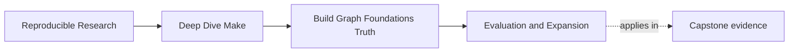

# Evaluation and Expansion


<!-- page-maps:start -->
## Page Maps




<!-- page-maps:end -->

Many Make bugs come from one quiet misunderstanding:

> some things happen while Make is reading the file, and other things happen later when a
> recipe runs in the shell.

If you blur those moments together, builds feel nondeterministic even when the syntax is
valid.

## Two different moments

### Read time

When Make parses the Makefile, immediate constructs expand and Make builds rule and
variable definitions.

### Recipe time

Later, after Make decides a target needs rebuilding, deferred recipe text expands and
Make launches a shell.

That distinction matters because a value computed at read time can affect the graph before
any recipe runs.

GNU Make has more detailed immediate/deferred rules than this first model. Module 01 uses
the model to answer three practical questions:

- when was this value observed;
- did it shape the graph or only the selected recipe;
- did Make expand it, or did the shell?

## A simple timeline


Keep that picture in your head. It explains many "Make is acting weird" moments.

## Two interpreters share recipe text

Make expands Make references before the shell interprets the resulting command:

```make
NAME := report

show:
	@file="$(NAME).txt"; printf '%s\n' "$$file"
```

Here:

- `$(NAME)` is expanded by Make;
- `$$` becomes one `$` for the shell;
- the shell assigns and expands `file`.

Writing `$file` in the recipe would let Make consume `$f` as a Make reference and pass
surprising text. Dollar ownership is part of reading a recipe.

Automatic variables such as `$@` and `$<` are supplied by Make for a selected target
context. They are not ordinary global values available while top-level assignments are
read.

## The assignment operators you need first

### `:=` immediate assignment

```make
SRCS := $(sort $(wildcard src/*.c))
```

Make computes the value once when reading the file. This is a good default for lists you
want to stay stable.

### `=` recursive assignment

```make
SRCS = $(wildcard src/*.c)
```

Make stores the recipe for computing the value and expands it later when the variable is
used. This is useful, but it is easier to misuse.

### `?=` and `+=`

Use `?=` for defaults and `+=` for simple extension. They are helpful, but they do not
replace the need to understand when evaluation happens.

Important details:

- `?=` assigns only when the variable is undefined; a defined empty value still counts as
  defined;
- `+=` follows the existing variable’s flavor, so appending to a recursive variable can
  preserve later expansion;
- command-line variables normally override ordinary Makefile assignments;
- `override` changes that policy and should be deliberate.

## A side-by-side example

```make
SRCS_IMMEDIATE := $(wildcard src/*.c)
SRCS_LATE = $(wildcard src/*.c)
```

The first line says, "decide this list now."

The second says, "decide this list whenever the variable is expanded later."

If the filesystem changes during the build or if the variable is used in several
different places, those two choices can lead to different behavior. That is why `:=` is a
good default for graph-shaping values.

Run a small observation:

```make
NOW := $(wildcard inputs/*.txt)
LATER = $(wildcard inputs/*.txt)

.PHONY: show
show:
	@printf 'NOW=%s\n' '$(NOW)'
	@printf 'LATER=%s\n' '$(LATER)'
```

This does not mean a file created by one recipe safely joins the same invocation’s graph
through `LATER`. Make constructs prerequisite relationships before executing the update
plan. Dynamic graph design requires explicit supported mechanisms, not hope that deferred
text will rediscover targets at the right moment.

## Assignment behavior table

| Form | Stored value | Observation moment | Beginner use |
| --- | --- | --- | --- |
| `A := $(B)` | expanded result | assignment read | stable graph-shaping list or normalized value |
| `A = $(B)` | unexpanded text | each reference expansion | intentionally late reference |
| `A ?= value` | default only when undefined | depends on resulting flavor | supported configurable default |
| `A += value` | append according to current flavor | depends on existing variable | extend a known interface |
| `A != command` | shell command result | assignment read | explicit but environment-sensitive observation |

Do not choose `=` merely because it has fewer characters.

## Why `$(shell ...)` deserves caution

`$(shell ...)` runs when the containing expression expands. With `:=` that is the
assignment read; with a recursive variable it can be later and repeated.

That means a line like this can change the graph before any recipe executes:

```make
BUILD_ID := $(shell date +%s)
```

If that value is part of target naming, prerequisites, or command selection, your build
definition itself changes every time Make reads the file.

That is how "we did not change the source" turns into "the build still changed."

Classify each shell observation:

| Observation | Risk | Better boundary |
| --- | --- | --- |
| current time | volatile correctness input | diagnostic target outside core graph |
| tracked revision | dirty-state and availability ambiguity | explicit release evidence policy |
| file discovery | membership, quoting, locale, and failure | rooted Make discovery or governed manifest |
| tool version | environment-sensitive semantic input | normalized tool signature/stamp |
| generated configuration | parse-time side effect or stale include | explicit producer and included generated file |

Shell failure also needs a policy. An empty result caused by a missing command can look
like a legitimate empty list.

## A bad and better contrast

Bad:

```make
BUILD_TAG := $(shell date +%s)
```

Better:

```make
BUILD_MODE ?= dev
MODE_STAMP := build/mode.$(BUILD_MODE).stamp
```

The bad version changes every invocation for no semantic reason. The better version ties
the graph to a declared mode that can be inspected, named, and discussed.

The mode name alone is not freshness evidence. A target whose bytes depend on
`BUILD_MODE` still needs a path, stamp, or separated output root that changes when the
mode changes.

## A safer Module 01 posture

- prefer `:=` for computed lists and flags
- sort discovered file lists so they stay stable
- treat `$(shell ...)` as a design choice, not harmless convenience
- inspect `make -p` when variable origin or value seems surprising

## What `make -p` is good for

Use `make -p` when you need to answer questions like:

- what value did this variable end up with
- where did that value come from
- which pattern rules exist after expansion

Do not treat it as a wall of text to fear. Treat it as a dump of the evaluated world.

Use a non-executing bounded form:

```sh
set +e
make -pRrq all > artifacts/learning/deep-dive-make/module-01-graph-truth/database.txt
database_exit=$?
set -e
printf 'database_exit=%s\n' "$database_exit"
```

Query mode can return `1` because work is needed. That is not a parse failure. Search for
the exact variable or target rather than reading the entire database linearly.

## Useful introspection tools

When a variable behaves oddly, these are worth knowing:

```make
$(origin VAR)
$(flavor VAR)
$(value VAR)
```

They tell you where a variable came from, how it expands, and what raw value it holds.

Those are not "advanced tricks." They are often the shortest path out of confusion.

Create a temporary diagnostic target in a module lab:

```make
.PHONY: explain-config
explain-config:
	@printf 'MODE origin=%s flavor=%s raw=%s expanded=%s\n' \
	  '$(origin MODE)' '$(flavor MODE)' '$(value MODE)' '$(MODE)'
```

The raw and expanded values may differ for recursive variables. Remove ad hoc probes from
production rules or promote a recurring question into a documented inspection target.

## Predict an expansion

For:

```make
BASE = alpha
EARLY := $(BASE)
LATE = $(BASE)
BASE = bravo
```

predict:

```text
EARLY=alpha
LATE=bravo
```

Then explain why:

- `EARLY` captured expanded content before reassignment;
- `LATE` stored a reference and expanded after reassignment.

This is evaluation timing, not nondeterminism.

## Expansion traps

| Trap | Result |
| --- | --- |
| using `$@` in a top-level immediate assignment | no selected-target context exists |
| forgetting `$$` for a shell variable | Make consumes the dollar reference |
| recursive variable calls volatile `$(shell ...)` several times | one invocation observes several states |
| `?=` after an empty environment definition | default is not applied |
| graph membership depends on a recipe-created file | current graph was already planned |
| command-line override changes bytes without freshness evidence | existing target may remain stale |

## Review prompts

- Which variables in this Makefile shape the graph itself?
- Which variables only affect recipe details?
- Would `:=` make any important value more stable or more readable?
- Is `$(shell ...)` solving a real problem here, or hiding one?

## Review questions

- Is this value supposed to be fixed when Make starts, or recomputed later?
- Could this expansion depend on time, environment, or filesystem order?
- If the value changes build meaning, where is that change made visible to the graph?
- Which interpreter owns each dollar reference?
- Does a command-line or environment value change target identity without graph evidence?

When you ask those questions early, Make stops feeling moody and starts feeling legible.
