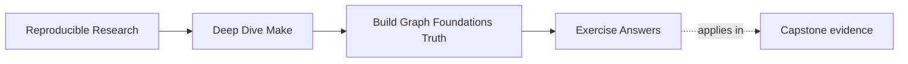

# Exercise Answers


<!-- page-maps:start -->
## Page Maps




<!-- page-maps:end -->

Use this file after you have written your own answers. The value is comparison, not
copying.

## How to use the answer page well

Do not read a model answer first and then reshape your work to sound similar.

A better rhythm is:

1. finish the exercise with your own files, traces, and notes
2. write one plain-language explanation of the graph
3. compare that explanation with the model answer
4. revise where the model answer exposes a missing edge, a weak proof route, or vague
   ownership language

The best Module 01 answers usually do four things:

- they name the target or prerequisite fact directly
- they explain why the current graph is truthful or weak
- they point to one evidence route
- they describe the repair in terms of ownership and observable behavior

The best self-study packets also leave behind six concrete artifacts:

- one corrected graph sketch
- one hidden-input repair
- one evaluation-timing note
- one atomic-publication drill
- one stale-output diagnosis
- one final graph you can defend calmly

If your answers rely only on "Make knows what changed," the reasoning is still too thin.

## Exercise 1: Draw the graph

A strong answer names both artifact targets and convenience targets explicitly.

Example answer shape:

- real artifact targets:
  - `app`
  - `build/main.o`
  - `build/util.o`
- convenience target:
  - `all`
- important shared prerequisite:
  - `include/util.h` if both objects include it

Why this is strong:

- it does not blur phony orchestration and file publication
- it names the shared header edge that can go stale
- it makes review possible before any command is run

The missing but important sentence is usually:

> `all` asks for work, but it is not itself the artifact whose freshness we are trying to
> defend.

Weak answer pattern:

- "The graph is main depends on util depends on app"

That answer is too vague to distinguish a build graph from a storytelling sequence.

## Exercise 2: Find a hidden input

`CFLAGS` is a hidden input because it changes compiler meaning without appearing in the
prerequisite list. A strong repair gives that semantic fact an artifact the graph can
depend on.

One acceptable sketch is:

```make
FLAGS_LINE := CFLAGS=$(CFLAGS)
FLAGS_ID := $(shell printf '%s' "$(FLAGS_LINE)" | cksum | awk '{print $$1}')
FLAGS_STAMP := build/flags.$(FLAGS_ID).stamp

$(FLAGS_STAMP):
	@mkdir -p build
	@printf '%s\n' "$(FLAGS_LINE)" > $@
```

The important point is not the checksum tool. The important point is that changing the
semantic compiler setting now moves a piece of evidence the graph can see.

Key explanatory sentence:

> The repair works because the graph no longer depends on a private variable value alone;
> it depends on an artifact that changes when that value changes.

Weak answer pattern:

- "I would just run `make clean` when flags change"

That does not repair the graph. It bypasses the graph.

## Exercise 3: Review rule ownership

An explicit rule makes ownership obvious because the output path is named directly. A
pattern rule is still truthful when the mapping is stable and reviewable, such as
`build/%.o: src/%.c`.

The strongest answers say more than "pattern rules are shorter." They say why the mapping
is still understandable and where confusion would begin.

For example:

> Ownership becomes unclear when two rules can both publish `build/alpha.o`, or when one
> multi-output generator is described as if each file were independently produced.

Why this is strong:

- it uses ownership language instead of taste language
- it identifies the actual failure mode

## Exercise 4: Explain evaluation timing

`:=` computes its value when Make reads the file. `=` stores an expression to expand
later. For graph-shaping values such as discovered source lists, `:=` is usually the
safer Module 01 default because it gives the run one stable interpretation.

A strong answer often includes a contrast like this:

```make
SOURCES_NOW := $(wildcard src/*.c)
SOURCES_LATER = $(wildcard src/*.c)
```

The key explanatory sentence is:

> The point is not that `=` is morally wrong; the point is that graph-shaping values are
> easier to reason about when they do not change meaning halfway through understanding the
> build.

Weak answer pattern:

- "`:=` is faster"

Speed may be true sometimes, but it misses the educational point of this module.

## Exercise 5: Prove safe publication

A safe publication answer writes to a temporary path such as `$@.tmp` and renames only on
success.

Example shape:

```make
app: build/main.o build/util.o
	$(CC) $^ -o $@.tmp
	mv $@.tmp $@
```

The proof statement is:

> A failed recipe leaves either no final target or the previously known-good target, but
> never a half-written new target at the published path.

The strongest answers also include the drill:

1. force failure before the final rename
2. inspect whether `app` changed
3. rerun and confirm clean recovery

Weak answer pattern:

- "Temporary files are safer"

That is directionally right but too weak. Safer against what, and what remains after
failure?

## Exercise 6: Write the smallest useful Makefile

A complete answer can stay small:

```make
.DEFAULT_GOAL := all
.PHONY: all

all: message.upper.txt

message.upper.txt: message.txt
	tr '[:lower:]' '[:upper:]' < $< > $@
```

The first run creates the target. The second run does nothing because
`message.upper.txt` exists and is newer than `message.txt`. Editing `message.txt` makes
the prerequisite newer than the target, so the recipe runs again.

Why this is strong:

- it gives one truthful edge
- it separates orchestration from publication
- it is small enough that every learner can inspect the whole graph

## Exercise 7: Predict automatic variables

For the rule shown:

- `$@` expands to `report.txt`
- `$<` expands to `title.txt`
- `$^` expands to `title.txt results.txt`

The shell command is:

```sh
cat title.txt results.txt > report.txt
```

The important explanation is:

> `$<` would be wrong here because the recipe combines every declared prerequisite, not
> just the first one.

Weak answer pattern:

- "`$^` means all dependencies"

That is not enough. A learner still needs to connect the variable to the recipe's actual
ownership and input story.

## Exercise 8: Remove duplicated compile recipes

A reusable rule is:

```make
build/%.o: src/%.c | build/
	$(CC) $(CPPFLAGS) $(CFLAGS) -c $< -o $@

build/:
	mkdir -p $@
```

If `build/gamma.o` is required by the final target, Make binds `%` to `gamma` and looks
for `src/gamma.c`. The pattern rule removes duplicated compile policy. It does not remove
the need to declare which objects belong in the final program.

The missing but important sentence is:

> Generalized production rules do not discover the final artifact set for you.

That sentence protects learners from confusing reusable recipes with truthful target
selection.

## Exercise 9: Diagnose a stale header build

The broken shape is:

```make
build/alpha.o: src/alpha.c config.h
build/beta.o: src/beta.c
```

If both sources include `config.h`, the second rule lies. Changing the header can leave
`build/beta.o` stale because the graph has no evidence connecting that object to the
header.

The repair is:

```make
build/beta.o: src/beta.c config.h
```

The important explanation is:

> `make clean` deletes the stale object, so the next build succeeds, but that only proves
> a clean rebuild works. It does not prove the incremental graph is truthful.

Weak answer pattern:

- "The broken build goes away if I rebuild everything"

That is exactly the trap this exercise is trying to expose.

## Exercise 10: Design and defend a small graph

One valid design is:

```make
.PHONY: all
all: summary.txt chart.svg

cleaned.csv: raw.csv
	cp $< $@

summary.txt: cleaned.csv
	printf 'summary from %s\n' "$<" > $@

chart.svg: cleaned.csv
	printf '<svg><!-- data from %s --></svg>\n' "$<" > $@
```

Expected rebuilds:

| Change | Rebuilds |
| --- | --- |
| edit `raw.csv` | `cleaned.csv`, `summary.txt`, and `chart.svg` |
| delete `summary.txt` | only `summary.txt` |
| delete `chart.svg` | only `chart.svg` |
| run twice without changes | no recipes on the second run |

The fan-out is honest because `cleaned.csv` has one writer and both final outputs name it
as the content-deciding input.

Why this is strong:

- every published path has one owner
- every rebuild can be defended with one declared edge
- the graph stays readable even after fan-out

## What a mastery-level answer set looks like

A mastery-level submission does not just contain the right snippets. It shows that you can
move comfortably between three levels:

- graph language:
  - target, prerequisite, convenience target, ownership, staleness
- command evidence:
  - `--trace`, failure drills, repeated runs, before-and-after comparisons
- plain-language explanation:
  - why the build is or is not telling the truth

If your answers can move between those three levels without slipping into folklore, you
are learning Module 01 in the right direction.
