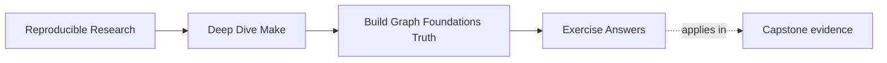
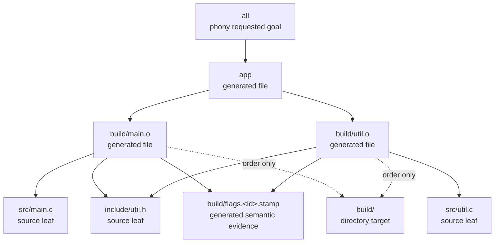

# Exercise Answers


<!-- page-maps:start -->
## Page Maps




<!-- page-maps:end -->

Use this file after you have written your own answers. The value is comparison, not
copying.

## How to use the answer page well

Do not read a model answer first and then reshape your work to sound similar.

A better rhythm is:

1. finish the exercise with your own files, traces, and notes
2. write one plain-language explanation of the graph
3. compare that explanation with the model answer
4. revise where the model answer exposes a missing edge, a weak proof route, or vague
   ownership language

The best Module 01 answers usually do four things:

- they name the target or prerequisite fact directly
- they explain why the current graph is truthful or weak
- they point to one evidence route
- they describe the repair in terms of ownership and observable behavior

The best self-study packets also leave behind reviewable artifacts:

- one corrected graph sketch
- an update-decision and ownership ledger
- one hidden-input repair with relevant and irrelevant mutations
- one Make-versus-shell evaluation note
- one failure-safe publication drill
- one stale-output diagnosis made without cleaning
- one final graph whose completeness, minimality, recovery, and convergence are evidenced

If your answers rely only on "Make knows what changed," the reasoning is still too thin.

## Exercise 1: Draw the graph

A defensible graph labels roles as well as paths:



The order-only edges ensure the directory exists but do not make objects stale whenever
the directory timestamp changes. Header edges are normal because header content can
change object meaning.

An update-decision table should reason from the requested goal inward:

| Starting state | `build/main.o` | `build/util.o` | `app` |
| --- | --- | --- | --- |
| no generated files | missing; compile | missing; compile | missing; link |
| only `src/util.c` is newer | up-to-date | stale; compile | stale after `util.o`; link |
| every normal prerequisite is older | up-to-date | up-to-date | up-to-date |

`all` is always considered because it is phony, but that does not force its file
prerequisites to rebuild. The most dangerous missing edge is usually the shared header
or semantic flags stamp: omitting either permits a semantically stale object to appear
current.

A common weak drawing is `main -> util -> app`. That is execution storytelling, not a
dependency graph: the arrows point the wrong way and the published targets disappear.

## Exercise 2: Find a hidden input

An incomplete rule can build successfully and still be false:

```make
build/%.o: src/%.c | build/
	$(CC) $(CFLAGS) -c $< -o $@
```

After `make CFLAGS=-O2 build/alpha.o`, requesting
`make CFLAGS=-O0 build/alpha.o` can report the object up to date. The object file and
source path have not changed, so the graph has no evidence that compiler policy changed.

One repair makes the semantic value select a prerequisite path:

```make
FLAGS_LINE := CC=$(CC) CFLAGS=$(CFLAGS)
FLAGS_ID := $(shell printf '%s' "$(FLAGS_LINE)" | cksum | awk '{print $$1}')
FLAGS_STAMP := build/compile-flags.$(FLAGS_ID).stamp

$(FLAGS_STAMP): | build/
	@candidate="$@.candidate.$$$$"; \
	printf '%s\n' "$(FLAGS_LINE)" > "$$candidate" && \
	rm -f build/compile-flags.*.stamp && \
	mv -f "$$candidate" "$@" || { rm -f "$$candidate"; exit 1; }

build/%.o: src/%.c $(FLAGS_STAMP) | build/
	$(CC) $(CFLAGS) -c $< -o $@
```

Changing `CFLAGS` now changes `FLAGS_ID`, selects a missing stamp, and makes that stamp a
prerequisite of the requested object. A later identical request selects the existing
stamp and converges. The stamp content gives a reviewer the human-readable policy; the
checksum only gives it a path-safe identity.

Removing the previously active stamp is essential in this single-configuration build
directory. After `-O2 -> -O0`, an old `-O2` stamp must not remain available: returning
to `-O2` has to create fresh evidence newer than the `-O0` object. If configurations must
build concurrently, give each one a separate output directory rather than sharing object
paths and deleting each other's active stamp.

The rejection test matters. After convergence, changing `notes/reading.md` should leave
`make -q build/alpha.o` at status `0` because the note has no edge to the object. Test
both `-O2 -> -O0` and `-O0 -> -O2`; a solution that proves only the first transition has
not established reversible semantic tracking. A solution that rebuilds on every file
change avoids staleness by giving up minimality.

Running `make clean` after flag changes does not repair the graph. It destroys the state
needed to test whether the graph recognized the semantic change.

## Exercise 3: Review rule ownership

The explicit version names membership and ownership together:

```make
build/alpha.o: src/alpha.c | build/
	$(CC) -c $< -o $@

build/beta.o: src/beta.c | build/
	$(CC) -c $< -o $@

app: build/alpha.o build/beta.o
	$(CC) $^ -o $@
```

The generalized version separates the mapping from membership:

```make
OBJS := build/alpha.o build/beta.o

build/%.o: src/%.c | build/
	$(CC) -c $< -o $@

app: $(OBJS)
	$(CC) $^ -o $@
```

The pattern says how a requested matching object can be produced. `OBJS` says which
objects belong in `app`. The pattern does not scan the filesystem and silently decide
application membership.

Adding a second recipe for `build/alpha.o` should produce an overriding-recipe warning.
By contrast, these two lines are compatible because there is still only one writer:

```make
build/alpha.o: src/alpha.c
build/alpha.o: include/alpha.h
```

Make combines their prerequisites. Ownership becomes confused only when competing recipe
bodies claim the same path. The ledger should therefore name the pattern rule as the
sole object writer and the `app` rule as the sole executable writer.

## Exercise 4: Explain evaluation timing

This example exposes immediate versus deferred expansion and dollar ownership:

```make
name = early
captured := $(name)
deferred = $(name)
name = late

$(info captured=$(captured))
$(info deferred=$(deferred))
$(info flavor=$(flavor deferred))
$(info origin=$(origin deferred))
$(info raw=$(value deferred))

.PHONY: inspect
inspect:
	label=shell; printf '%s %s %s\n' '$(captured)' '$(deferred)' "$$label"
```

Without an override, Make prints `captured=early` and `deferred=late`; the shell receives:

```sh
label=shell; printf '%s %s %s\n' 'early' 'late' "$label"
```

Make owns `$(captured)` and `$(deferred)`, so it expands them before launching the shell.
The doubled dollar survives Make as one dollar for the shell. `$(value deferred)` reports
the stored text `$(name)`, while normal expansion follows that reference to `late`.

With `make name=command inspect`, the command-line assignment wins over ordinary
Makefile assignments; `origin` reports `command line`. The already captured value also
becomes `command` because the override is in force when parsing begins.

For a graph-shaping source list, `:=` is usually the safer default because the set is
fixed when Make parses the declaration. The claim is about stable meaning, not speed.

## Exercise 5: Prove safe publication

A failure-safe link rule uses a candidate name specific to the target and shell process:

```make
app: build/main.o build/util.o
	candidate=$@.candidate.$$$$; \
	$(CC) $^ -o "$$candidate" && mv -f "$$candidate" $@ || { \
	  status=$$?; rm -f "$$candidate"; exit $$status; \
	}
```

The rename is the publication commit point. Before it, readers still see either the old
valid `app` or no `app`; after it, they see the complete new one. The candidate is in the
same directory so the final rename can use the filesystem's atomic rename behavior.

A valid drill is:

```sh
before=$(cksum app)
# Introduce a compile or link failure.
if make app; then exit 1; fi
after=$(cksum app)
test "$before" = "$after"
test -z "$(find . -name '*.candidate.*' -print -quit)"
```

If no old target existed, replace the checksum assertion with `test ! -e app`. After
repair, the target should rebuild and a safely captured `make -q app` status should be
`0`.

For an object plus depfile, two renames cannot be one atomic transaction. Publishing the
depfile first and object last is recovery-biased: a published new object will not be
paired with older dependency information. The object rename remains the commit point.

Writing directly to `$@`, using one shared candidate name, or relying only on
`.DELETE_ON_ERROR` does not prove the same invariant.

## Exercise 6: Write the smallest useful Makefile

A complete answer can stay small:

```make
.DEFAULT_GOAL := all
.PHONY: all

all: message.upper.txt

message.upper.txt: message.txt
	tr '[:lower:]' '[:upper:]' < $< > $@
```

The mutation ledger should look like this:

| State or mutation | Classification before request | Expected recipe |
| --- | --- | --- |
| target absent | missing | build `message.upper.txt` |
| no change | up-to-date | none |
| edit `message.txt` | stale | rebuild `message.upper.txt` |
| edit unrelated note | up-to-date | none |

After the unrelated change, capture the query result with an `if` statement rather than
`make -q ...; echo $?` in a shell that may use `set -e`. Status `0` is the rejection
evidence. The edge `message.upper.txt -> message.txt` explains both the warranted rebuild
and the ignored note.

## Exercise 7: Predict automatic variables

For the rule shown:

- `$@` expands to `build/report.txt`
- `$<` expands to `title.txt`
- `$^` expands to `title.txt results.txt`

The shell command is:

```sh
cat title.txt results.txt > build/report.txt
```

The duplicate `title.txt` appears only once in `$^`. The order-only `build/` prerequisite
is absent because `$^` contains normal prerequisites. After reversing the two normal
prerequisite names, `$<` becomes `results.txt` and `$^` begins with `results.txt`.

That order is observable because `cat` is order-sensitive. `$<` would be wrong because
the report's meaning comes from both normal prerequisites, not only the first. Automatic
variables abbreviate graph facts; they do not decide which facts belong in the graph.

## Exercise 8: Remove duplicated compile recipes

A reusable rule is:

```make
build/%.o: src/%.c | build/
	$(CC) $(CPPFLAGS) $(CFLAGS) -c $< -o $@

build/:
	mkdir -p $@
```

Before membership changes:

```make
OBJS := build/alpha.o build/beta.o
app: $(OBJS)
```

`make build/gamma.o` can bind `%` to `gamma` and use `src/gamma.c`. Merely adding that
source does not cause `make app` to request it. If it belongs in the program, declare:

```make
OBJS := build/alpha.o build/beta.o build/gamma.o
```

The rejection observation is that `make app` remains a no-op after an unrequested
matching source appears. This is correct for an explicit membership policy. The pattern
answers “how can this object be built?”; `OBJS` answers “which objects belong in this
goal?”

## Exercise 9: Diagnose a stale header build

The broken shape is:

```make
build/alpha.o: src/alpha.c config.h
build/beta.o: src/beta.c
```

If both sources include `config.h`, the second rule lies. Changing the header can leave
`build/beta.o` stale because the graph has no evidence connecting that object to the
header.

Compiler-generated dependency files scale the repair:

```make
DEPFLAGS := -MMD -MP
OBJS := build/alpha.o build/beta.o
DEPS := $(OBJS:.o=.d)

build/%.o: src/%.c | build/
	$(CC) $(CPPFLAGS) $(CFLAGS) $(DEPFLAGS) -MF $(@:.o=.d) -MT $@ -c $< -o $@

-include $(DEPS)
```

One generated file might contain:

```make
build/beta.o: src/beta.c config.h
config.h:
```

On the first parse, the `.d` file is absent and `-include` tolerates that absence. The
successful compile emits it. On later parses, Make reads the stored header edge. `-MP`
adds a phony header stub so a removed header can be diagnosed through compilation rather
than failing immediately with “No rule to make target.”

After the repair, changing `config.h` must rebuild both objects. Before the repair,
`build/beta.o` was the stale artifact and its missing `config.h` edge was the cause.
Cleaning would delete the evidence of that false incremental decision.

For production code, publish the depfile and object through candidates as taught in
Exercise 5; the short fragment above isolates dependency discovery.

## Exercise 10: Design and defend a small graph

One valid design publishes each file through an owning rule:

```make
.PHONY: all
all: summary.txt chart.svg

cleaned.csv: raw.csv
	candidate=$@.candidate.$$$$; \
	cp $< "$$candidate" && mv -f "$$candidate" $@ || { rm -f "$$candidate"; exit 1; }

summary.txt: cleaned.csv
	candidate=$@.candidate.$$$$; \
	printf 'summary from %s\n' "$<" > "$$candidate" && mv -f "$$candidate" $@ || { rm -f "$$candidate"; exit 1; }

chart.svg: cleaned.csv
	candidate=$@.candidate.$$$$; \
	printf '<svg><!-- data from %s --></svg>\n' "$<" > "$$candidate" && mv -f "$$candidate" $@ || { rm -f "$$candidate"; exit 1; }
```

The node and ownership review is:

| Path | Role | Sole writer | Content-deciding input |
| --- | --- | --- | --- |
| `raw.csv` | source leaf | outside the build | none inside the build |
| `cleaned.csv` | intermediate file target | `cleaned.csv` rule | `raw.csv` |
| `summary.txt` | final file target | `summary.txt` rule | `cleaned.csv` |
| `chart.svg` | final file target | `chart.svg` rule | `cleaned.csv` |
| `all` | phony requested goal | no file writer | final target membership |

Expected evidence:

| Change | Must rebuild | Must not rebuild |
| --- | --- | --- |
| edit `raw.csv` | all three file targets | none |
| delete `summary.txt` | `summary.txt` | `cleaned.csv`, `chart.svg` |
| delete `chart.svg` | `chart.svg` | `cleaned.csv`, `summary.txt` |
| edit unrelated note | none | all file targets |
| unchanged rerun | none | all file targets |

During the chart failure drill, the old `chart.svg` checksum must remain unchanged, or
the file must remain absent if it had never been valid. No `*.candidate.*` file should
remain. After repair, only the warranted downstream work should run and `make -q all`
should return `0`.

The reviewer guide maps claims to artifacts:

- completeness: the graph and relevant-change traces
- minimality: delete-one-output and unrelated-note traces
- failure safety: checksum or absence assertion plus candidate search
- convergence: unchanged trace plus query status

The fan-out is honest because `cleaned.csv` has one writer and both consumers name it as
their content-deciding input. Neither consumer writes the shared intermediate.

## What a mastery-level answer set looks like

A mastery-level submission does not just contain the right snippets. It shows that you can
move comfortably between three levels:

- graph language:
  - target, prerequisite, convenience target, ownership, staleness
- command evidence:
  - `--trace`, failure drills, repeated runs, before-and-after comparisons
- plain-language explanation:
  - why the build is or is not telling the truth

If your answers can move between those three levels without slipping into folklore, you
are learning Module 01 in the right direction.
