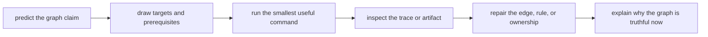
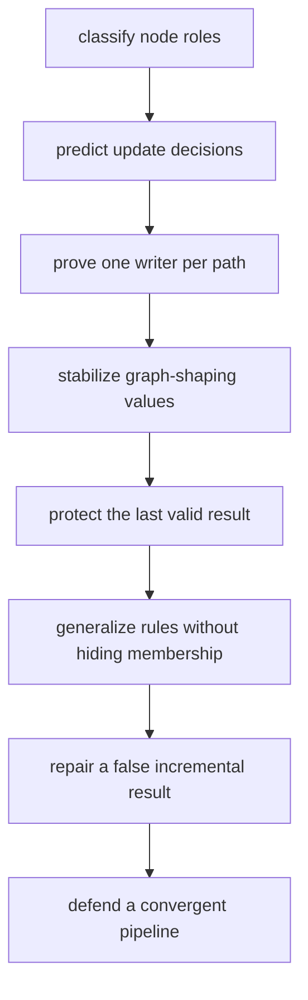

# Exercises

Use these after reading the five core lessons and the worked example. The goal is to make
your graph reasoning visible through artifacts, traces, and repair notes, not through
confident-sounding Make syntax.

## How to work through this set

Treat the ten exercises as one full lab day on graph truth.

Before each answer:

1. name the target or input relationship you are testing
2. predict what Make will do before you run the command
3. keep the smallest artifact that proves whether your prediction was honest

If you skip the prediction, it becomes too easy to write a polished story after the fact.
The whole point of Module 01 is to catch where your mental graph is still weak.

Do the exercises in order. The day is designed as one progression:

- Exercises 1-3 teach you to draw and defend the graph honestly
- Exercises 4-6 move from graph language into concrete build behavior
- Exercises 7-8 teach you to generalize a design without losing ownership
- Exercises 9-10 test whether you can diagnose and defend a small build yourself

Keep one build-truth packet as you go. By the end of the day it should contain:

- one graph sketch that you corrected after running Make
- one relevant-change and one irrelevant-change observation
- one hidden-input example, its repair, and the semantic evidence it introduces
- one failure-safe publication rule with a checksum-based failure drill
- one small Makefile that you can explain target by target
- one stale-output diagnosis where `make clean` would hide the defect
- one final graph and mutation ledger another learner can review without rerunning it

If those six artifacts are missing, you are probably collecting snippets instead of
learning how Make decides what is true.

## Recommended working layout

If you want one lab tree that can support the whole day, use something like:

```text
module01-lab/
├── Makefile
├── src/
├── include/
├── build/
├── data/
├── notes/
└── artifacts/
```

That is intentionally small. Module 01 should feel inspectable. If your lab gets large
enough that you stop seeing the graph directly, shrink it again.

Keep one evidence sheet while you work:

| Before the run | Command | What happened | What the graph means now |
| --- | --- | --- | --- |
| prediction written first | exact `make` command | target-level observation | corrected explanation |

Also keep one ownership list for every multi-target example:

| Target path | Owning rule | Meaning-changing inputs | Expected stale conditions | Expected non-events |
| --- | --- | --- | --- | --- |

That second table is the fastest way to notice where you are relying on hidden inputs or
implicit assumptions.



Use that route on purpose. It keeps the day centered on evidence instead of on folklore
about "how Make usually works."

The completed set follows one widening argument:



Do not treat each exercise as an unrelated syntax puzzle. Carry forward the vocabulary,
ledger, and evidence standard.

## Exercise 1: Draw the graph

Take the tiny C project and draw the dependency graph for `all`, `app`, `build/main.o`,
and `build/util.o`. Include source leaves, the shared header, the semantic flags stamp,
and the build directory. Classify each node as a requested goal, phony target, generated
file, source leaf, or order-only prerequisite.

For these three starting states, predict whether each node is missing, stale, or
up-to-date:

- no generated files exist
- only `src/util.c` is newer than the built application
- every prerequisite is older than its target

What to hand in:

- a graph sketch
- a role label for every node and one sentence per edge explaining why it matters
- an update-decision table for the three starting states
- one sentence naming the most dangerous missing edge
- one explanation of why the order-only directory edge is different from the header edge

Study note:
If your graph does not name headers, directories, or convenience targets explicitly, it
is probably too vague to teach you anything.

## Exercise 2: Find a hidden input

Modify the build so that changing `CFLAGS` matters. Begin with a deliberately incomplete
object rule, build once with `CFLAGS=-O2`, then predict and observe what happens when you
request the same target with `CFLAGS=-O0`. Repair the graph with a content-addressed
stamp or manifest, and repeat the mutation without cleaning.

Also change an unrelated note file. The repaired build should react to `CFLAGS` and
ignore the note. A truthful graph needs both properties.

What to hand in:

- the changed Makefile fragment
- a plain-language explanation of why the input is hidden
- the stamp or manifest content and the edge that connects it to the object
- before-and-after traces for the `CFLAGS` mutation
- a rejection trace showing that the unrelated note causes no recipe to run
- one sentence explaining how the new path encodes the semantic value

Study note:
Do not answer this as "Make cannot track variables." The better question is: what
artifact could carry the semantic value so the graph has something truthful to depend on?

## Exercise 3: Review rule ownership

Write explicit compile rules for `build/alpha.o` and `build/beta.o`. Then replace their
duplicated recipes with one pattern rule while keeping target membership explicit in an
`OBJS` list and the final link prerequisites.

Deliberately add a second recipe for `build/alpha.o`, record Make's diagnostic, then
remove the conflict. The deliberate failure distinguishes recipe ownership from the
fact that prerequisites may be declared on more than one rule line.

What to hand in:

- one explicit rule example
- the pattern rule and the target-membership declaration
- the conflicting recipe diagnostic
- a short comparison of mapping, membership, and recipe ownership
- an ownership ledger naming the only intended writer of each object and the application

Study note:
Ownership is not the same as convenience. A shorter Makefile is not better if another
reader can no longer tell who publishes a path.

## Exercise 4: Explain evaluation timing

Write one example that uses `:=` and one that uses `=` around a value that changes later
in the Makefile. Add a recipe that prints a shell variable with `$$name` and a Make
variable with `$(name)`. Before running Make, write the exact command text you expect the
shell to receive.

Inspect the values with `$(info ...)`, `$(flavor ...)`, `$(origin ...)`, and
`$(value ...)`. Then run the target with and without a command-line override.

What to hand in:

- one `:=` example
- one `=` example
- your predicted and observed Make values and shell command text
- a table recording flavor, origin, raw text, and expanded value
- one paragraph describing when each value is fixed
- one explanation of why `$$` is necessary when the shell, rather than Make, owns a dollar
- one sentence explaining which version is safer for a graph-shaping source list and why

Study note:
The important distinction is not "simple variables versus recursive variables." The
important distinction is whether the graph-shaping value is stable for the whole run.

## Exercise 5: Prove safe publication

Take a compile or link rule and redesign it to publish through a target-local,
process-local candidate in the final target's directory. State exactly what failure
should leave behind. If the rule publishes an object and a depfile, explain the rename
order and why two renames are not one atomic transaction.

Build a valid target and record its checksum. Force the producer to fail after writing
partial candidate bytes, then compare the checksum and search for abandoned candidates.
Repair the input and prove that the build converges again.

What to hand in:

- the revised rule
- the old-target or absent-target failure policy
- the exact failure drill and checksums
- the candidate-file search after failure
- the successful repair trace and no-op query status
- one sentence locating the commit point that protects the final path

Study note:
If your proof is only theoretical, the lesson is incomplete. Force a failure and inspect
what actually remains on disk.

## Midday self-check

Before you move into the smaller design and refactor exercises, make sure your packet can
already answer these questions cleanly:

- which graph edge in your lab is easiest to forget and most dangerous to omit
- which input in your build is still hidden unless you add evidence
- which target path is published atomically and how you proved it
- which value in your Makefile must be fixed at parse time for the graph to stay stable
- which irrelevant change you proved the build ignores

If you cannot answer those four questions in plain language, return to Exercises 1-5 and
make the packet more explicit before you continue.

## Exercise 6: Write the smallest useful Makefile

Create `message.txt` containing one line of text. Write a Makefile that produces
`message.upper.txt` with `tr`, then add a phony `all` target that requests it.

Before each request, classify `message.upper.txt` as missing, stale, or up-to-date.
Run the build twice, change `message.txt`, and run it again. Then change an unrelated
file and query the target without cleaning.

What to hand in:

- the complete Makefile
- the prediction and output from all four mutations
- one sentence explaining why the second run does no work
- one sentence naming the exact edge that makes the third run legitimate
- the captured `make -q message.upper.txt` status after the unrelated change

Study note:
The point is not to impress anyone with terseness. The point is to feel the smallest
possible truthful graph in your hands.

## Exercise 7: Predict automatic variables

Without running Make, fill in the values of `$@`, `$<`, and `$^` for this rule:

```make
build/report.txt: title.txt results.txt title.txt | build/
	cat $^ > $@
```

Then create the files, run `make --trace report.txt`, and compare the trace with your
prediction. Reverse the order of the two normal prerequisite names and predict again.

What to hand in:

- your prediction written before the run
- the observed command
- a corrected explanation if any value surprised you
- one explanation of duplicate removal in `$^`
- one explanation of why the order-only directory is absent from `$^`
- one sentence explaining why `$<` would be wrong for this recipe and why prerequisite
  order is therefore observable

Study note:
Automatic variables become much easier once you tie each one to a graph question instead
of memorizing a table.

## Exercise 8: Remove duplicated compile recipes

Continue from the ownership build in Exercise 3. Replace the explicit recipes with one
pattern rule while keeping the object paths under `build/`.

Add `src/gamma.c`. First request `build/gamma.o` directly. Then decide whether the final
application should contain it and change the explicit membership declaration if so.
The distinction matters: the pattern rule knows how to compile a matching target, but it
does not decide which objects belong in the application.

What to hand in:

- the explicit version
- the pattern-rule version
- a trace showing the third object built from the reusable rule
- a before-and-after membership declaration for the final application
- one rejection observation showing that an unrequested matching source does not cause a
  target to appear by itself
- one sentence separating “this target can be built” from “this target belongs in this goal”

Study note:
Pattern rules remove duplicated policy. They do not remove the need to declare which
outputs belong in the build.

## Exercise 9: Diagnose a stale header build

Create a two-source C project where both source files include `config.h`, but omit the
header from one object rule. Build, change a macro in `config.h`, and observe the stale
object without cleaning.

Repair the graph with compiler-generated dependency files. Explain how the first build
can succeed before those files exist and how later parses recover their edges. Repeat
the header mutation, then delete the header to inspect the purpose of phony header
stubs such as those produced by `-MP`.

What to hand in:

- the broken rule and the repaired rule
- the trace before and after repair
- one generated depfile with its target and prerequisites annotated
- an explanation of the first-build/later-build transition
- an explanation of why `make clean` would hide rather than solve the problem
- one sentence naming the stale artifact and the missing edge that allowed it

Study note:
This is the exercise where many learners realize they have been proving only that clean
builds work, not that incremental builds tell the truth.

## Exercise 10: Design and defend a small graph

Design a build for this pipeline:

```text
raw.csv -> cleaned.csv -> summary.txt
                    \-> chart.svg
```

Write rules for all three outputs and a phony `all` target. You may use `cp` and
`printf` instead of real data-analysis tools.

Test these changes separately:

1. change `raw.csv`
2. delete `summary.txt`
3. delete `chart.svg`
4. change an unrelated note
5. run the successful build twice
6. make the `chart.svg` producer fail after writing candidate bytes, then repair it

What to hand in:

- the Makefile and a graph diagram
- a node-role table and ownership ledger
- your predicted rebuild and non-rebuild sets for each change
- traces confirming or correcting every prediction
- the failure checksum or absence policy, candidate search, and repair trace
- a final `make -q all` status captured safely
- one paragraph defending the ownership of every output path
- one sentence explaining why the fan-out from `cleaned.csv` is honest
- a short reviewer guide naming which artifact proves completeness, minimality, failure
  safety, and convergence

Study note:
The best final answers sound calm and specific. They name the writer of every path and
the input that makes each rebuild legitimate.

## Before you read the answers

Before opening `exercise-answers.md`, make sure you have at least:

- one wrong prediction you can now explain
- one repaired hidden-input example
- one graph diagram you would be willing to show a classmate
- one failure drill that proved atomic publication
- one reason a clean build is not an honest fix for stale outputs
- one irrelevant mutation whose no-op behavior you can prove

If you do not yet have those five things, the answer page will feel useful but will not
do much teaching.

## Mastery standard for this exercise set

You are aiming for four things across all ten answers:

- you name the evidence Make is using
- you explain why that evidence is sufficient or insufficient
- you prove the claim with a command, a graph sketch, or a failure drill
- you distinguish file targets, convenience targets, and owned output paths clearly
- you show both acceptance evidence and rejection evidence
- you leave enough context for a reviewer who did not attend the class

If your answer only says "this is best practice" without evidence, keep going.
